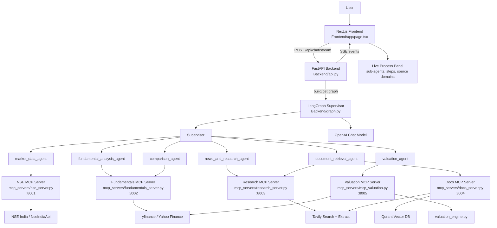
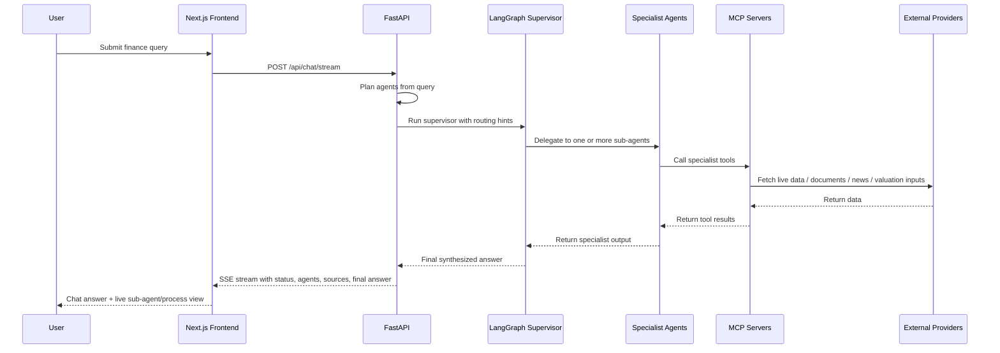
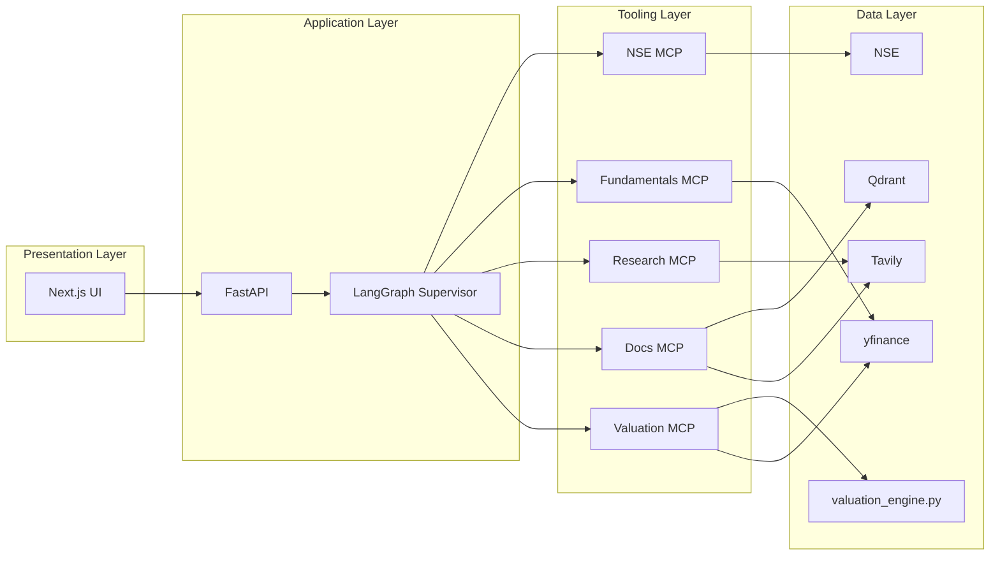

# ORACLE FIOS Architecture

This document describes the current architecture of the ORACLE Financial Intelligence OS that we built across the frontend, backend, LangGraph supervisor, MCP servers, and external data providers.

## High-Level Architecture

## Runtime Request Flow

## Component Breakdown

### 1. Frontend
- `Frontend/app/page.tsx`
- Sends chat requests to the backend
- Consumes streaming SSE events
- Shows:
  - chat response
  - active/planned/completed sub-agents
  - process steps
  - source website domains

### 2. Backend API
- `Backend/api.py`
- Exposes:
  - `POST /api/chat`
  - `POST /api/chat/stream`
  - `GET /health`
- Responsibilities:
  - build and cache the graph
  - compute query-to-agent routing hints
  - stream progress events to the frontend
  - handle fallback, timeout, and provider errors

### 3. LangGraph Supervisor Layer
- `Backend/graph.py`
- Builds the multi-agent system from live MCP tools
- Creates these specialist agents:
  - `market_data_agent`
  - `fundamental_analysis_agent`
  - `comparison_agent`
  - `news_and_research_agent`
  - `document_retrieval_agent`
  - `valuation_agent`
- Uses OpenAI for reasoning and synthesis

### 4. MCP Server Layer

#### `:8001` NSE Market Data
- `Backend/mcp_servers/nse_server.py`
- Tools for:
  - live quote
  - historical prices
  - option chain
  - shareholding
  - announcements
  - board meetings

#### `:8002` Fundamentals
- `Backend/mcp_servers/fundamentals_server.py`
- Tools for:
  - profile
  - statements
  - ratios
  - quarterly results
  - peer comparison
  - dividend history

#### `:8003` Research & News
- `Backend/mcp_servers/research_server.py`
- Tools for:
  - web search
  - finance search
  - news search
  - URL extraction

#### `:8004` Documents Pipeline
- `Backend/mcp_servers/docs_server.py`
- Tools for:
  - document search
  - PDF ingest
  - URL ingest
  - annual report fetch
  - DRHP/RHP/prospectus comparison
- Uses Qdrant for indexed document retrieval

#### `:8005` Valuation Engine
- `Backend/mcp_servers/mcp_valuation.py`
- Backed by `Backend/valuation_engine.py`
- Tools for:
  - DCF
  - PE valuation
  - Graham valuation
  - EV/EBITDA
  - DDM
  - WACC
  - CAGR
  - Piotroski
  - Altman Z
  - DuPont
  - full valuation

## Data and Control Boundaries

## Operational Notes

- MCP server registry: `Backend/mcp_config.py`
- MCP startup script: `Backend/start_servers.ps1`
- MCP shutdown script: `Backend/stop_servers.ps1`
- If MCP servers are down, the backend can enter fallback mode and live financial analysis will not work correctly.
- The frontend sub-agent panel depends on streamed events from `api.py`.

## Current Design Intent

- Keep the UI thin
- Keep orchestration in FastAPI + LangGraph
- Keep data acquisition and calculations in MCP servers
- Keep deterministic finance math in `valuation_engine.py`
- Keep document memory in Qdrant
- Keep live process visibility in the frontend
