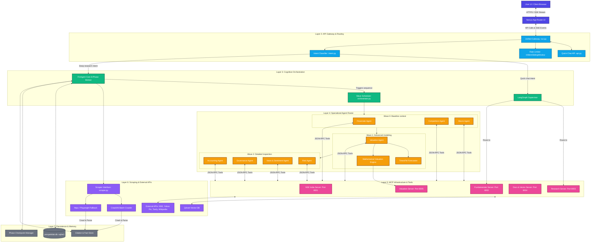
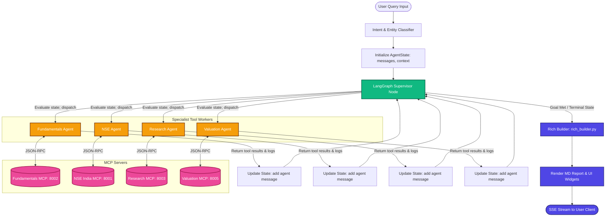

# 🏗️ ProspektLab Complete Architecture Reference

ProspektLab is a hybrid financial intelligence operating system (OS) composed of **ORACLE FIOS** (an agentic, interactive quick-chat supervisor engine powered by LangGraph) and **FinAgent** (an autonomous, multi-phase deep-research engine).

---

## 📐 System Architecture & Structural Hierarchy

This section presents the ProspektLab system layout from two dimensions: a visual hierarchical Mermaid diagram and an aligned text-based system tree structure.

### 1. Hierarchical Architecture Diagram

This diagram maps out the system components across their respective layers, styled with color-coded classes to highlight security boundaries, runtime environments, and logical hierarchies.



---

### 2. System Structural Hierarchy (Tree View)

The following outline represents the aligned operational execution tree from the entry-point interface to the persistence layer:

```text
ProspektLab Multi-Tier System Hierarchy
├── [Layer 1] Presentation Layer (Client Facing)
│   ├── User Interface Components (React, TypeScript, CSS)
│   ├── Dynamic Charts Rendering Engine (AreaChart, BarChart)
│   └── Event Streams (SSE client mapping update states)
│
├── [Layer 2] API Gateway & Routing (FastAPI Engine)
│   ├── Unified Gateway entrypoint (run.py)
│   ├── Quick-Chat Legacy API Bridge (api.py)
│   ├── User Query Intent Classifier & Entity Resolver (intent.py)
│   └── Rate Limiter Service (InMemSlidingWindowRateLimiter)
│
├── [Layer 3] Cognitive Orchestration (Graph & Phase Controllers)
│   ├── LangGraph Supervisor (Quick Chat Mode, dynamic node routing)
│   ├── FinAgent Core 8-Phase Worker Orchestrator (Deep Research Mode)
│   └── Topological Wave Scheduler (orchestrator.py, parallel dispatcher)
│
├── [Layer 4] Specialized Multi-Agent Roster (Domain Specialists)
│   ├── Wave 0: Baseline context gatherers
│   │   ├── Financials Agent (Balance sheet metrics)
│   │   ├── Competitors Agent (SWOT & peers)
│   │   └── Macro Agent (Geopolitical factors)
│   │
│   ├── Wave 1: Advanced valuation & projections models
│   │   ├── Valuation Agent (DCF model controller)
│   │   ├── TimesFM Forecaster (Zero-shot time-series modeling)
│   │   └── Mathematical Valuation Engine (WACC, Graham number metrics)
│   │
│   └── Wave 2: Forensic & risk inspectors
│       ├── Accounting Agent (Regulatory audit alerts)
│       ├── Governance Agent (Insider trading & promoter pledging)
│       ├── News & Sentiment Agent (Near-term events scoring)
│       └── Risk Agent (Pump-and-dump checks & checklist validation)
│
├── [Layer 5] Model Context Protocol (MCP) Services
│   ├── NSE India Server (:8001) -> Options chains, corporate feed
│   ├── Fundamentals Server (:8002) -> Income statements, peer comparisons
│   ├── Research Server (:8003) -> Tavily web query gateway
│   ├── Documents Server (:8004) -> Local PDF parser & Qdrant query interface
│   └── Valuation Server (:8005) -> Math formula solvers (Altman Z, Dupont)
│
├── [Layer 6] Web Scraping & External Integrations
│   ├── Unified Scraper Interface (scraper.py)
│   ├── Crawl4AI Batch Headless Crawler (Stealth mode, consent bypass)
│   └── httpx/Playwright Fallbacks
│
└── [Layer 7] Persistence, Checkpoints & Memory
    ├── SQLite Memory Database (prospektlab.db)
    ├── Research Phase Checkpoint Store (Graceful recovery logs)
    └── Verified Citations Logger (Source-URL mapping & validation)
```


---

## 📋 Component Breakdown

### 1. Presentation Layer (Frontend)
*   **Technology**: Next.js 13+ App Router (React, TypeScript).
*   **Location**: `Frontend/app/`
*   **Key Files**:
    *   [AreaChart.tsx](file:///c:/Users/kusha/OneDrive/डेस्कटॉप/PROSPEKTLAB/Frontend/app/_components/Charts/AreaChart.tsx) (Dynamic stock/metric area visualization).
    *   [BarChart.tsx](file:///c:/Users/kusha/OneDrive/डेस्कटॉप/PROSPEKTLAB/Frontend/app/_components/Charts/BarChart.tsx) (Historical comparison visualization).
*   **Responsibility**:
    *   Submits user queries to FastAPI.
    *   Establishes Server-Sent Events (SSE) via `EventSource` to process stream updates.
    *   Visualizes agent executions (e.g. which agent is active, progress bars, source web domains).
    *   Renders high-quality visual outputs including charts, tables, and Markdown-formatted reports with inline citations.

### 2. API Gateway & Routing
*   **Location**: `finagent/` & `finagent/gateway/`
*   **Key Files**:
    *   [run.py](file:///c:/Users/kusha/OneDrive/डेस्कटॉप/PROSPEKTLAB/finagent/gateway/run.py) (Unified FastAPI endpoint gateway).
    *   [api.py](file:///c:/Users/kusha/OneDrive/डेस्कटॉप/PROSPEKTLAB/finagent/api.py) (Teammate's merged quick-chat API interface).
    *   [intent.py](file:///c:/Users/kusha/OneDrive/डेस्कटॉप/PROSPEKTLAB/finagent/intent.py) (Entity extractor and intent classifier).
*   **Responsibility**:
    *   Exposes endpoints such as `/api/chat` (standard JSON) and `/api/chat/stream` (SSE EventStream).
    *   Applies rate-limiting policies (`InMemSlidingWindowRateLimiter`).
    *   Provides user authentication wrappers via Google OAuth / Supabase and secures route headers (CSP, frame-blocking, CORS policies).
    *   Classifies incoming queries to distinguish between:
        *   **Interactive Chat Mode** (ORACLE FIOS): Handled by LangGraph supervisor (5-15s response latency).
        *   **Deep Research Mode** (FinAgent): Handled by the 8-phase pipeline in [run_agent.py](file:///c:/Users/kusha/OneDrive/डेस्कटॉप/PROSPEKTLAB/finagent/run_agent.py) (2-5 min response latency).

### 3. Application Orchestration
*   **Quick Chat Mode (LangGraph)**:
    *   Constructs a state machine graph where a **Supervisor Node** decides which specialized agent to route control to, based on current conversation state.
    *   Agents execute tools via MCP and return values back to the supervisor to construct final responses.
*   **Deep Research Mode (FinAgent 8-Phase Pipeline)**:
    *   Orchestrates an autonomous state machine across 8 distinct phases:
        1.  **Identify**: Resolves search target names into tickers, exchanges, and regions via `geo.entity_resolver`.
        2.  **Enrichment**: Parallel requests to Yahoo Finance, Wikipedia, and NSE APIs to populate an `EnrichmentBundle`.
        3.  **Breadth Survey**: Multi-angle, structured web searches (e.g. competitor search, growth search, risks search) to gather a baseline context of up to 25 primary web documents.
        4.  **Deep Dive**: Identifies gaps in current facts and dispatches targeted second-pass queries.
        5.  **Analysis**: Detects conflicts across sources and scores items for viral pump-and-dump flags.
        6.  **Specialist Analysis**: Dispatches parallel waves of domain-expert subagents.
        7.  **Verification**: A verification agent cross-checks assertions against original citations to block hallucinations.
        8.  **Synthesis**: Compiles the findings into a structured report using predefined layouts.

### 4. Agent Layer & Specialist Roster
*   **Location**: `finagent/agents/`
*   **Key Files**:
    *   [base.py](file:///c:/Users/kusha/OneDrive/डेस्कटॉप/PROSPEKTLAB/finagent/agents/base.py) (Base contracts for specialist subagents).
    *   [orchestrator.py](file:///c:/Users/kusha/OneDrive/डेस्कटॉप/PROSPEKTLAB/finagent/agents/orchestrator.py) (Parallel wave scheduler).
    *   [valuation.py](file:///c:/Users/kusha/OneDrive/डेस्कटॉप/PROSPEKTLAB/finagent/agents/specialists/valuation.py) (Valuation agent).
*   **Responsibility**:
    *   Subagents inherit from [BaseSubAgent](file:///c:/Users/kusha/OneDrive/डेस्कटॉप/PROSPEKTLAB/finagent/agents/base.py#L120) and are executed in parallel waves according to a topological dependency graph.
    *   **Specialist Roster**:
        *   `financials`: Computes historical ratios, debt metrics, and checks balance-sheet trends.
        *   `valuation`: Implements a Discounted Cash Flow (DCF) engine combined with **TimesFM zero-shot time-series forecasting** for revenue projections.
        *   `accounting`: Inspects regulatory filings for audit qualifications, red flags, and forensic ratios.
        *   `governance`: Checks promoter pledges, board composition, and insider transactions.
        *   `competitor`: Performs peer-group SWOT analysis.
        *   `news` / `risk` / `macro`: Summarizes near-term market events and geopolitical factors.

### 5. Model Context Protocol (MCP) & Tooling Layer
*   **Technology**: JSON-RPC over HTTP.
*   **Roster of Services**:
    *   **NSE India Server (`:8001`)**: Real-time quotes, historical OHLC datasets, option chains, corporate notifications.
    *   **Fundamentals Server (`:8002`)**: Company profiles, income statements, cash flow ratios, peer tables.
    *   **Research Server (`:8003`)**: Web search (Tavily), news feeds, analyst price targets.
    *   **Docs Server (`:8004`)**: Document search, local PDF parsing, prospectus comparison (integrated with Qdrant Vector DB).
    *   **Valuation Server (`:8005`)**: Mathematical valuation formulas (WACC, Graham Number, Altman Z, Dupont analysis).

### 6. Memory & Persistence Layer
*   **Location**: `finagent/memory/` and `finagent/state/`
*   **Key Files**:
    *   `finagent/memory/store.py` (SQLite memory engine).
    *   `finagent/state/checkpoint.py` (Phase snapshots).
*   **Responsibility**:
    *   Saves research facts securely in a SQLite database (`prospektlab.db`) to enable future context retrieval.
    *   Saves checkpoints after each pipeline phase so failed long-running deep research jobs can resume gracefully.
    *   Records full source URLs, timestamps, and confidence metrics for every extracted claim inside the citation tracker.

---

## 🔄 End-to-End Execution Flows

### Example 1: Quick Chat Flow (ORACLE FIOS)
Below is the sequence of actions triggered when a user enters: **"What is TCS's dividend yield?"**

```
[User Interface]
       │  (1) POST /api/chat {"message": "What's TCS's dividend yield?"}
       ▼
[Gateway API (run.py)]
       │  (2) Calls extract_finance_entities()
       ▼
[Intent Classifier (intent.py)]
       │  (3) Identifies: target="TCS", intent="VALUATION_METRICS"
       ▼
[LangGraph Supervisor (graph.py)]
       │  (4) Evaluates intent; routes to "fundamentals_agent" node
       ▼
[Fundamentals Agent]
       │  (5) Calls tool: get_dividend_yield("TCS") via JSON-RPC
       ▼
[Fundamentals MCP Server (Port 8002)]
       │  (6) Queries Yahoo Finance API / Screener API
       │      Returns: {"dividend_yield": 1.85, "last_payment": "6.50 INR"}
       ▼
[Fundamentals Agent]
       │  (7) Updates agent graph state with data
       ▼
[LangGraph Supervisor]
       │  (8) Notes all target data is acquired; terminates graph execution
       ▼
[Rich Builder (rich_builder.py)]
       │  (9) Compiles markdown text, generates a gauge widget and a summary table
       ▼
[Gateway API]
       │  (10) Returns JSON response with raw string + structured rich data
       ▼
[User Interface]
          Renders dividend text + gauge chart
```

---

### Example 2: Deep Research Flow (FinAgent)
Below is the sequence of actions triggered when a user clicks the **Marathon Mode** button for: **"Deep analysis of Asian Paints"**

```
[User Interface]
       │  (1) POST /api/research {"query": "Deep analysis of Asian Paints", "depth": "marathon"}
       ▼
[Gateway API (run.py)]
       │  (2) Allocates Session ID; spawns background worker thread;
       │      Returns 202 Accepted {"session_id": "uuid-1234"}
       ▼
[User Interface]
       │  (3) Opens SSE channel: GET /api/session/uuid-1234/events
       ▼
[FinAgent Core Pipeline (run_agent.py)]
       │  (4) PHASE 1: IDENTIFY. Resolves "Asian Paints" -> "ASIANPAINT" on NSE.
       │      Emits event: "phase_complete" (Progress: 10%)
       │
       │  (5) PHASE 2: ENRICHMENT. Parallel gather fetch:
       │      - NSE Snapshot (prices, live changes, volumes)
       │      - Yahoo Finance (historical balances, shares outstanding)
       │      - Wikipedia (brand overview)
       │      - RSS News (headlines)
       │      Emits event: "phase_complete" (Progress: 35%)
       │
       │  (6) PHASE 3: BREADTH SURVEY. Dispatches 5 parallel search queries using
       │      different angles (e.g. competitors, margins, risks) to DDG + Bing.
       │      Downloads top HTML pages using Crawl4AI headless browser.
       │      Emits event: "phase_complete" (Progress: 55%)
       │
       │  (7) PHASE 4 & 5: DEEP DIVE & ANALYSIS. Dispatches secondary search queries
       │      to target gaps. Computes pump-and-dump metrics and cross-source conflicts.
       │      Emits event: "phase_complete" (Progress: 70%)
       │
       │  (8) PHASE 6: SPECIALIST ANALYSIS. Parallel wave scheduler execution:
       │      - WAVE 0: Financials Agent reads balance sheets.
       │      - WAVE 1: Valuation Agent extracts revenue arrays, passes them to
       │                TimesFM transformer, and computes DCF intrinsic price.
       │      - WAVE 2: Governance, Accounting, and News specialists evaluate risks.
       │      Emits event: "phase_complete" (Progress: 85%)
       │
       │  (9) PHASE 7: VERIFICATION. Verifier Agent checks all extracted claims
       │      against crawl texts; flags unverified content.
       │
       │  (10) PHASE 8: SYNTHESIS. Generates markdown research memo, maps citation URLs,
       │       and saves session.
       │       Emits event: "research_complete" (Progress: 100%)
       ▼
[User Interface]
       Renders final Markdown research report with inline citations, charts, and tables
```

---

## 📊 Complete Graph Workflow Routing

ProspektLab operates under two fundamentally different routing graph paradigms depending on the query classification: **LangGraph Supervisor** (for real-time chat) and the **FinAgent 8-Phase State Machine** (for deep marathon analysis).

### 1. ORACLE FIOS: LangGraph Supervisor Workflow

The interactive chat mode uses a star-topology LangGraph state machine. A central **Supervisor Node** governs a conversation state (containing message histories) and dynamically dispatches work to specialist nodes.



---

### 2. FinAgent: 8-Phase Deep-Research Pipeline

Deep Research mode executes an autonomous sequential pipeline across 8 distinct phases, featuring multi-wave parallel processing, TimesFM time-series forecasting, and citation verification.

```mermaid
flowchart TD
    %% Nodes
    START([User Deep Research Request]) --> P1[Phase 1: IDENTIFY]
    
    subgraph P1_PROC [Ticker Resolution]
        P1 --> P1_RESOLVE{Resolve entity on NSE/Yahoo?}
        P1_RESOLVE -->|No| P1_FALLBACK[General Web Search Search Target]
        P1_RESOLVE -->|Yes| P1_SET[Set Ticker & Region Profile]
    end

    P1_FALLBACK & P1_SET --> P2[Phase 2: ENRICHMENT]

    subgraph P2_PROC [Data Enrichment in Parallel]
        P2 --> P2_WIKI[Scrape Wikipedia Profile]
        P2 --> P2_YF[Fetch Yahoo Financials Data]
        P2 --> P2_NSE[Query NSE Live Stock Snapshot]
        P2_WIKI & P2_YF & P2_NSE --> P2_COMBINE[Compile Enrichment Bundle]
    end

    P2_COMBINE --> P3[Phase 3: BREADTH SURVEY]

    subgraph P3_PROC [Breadth Survey Scraping]
        P3 --> P3_GEN[Generate 5 Structured Query Angles]
        P3_GEN --> P3_SERP[Search Serp Engines: DDG / Bing]
        P3_SERP --> P3_CRAWL[Batch Headless Fetch via Crawl4AI]
        P3_CRAWL --> P3_FILTER[Run Content Filters: BM25 / Pruner]
    end

    P3_FILTER --> P4[Phase 4: DEEP DIVE]

    subgraph P4_PROC [Knowledge Gap Analysis]
        P4 --> P4_EVAL[Evaluate Enrichment & Crawl Facts]
        P4_EVAL --> P4_GAPS{Knowledge Gaps Found?}
        P4_GAPS -->|Yes| P4_SEARCH[Secondary Search Queries Dispatch]
        P4_GAPS -->|No| P4_BYPASS[Skip Second Pass]
        P4_SEARCH --> P4_FETCH[Fetch & Parse Secondary Web Pages]
        P4_FETCH & P4_BYPASS --> P4_COMP
    end

    P4_COMP --> P5[Phase 5: ANALYSIS]

    subgraph P5_PROC [Conflict Resolution]
        P5 --> P5_CHECK[Verify Cross-Source Assertions]
        P5_CHECK --> P5_PUMP[Compute Viral Pump & Dump Score]
        P5_PUMP --> P5_MEMO[Initialize Research Facts Memo]
    end

    P5_MEMO --> P6[Phase 6: SPECIALIST ANALYSIS]

    subgraph P6_PROC [Topological Wave Orchestration]
        P6 --> P6_WV0[Wave 0: Financials + Competitor + Macro Agents]
        P6_WV0 --> P6_WV1[Wave 1: Valuation Agent]
        P6_WV1 --> P6_FORECAST[TimesFM Zero-Shot Forecast]
        P6_FORECAST --> P6_DCF[Intrinsic Value DCF Calculations]
        P6_DCF --> P6_WV2[Wave 2: Accounting + Governance + Risk Agents]
    end

    P6_WV2 --> P7[Phase 7: VERIFICATION]

    subgraph P7_PROC [Fact Checking]
        P7 --> P7_CHECK[Verifier Agent checks fact assertions against source URLs]
        P7_CHECK --> P7_CLEAN{Contains Hallucinations?}
        P7_CLEAN -->|Yes| P7_PURGE[Purge unverified claims & drop citations]
        P7_CLEAN -->|No| P7_KEEP[Accept facts and citation metadata]
    end

    P7_PURGE & P7_KEEP --> P8[Phase 8: SYNTHESIS]

    subgraph P8_PROC [Final Outputs]
        P8 --> P8_FORMAT[Format markdown research report]
        P8_FORMAT --> P8_SAVE[Save facts and logs to prospektlab.db]
        P8_SAVE --> P8_CHECKPOINT[Write phase checkpoint to resume logs]
    end

    P8_CHECKPOINT --> FINISH([Stream Completed Report via SSE to User UI])

    %% Styling
    classDef phase fill:#0EA5E9,stroke:#0369A1,stroke-width:2px,color:#FFFFFF;
    classDef subphase fill:#F59E0B,stroke:#78350F,stroke-width:1px,color:#FFFFFF;
    classDef finish fill:#4F46E5,stroke:#312E81,stroke-width:2px,color:#FFFFFF;

    class P1,P2,P3,P4,P5,P6,P7,P8 phase;
    class P1_RESOLVE,P2_WIKI,P2_YF,P2_NSE,P3_CRAWL,P4_GAPS,P5_CHECK,P6_FORECAST,P6_DCF,P7_CLEAN subphase;
    class START,FINISH finish;
```



---

## 💻 Technical Design Choices & Code Snippets

### A. Headless Crawling & Fallback Chain
Web pages are fetched using a headless browser engine powered by Crawl4AI. If blocking occurs, it falls back to a standard HTTP fetcher or a local Playwright fallback instance.

From [scraper.py](file:///c:/Users/kusha/OneDrive/डेस्कटॉप/PROSPEKTLAB/finagent/tools/web/scraper.py#L652-L683):
```python
    # BM25 filter matches page elements to query relevance;
    # PruningContentFilter strips navbars, footers, and advertisement noise.
    if BM25ContentFilter and sanitized_query:
        content_filter = BM25ContentFilter(user_query=sanitized_query)
    else:
        content_filter = PruningContentFilter(
            threshold=0.45,
            threshold_type="dynamic",
            min_word_threshold=10,
        )
    md_gen = DefaultMarkdownGenerator(content_filter=content_filter)

    browser_cfg = BrowserConfig(
        headless=True,
        browser_type="chromium",
        verbose=False,
        enable_stealth=True,
    )
    run_cfg = CrawlerRunConfig(
        cache_mode=CacheMode.BYPASS,
        markdown_generator=md_gen,
        word_count_threshold=10,
        excluded_tags=["nav", "footer", "form", "aside", "header"],
        page_timeout=int(timeout_s * 1000),
        magic=True,
        simulate_user=True,
        override_navigator=True,
        remove_consent_popups=True,
    )
```

---

### B. Valuation Projections via TimesFM
Rather than relying on static linear growth rate assumptions, the `ValuationAgent` leverages Google's **TimesFM** model to forecast future revenue based on historical trends.

From [valuation.py](file:///c:/Users/kusha/OneDrive/डेस्कटॉप/PROSPEKTLAB/finagent/agents/specialists/valuation.py#L120-L149):
```python
        if generate_zero_shot_forecast is not None:
            try:
                forecast_result = await generate_zero_shot_forecast(
                    revenue_values,
                    horizon=horizon,
                    freq=2,  # low-frequency (annual data)
                    quantiles=[0.1, 0.25, 0.5, 0.75, 0.9],
                )
            except Exception as exc:
                logger.warning("Forecast call failed: %s", exc)

        # ── 3. Extract projections or fall back ────────────────────────
        if forecast_result and forecast_result.point_forecast:
            projected = forecast_result.point_forecast
            model_used = forecast_result.model_used
            q50 = forecast_result.quantile_forecasts.get(0.5, projected)
            q10 = forecast_result.quantile_forecasts.get(0.1, [])
            q90 = forecast_result.quantile_forecasts.get(0.9, [])
        else:
            # Pure CAGR fallback
            growth = _cagr(revenue_values) or 0.08
            last = revenue_values[-1]
            projected = [last * (1 + growth) ** (i + 1) for i in range(horizon)]
            ...
```

---

### C. Live Real-time Gateway Events (SSE Stream)
The gateway exposes an asynchronous event generator that streams live execution updates directly to client browsers.

From [api.py](file:///c:/Users/kusha/OneDrive/डेस्कटॉप/PROSPEKTLAB/finagent/api.py#L76-L127):
```python
@app.post("/api/chat/stream")
async def chat_stream(req: ChatRequest):
    """Streaming endpoint that yields agent events and final rich data."""
    async def event_generator() -> AsyncIterator[str]:
        try:
            from finagent.run_agent import run_finagent_session, AgentLoopConfig
            from finagent.events import BUS

            session_id = str(uuid.uuid4())
            cfg = AgentLoopConfig(
                session_id=session_id,
                response_depth=req.response_depth,
                close_bus_on_finish=False,
            )

            event_queue = []
            def on_event(event_data):
                event_queue.append(event_data)

            if hasattr(BUS, 'on'):
                BUS.on(session_id, on_event)

            # Run the agent loop asynchronously
            reply, agents_used, rich = await run_finagent_session(req.message, cfg)

            # Yield buffered agent events
            for event_data in event_queue:
                yield f"event: agent_event\ndata: {json.dumps(event_data)}\n\n"

            # Yield final enriched payload
            final_payload = {
                "type": "final",
                "reply": reply,
                "agents_used": agents_used or [],
                "rich": rich.model_dump(mode="json") if rich is not None else None,
                "output_mode": "company_snapshot",
                "response_depth": req.response_depth,
            }
            yield f"event: final\ndata: {json.dumps(final_payload)}\n\n"
            ...
```
