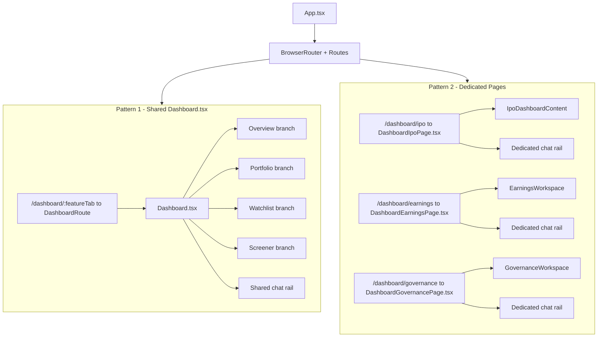
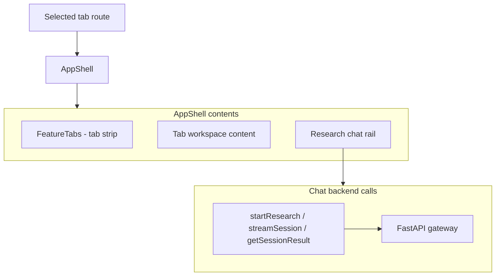
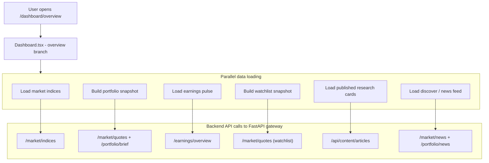
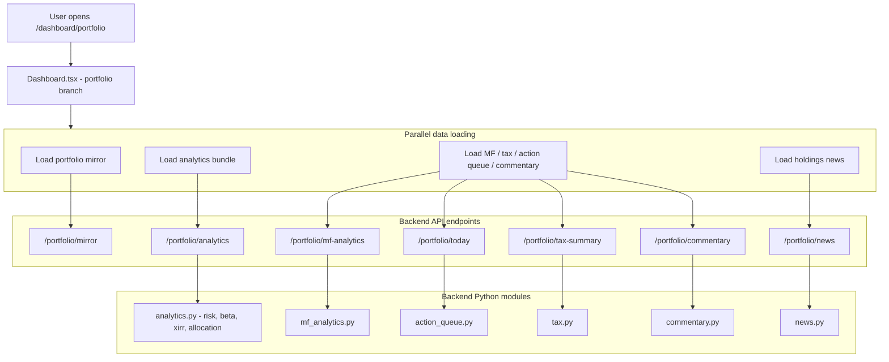
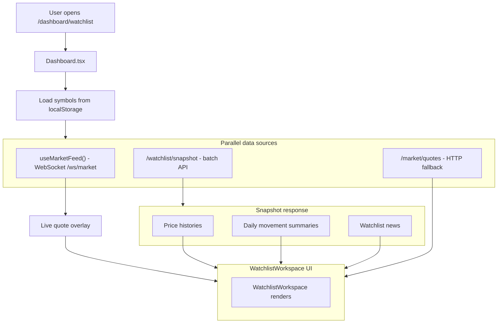
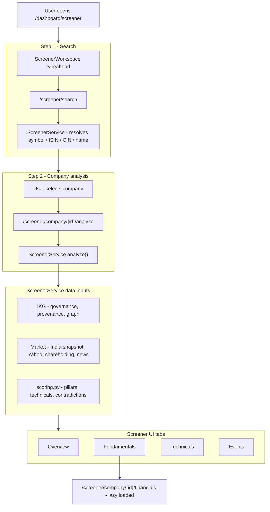
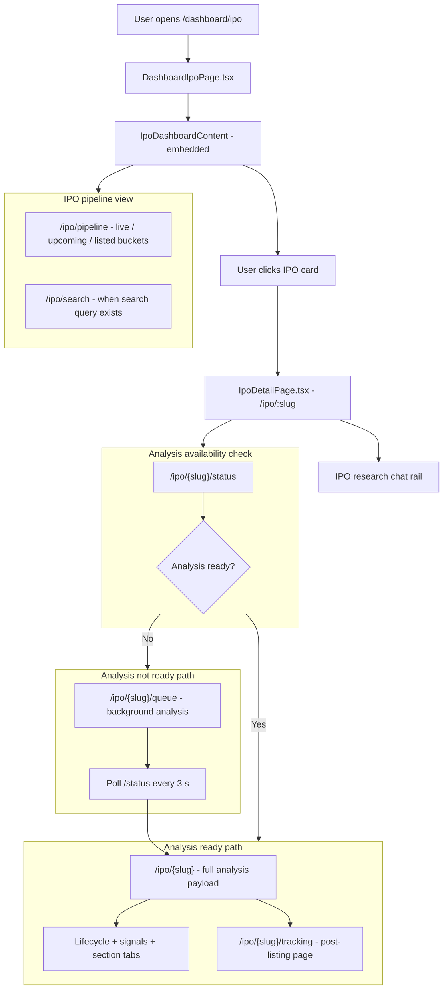
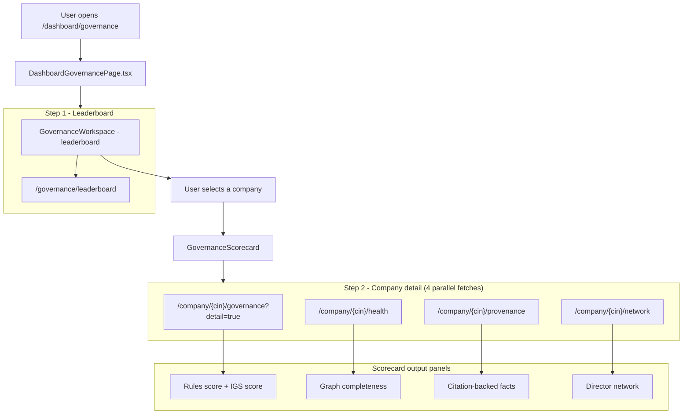
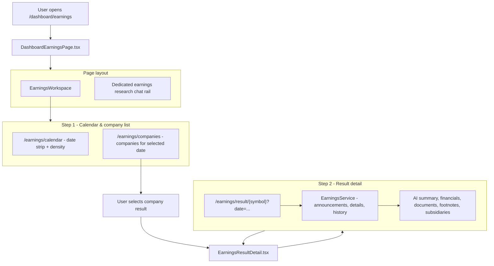

# Dashboard Tabs Knowledge Transfer

## Table of Contents

1. [Scope](#1-scope)
2. [Overall Tab Architecture](#2-overall-tab-architecture)
3. [Common Tab Shell Behavior](#3-common-tab-shell-behavior)
4. [Overview Tab](#4-overview-tab)
5. [Portfolio Tab](#5-portfolio-tab)
6. [Watchlist Tab](#6-watchlist-tab)
7. [Screener Tab](#7-screener-tab)
8. [IPO Tab](#8-ipo-tab)
9. [Governance Tab](#9-governance-tab)
10. [Earnings Tab](#10-earnings-tab)
11. [Cross-Tab Maintenance Notes](#11-cross-tab-maintenance-notes)

## 1. Scope

This document is a tab-focused knowledge transfer for the main dashboard surfaces in ProspektLab.

Covered tabs:

- Overview
- Portfolio
- Watchlist
- Screener
- IPO
- Governance
- Earnings

Not covered here:

- Landing and onboarding pages
- Insights Studio
- Auth flows in full detail

This document is intentionally implementation-oriented. It explains the real code structure, not just the intended product structure.

## 2. Overall Tab Architecture

The dashboard tabs are split into two implementation patterns.

Pattern 1: tabs rendered inside the large shared `Dashboard.tsx` page.

- `overview`
- `portfolio`
- `watchlist`
- `screener`

Pattern 2: tabs rendered through dedicated pages that reuse the same visual shell and chat-rail pattern.

- `ipo`
- `governance`
- `earnings`

### Route Wiring

| Route | Frontend Entry | Actual Workspace Host |
| --- | --- | --- |
| `/dashboard/overview` | `frontend/src/App.tsx` -> `DashboardRoute` | `frontend/src/pages/Dashboard.tsx` |
| `/dashboard/portfolio` | `frontend/src/App.tsx` -> `DashboardRoute` | `frontend/src/pages/Dashboard.tsx` |
| `/dashboard/watchlist` | `frontend/src/App.tsx` -> `DashboardRoute` | `frontend/src/pages/Dashboard.tsx` |
| `/dashboard/screener` | `frontend/src/App.tsx` -> `DashboardRoute` | `frontend/src/pages/Dashboard.tsx` |
| `/dashboard/ipo` | `frontend/src/App.tsx` -> direct route | `frontend/src/pages/DashboardIpoPage.tsx` |
| `/dashboard/governance` | `frontend/src/App.tsx` -> direct route | `frontend/src/pages/DashboardGovernancePage.tsx` |
| `/dashboard/earnings` | `frontend/src/App.tsx` -> direct route | `frontend/src/pages/DashboardEarningsPage.tsx` |

### Important Structural Reality

`FeatureTabs.tsx` shows one unified tab strip, but the tab bodies are not implemented in one place.

- `FeatureTabs.tsx` defines `overview`, `portfolio`, `watchlist`, `screener`, `ipo`, `earnings`, and `governance`.
- `DashboardRoute` in `App.tsx` only normalizes `overview`, `portfolio`, `watchlist`, and `screener`.
- `ipo`, `governance`, and `earnings` have their own dedicated page components and are not routed through `DashboardRoute`.

### Top-Level Architecture Diagram

### Core Files That Affect All Tabs

| File | Role |
| --- | --- |
| `frontend/src/App.tsx` | Owns route mapping and decides which page hosts each tab |
| `frontend/src/components/layout/FeatureTabs.tsx` | Shared tab-strip component |
| `frontend/src/components/layout/AppShell.tsx` | Shared full-screen shell container |
| `frontend/src/context/AuthContext.tsx` | Shared auth state, read-only gating, toasts |
| `frontend/src/api/client.ts` | Shared HTTP client used by all tabs |
| `frontend/src/components/chat/ChatInput.tsx` | Shared chat entry component |
| `frontend/src/components/chat/MessageBubble.tsx` | Shared message rendering |
| `frontend/src/components/chat/AgentThinking.tsx` | Shared streaming progress UI |
| `frontend/src/components/chat/ExportPanel.tsx` | Shared export UI for research outputs |
| `frontend/src/index.css` | Shared dashboard styling base |

## 3. Common Tab Shell Behavior

Even though all tabs do not share one page component, they still share several implementation behaviors.

### Common Shell Pattern

### Shared Behaviors Across Tab Pages

1. All tab pages use `AppShell` for the full-height workbench layout.
2. All tab pages use `FeatureTabs` for navigation.
3. All chat-enabled tab pages use the same research backend functions:
 `startResearch`, `streamSession`, and `getSessionResult` from `frontend/src/api/client.ts`.
4. All chat-enabled pages store chat state in localStorage with user-scoped keys.
5. The resizable chat rail width is shared through `prospektlab_chat_width`.
6. Read-only users are gated by an overlay that redirects to login.
7. Deep research behavior is plan-aware and surfaces Pro prompts when necessary.

### Shared Storage Behavior

| Concern | Storage Pattern |
| --- | --- |
| Watchlist | `prospektlab_watchlist` or `prospektlab_watchlist:<email>` |
| Conversations | `prospektlab_conversations:<email-or-guest>` |
| Messages | `prospektlab_messages:<scope>:<conversationId>` |
| Chat rail width | `prospektlab_chat_width` |

### Important Common Reality

Chat history is user-scoped, not tab-scoped. That means a conversation created in one tab can appear in another tab if the same storage scope is reused.

## 4. Overview Tab

### What the Overview Tab Is

The Overview tab is the high-level dashboard landing surface. It is designed to answer the question:

> What is happening in the market and in this user's investing world right now?

It mixes broad market context, portfolio summary, earnings pulse, watchlist snapshot, generated research, and a discover/news surface.

### Route and Entry Path

| Layer | File |
| --- | --- |
| Route host | `frontend/src/App.tsx` |
| Route handler | `DashboardRoute` inside `frontend/src/App.tsx` |
| Page host | `frontend/src/pages/Dashboard.tsx` |
| Legacy wrapper that exists but is not used by the router | `frontend/src/pages/DashboardOverviewPage.tsx` |

### Key Frontend Files

| File | Role |
| --- | --- |
| `frontend/src/pages/Dashboard.tsx` | Overview UI, state, and data loading |
| `frontend/src/components/dashboard/IndexTickerCard.tsx` | Index cards for NIFTY, SENSEX, and related indices |
| `frontend/src/components/dashboard/AssetHistoryModal.tsx` | Historical price modal used when cards are clicked |
| `frontend/src/components/charts/InteractiveChart.tsx` | Chart rendering for history and comparison views |
| `frontend/src/components/chat/*` | Shared chat rail shown on the right |

### What the Overview Tab Renders

The overview branch inside `Dashboard.tsx` currently renders these major sections:

1. Top India Indices
2. Portfolio Snapshot
3. Earnings Pulse
4. Watchlist Snapshot
5. ProspektLab Research
6. Discover

### Frontend Data Sources Used by Overview

| Client Function | Purpose |
| --- | --- |
| `getMarketIndices()` | Load major India index cards |
| `getMarketQuotes()` | Load price snapshots for portfolio/watchlist-linked symbols |
| `getMarketHistory()` | Populate `AssetHistoryModal` when a user opens a chart |
| `getMarketNews()` | Load discover/market headlines |
| `getPortfolioNews()` | Pull holdings-aware news when portfolio exists |
| `getPortfolioBrief()` | Generate short portfolio summary text used in contextual prompts |
| `getEarningsOverview()` | Load compact earnings pulse for the dashboard overview |
| `listContentArticles()` | Load recent published ProspektLab research pieces |

### Backend Routes and Modules Used by Overview

| Endpoint | Backend Route File | Core Module Behind It |
| --- | --- | --- |
| `/market/indices` | `backend/finagent/gateway/run.py` | Gateway market aggregation logic |
| `/market/quotes` | `backend/finagent/gateway/run.py` | Upstox/NSE/BSE/Yahoo quote resolution |
| `/market/history` | `backend/finagent/gateway/run.py` | Yahoo history fetch and period filtering |
| `/market/news` | `backend/finagent/gateway/run.py` | `fetch_news()` market news aggregation |
| `/portfolio/news` | `backend/finagent/gateway/run.py` | `finagent.portfolio.news` |
| `/portfolio/brief` | `backend/finagent/gateway/run.py` | Portfolio summary built from analytics |
| `/earnings/overview` | `backend/finagent/api_routes/earnings.py` | `backend/finagent/earnings/service.py` |
| `/api/content/articles` | `backend/finagent/gateway/run.py` | Content automation article listing |

### Overview Workflow Diagram

### How the Overview Tab Actually Works

1. `DashboardRoute` passes `initialFeatureTab="overview"` into `Dashboard.tsx`.
2. `Dashboard.tsx` derives `activeFeatureTab` from that route value.
3. The overview branch is selected in the main render block.
4. Independent effects fetch indices, quotes, news, earnings pulse, and recent research.
5. Clicking an index, mover, or relevant asset opens `AssetHistoryModal`, which pulls `/market/history`.
6. Clicking context actions can seed the shared chat rail with a prebuilt analysis prompt.

### Important Implementation Notes for Overview

- The router does not actually use `DashboardOverviewPage.tsx`; it routes overview through `DashboardRoute` and `Dashboard.tsx`.
- The overview tab is one branch inside a very large page component, so changes here can accidentally affect portfolio, watchlist, and screener behavior.
- The overview earnings widget uses `getEarningsOverview()`, which is deprecated in the client but still intentionally used here as a compact combined endpoint.
- The backend earnings overview endpoint returns a valid empty response instead of a 504 on failure, specifically to keep the Overview tab stable.
- The overview tab is a composite dashboard, not a simple page. It is one of the highest fan-out surfaces in the frontend.

## 5. Portfolio Tab

### What the Portfolio Tab Is

The Portfolio tab is the main investor workspace. It assumes the user has already synced holdings into the portfolio mirror or entered them manually.

It answers these questions:

- What is my portfolio worth right now?
- How is it performing versus a benchmark?
- How concentrated or risky is it?
- What do taxes, stress scenarios, and correlations look like?
- What is Arthik's current read on the book?

### Route and Entry Path

| Layer | File |
| --- | --- |
| Route host | `frontend/src/App.tsx` |
| Route handler | `DashboardRoute` in `frontend/src/App.tsx` |
| Page host | `frontend/src/pages/Dashboard.tsx` |

### Key Frontend Files

| File | Role |
| --- | --- |
| `frontend/src/pages/Dashboard.tsx` | Main portfolio tab orchestration, state, and rendering |
| `frontend/src/components/dashboard/PortfolioTable.tsx` | Holdings table and total footer |
| `frontend/src/components/dashboard/WatchlistWorkspace.tsx` | Reused inside the Holdings Workspace secondary toggle |
| `frontend/src/components/dashboard/AssetHistoryModal.tsx` | Deep-dive price/history modal |
| `frontend/src/components/charts/InteractiveChart.tsx` | Indexed benchmark comparison chart |
| `frontend/src/components/charts/DonutChart.tsx` | Sector and asset allocation visuals |

### Important Structural Reality for Portfolio

The top-level Portfolio tab includes a secondary local toggle called `activeTab` inside `Dashboard.tsx`.

That internal toggle switches between:

- Holdings
- Watchlist

So the Watchlist experience exists in two places:

1. As its own top-level route and tab
2. As a sub-panel inside the Portfolio tab's Holdings Workspace

This is a real implementation detail that can confuse new developers.

### Main Portfolio Sections

The Portfolio tab currently renders:

1. Portfolio value hero and top metrics
2. Indexed portfolio-vs-benchmark comparison chart
3. Portfolio Health panel
4. Arthik's daily read panel
5. Portfolio stats summary tiles
6. Sector and asset allocation donut charts
7. Advanced analytics area with sub-tabs
8. Holdings Workspace with internal Holdings/Watchlist toggle
9. Holdings-aware news feed

### Portfolio Analytics Sub-Tabs

Inside the advanced analytics area, `Dashboard.tsx` maintains an `analyticsTab` state with these values:

- `risk`
- `mf`
- `corr`
- `stress`
- `tax`

Rendered labels:

- Moat & Risk Matrix
- Mutual Fund Diagnostics
- Correlation
- Shock & Stress Simulator
- Tax & Harvesting

### Frontend Data Sources Used by Portfolio

| Client Function | Purpose |
| --- | --- |
| `getPortfolioMirror()` | Load synchronized holdings for authenticated users |
| `replacePortfolioMirror()` | Save or clear holdings mirror |
| `syncManualPortfolio()` | Push manual guest holdings into backend mirror |
| `getPortfolioAnalytics()` | Main analytics bundle for value, returns, risk, and allocations |
| `getMfAnalytics()` | Mutual fund specific analysis |
| `getTodayQueue()` | Build action queue items |
| `getTaxSummary()` | Tax and harvesting numbers |
| `getPortfolioCommentary()` | AI daily read |
| `postStressTest()` | Shock/stress scenario analysis |
| `getPortfolioBrief()` | Short summary text for prompts and UI |
| `getMarketHistory()` | Asset history modal |
| `getPortfolioNews()` | Holdings-linked news |

### Backend Routes and Modules Used by Portfolio

| Endpoint | Backend Route File | Core Module Behind It |
| --- | --- | --- |
| `/portfolio/mirror` | `backend/finagent/gateway/run.py` | Portfolio mirror load/replace/delete flows |
| `/portfolio/mirror/sync-manual` | `backend/finagent/gateway/run.py` | Manual onboarding sync |
| `/portfolio/analytics` | `backend/finagent/gateway/run.py` | `backend/finagent/portfolio/analytics.py` |
| `/portfolio/mf-analytics` | `backend/finagent/gateway/run.py` | `backend/finagent/portfolio/mf_analytics.py` |
| `/portfolio/today` | `backend/finagent/gateway/run.py` | `backend/finagent/portfolio/action_queue.py` |
| `/portfolio/tax-summary` | `backend/finagent/gateway/run.py` | `backend/finagent/portfolio/tax.py` |
| `/portfolio/commentary` | `backend/finagent/gateway/run.py` | `backend/finagent/portfolio/commentary.py` |
| `/portfolio/stress-test` | `backend/finagent/gateway/run.py` | `backend/finagent/portfolio/stress_test.py` |
| `/portfolio/news` | `backend/finagent/gateway/run.py` | `backend/finagent/portfolio/news.py` |
| `/market/history` | `backend/finagent/gateway/run.py` | Market history service |

### Portfolio Workflow Diagram

### How the Portfolio Tab Actually Works

1. On mount, `Dashboard.tsx` decides whether the source of truth is the backend mirror or guest local storage.
2. Authenticated users treat `/portfolio/mirror` as the source of truth.
3. Unauthenticated users read `prospektlab_manual_portfolio` from local storage and may opportunistically sync it to the backend.
4. The loaded holdings are enriched on the client with better names, sectors, and mutual-fund detection.
5. Main analytics load through `/portfolio/analytics`.
6. Secondary widgets load independently so one failure does not blank the whole portfolio tab.
7. The tab renders advanced analytics panels from the analytics bundle and separate specialized endpoints.

### Important Implementation Notes for Portfolio

- Portfolio sync logic is embedded directly in `Dashboard.tsx`, not isolated in a dedicated hook or page-specific data module.
- The tab depends heavily on the portfolio mirror. If the mirror is empty, the tab becomes a setup surface rather than a true analytics surface.
- The portfolio tab does not currently call `getPortfolioGovernance()` even though that API exists. Governance has effectively moved into its own top-level tab.
- The internal Holdings/Watchlist toggle means watchlist code paths can be affected by portfolio-tab changes.
- The backend analytics function `compute_portfolio_analytics()` is one of the most important portfolio-side functions to understand.

## 6. Watchlist Tab

### What the Watchlist Tab Is

The Watchlist tab is a live market-monitoring workspace built around user-managed symbols. It is more real-time and market-tape oriented than the Portfolio tab.

It answers these questions:

- Which watchlist names are moving right now?
- How have they behaved across different time windows?
- What notable movement events happened recently?
- What symbol-focused news is attached to them?

### Route and Entry Path

| Layer | File |
| --- | --- |
| Route host | `frontend/src/App.tsx` |
| Route handler | `DashboardRoute` in `frontend/src/App.tsx` |
| Page host | `frontend/src/pages/Dashboard.tsx` |
| Main workspace | `frontend/src/components/dashboard/WatchlistWorkspace.tsx` |

### Key Frontend Files

| File | Role |
| --- | --- |
| `frontend/src/pages/Dashboard.tsx` | Loads and persists symbols, injects handlers |
| `frontend/src/components/dashboard/WatchlistWorkspace.tsx` | Main watchlist UI and snapshot orchestration |
| `frontend/src/components/dashboard/watchlistTypes.ts` | Shared watchlist type definitions |
| `frontend/src/hooks/useMarketFeed.ts` | Real-time price feed hook via backend WebSocket |
| `frontend/src/components/dashboard/AssetHistoryModal.tsx` | Deep-dive modal for clicked symbols |

### Frontend State and Persistence Model

The watchlist is currently client-persisted.

- Authenticated users use `prospektlab_watchlist:<email>`.
- Guests use `prospektlab_watchlist`.
- There is no dedicated watchlist database table in the current implementation.

This is one of the most important implementation realities for this tab.

### Main Watchlist Sections

`WatchlistWorkspace.tsx` renders:

1. Manage Watchlist action
2. Watchlist movers chart with time-range selector
3. Symbol-by-symbol live rows with Ask and Remove actions
4. Notable price movement timeline
5. Watchlist news cards
6. Empty-state builder if the list is blank

### Frontend Data Sources Used by Watchlist

| Client Function / Hook | Purpose |
| --- | --- |
| `useMarketFeed()` | Primary real-time quote source over WebSocket |
| `getWatchlistSnapshot()` | Batched quotes, histories, movement summaries, and news |
| `getMarketQuotes()` | HTTP fallback when snapshot or live feed is incomplete |

### Backend Routes and Modules Used by Watchlist

| Endpoint | Backend Route File | Core Behavior |
| --- | --- | --- |
| `/watchlist/snapshot` | `backend/finagent/gateway/run.py` | Watchlist batched quote/history/news snapshot |
| `/market/quotes` | `backend/finagent/gateway/run.py` | HTTP quote fallback |
| `/ws/market` | `backend/finagent/gateway/run.py` | WebSocket relay for live ticks |

### Watchlist Workflow Diagram

### How the Watchlist Tab Actually Works

1. `Dashboard.tsx` loads watchlist symbols from user-scoped local storage.
2. `WatchlistWorkspace.tsx` subscribes to live price updates through `useMarketFeed()`.
3. In parallel, it requests `/watchlist/snapshot` for batched histories, news, and movement summaries.
4. Live feed values override slower snapshot values when fresh ticks exist.
5. Clicking a symbol opens the shared `AssetHistoryModal`.
6. Clicking `Ask` seeds the shared chat rail with `Analyse <symbol> and check its core ratios.`

### Important Implementation Notes for Watchlist

- This tab is not server-persisted today. It is localStorage-persisted.
- The backend snapshot route caps the symbol list to 12 names for batched history/news work.
- `WatchlistWorkspace` mixes three data modes: WebSocket live feed, batch snapshot API, and HTTP quote fallback.
- The top-level Watchlist tab and the Portfolio tab both reuse `WatchlistWorkspace`, so changes here affect both surfaces.

## 7. Screener Tab

### What the Screener Tab Is

The Screener tab is a company analysis workspace centered on search and symbol deep-dives. It behaves more like a mini product inside the dashboard than a simple summary widget.

It answers these questions:

- Which company do I want to inspect?
- What does the platform know about its fundamentals, technicals, events, and peers?
- What contradictions or red flags show up when multiple data sources are combined?

### Route and Entry Path

| Layer | File |
| --- | --- |
| Route host | `frontend/src/App.tsx` |
| Route handler | `DashboardRoute` in `frontend/src/App.tsx` |
| Page host | `frontend/src/pages/Dashboard.tsx` |
| Main workspace | `frontend/src/components/screener/ScreenerWorkspace.tsx` |

### Key Frontend Files

| File | Role |
| --- | --- |
| `frontend/src/components/screener/ScreenerWorkspace.tsx` | Main screener UI, search, and company analysis |
| `frontend/src/styles/screener.css` | Dedicated screener styles |
| `frontend/src/hooks/useMarketFeed.ts` | Live price overlay for active symbol |
| `frontend/src/api/client.ts` | Screener search, analysis, and financials API calls |

### Internal Screener Tabs

Inside `ScreenerWorkspace.tsx`, the screener has its own internal tab model:

- `overview`
- `fundamentals`
- `technicals`
- `events`

This means the Screener tab is itself a tabbed workspace inside the main dashboard tab system.

### Frontend Data Sources Used by Screener

| Client Function / Hook | Purpose |
| --- | --- |
| `screenerSearch()` | Typeahead company search |
| `getScreenerAnalysis()` | Main all-in-one company analysis payload |
| `getScreenerFinancials()` | Lazy-load detailed financial tables |
| `useMarketFeed()` | Overlay fresh price ticks for active symbol |

### Backend Routes and Modules Used by Screener

| Endpoint | Backend Route File | Core Module Behind It |
| --- | --- | --- |
| `/screener/search` | `backend/finagent/gateway/run.py` | `backend/finagent/screener/service.py::search()` |
| `/screener/company/{identifier}/analyze` | `backend/finagent/gateway/run.py` | `backend/finagent/screener/service.py::analyze()` |
| `/screener/company/{identifier}/financials` | `backend/finagent/gateway/run.py` | `backend/finagent/screener/service.py::company_financials()` |
| `/screener/company/{identifier}/snapshot` | `backend/finagent/gateway/run.py` | Available backend route, not the main current UI path |
| `/screener/company/{identifier}/technicals` | `backend/finagent/gateway/run.py` | Available backend route, not the main current UI path |
| `/screener/company/{identifier}/events` | `backend/finagent/gateway/run.py` | Available backend route, not the main current UI path |

### Main Backend Files for Screener Logic

| File | Role |
| --- | --- |
| `backend/finagent/screener/service.py` | Main screener aggregation and synthesis service |
| `backend/finagent/screener/scoring.py` | Screener scoring, technicals, filter parsing, contradiction detection |
| `backend/finagent/screener/schemas.py` | Structured schema objects |

### Screener Workflow Diagram

### How the Screener Tab Actually Works

1. The workspace auto-loads `RELIANCE` on first mount if no active symbol is set.
2. Search is debounced and returns search suggestions.
3. Selecting a company triggers `getScreenerAnalysis()`.
4. The analysis response is broad enough to feed overview, technical, events, and peer views.
5. The detailed financials request is deferred until the user opens the Fundamentals tab.
6. `useMarketFeed()` overlays the latest live price on top of the analysis payload.

### Important Implementation Notes for Screener

- The current UI mostly uses `getScreenerAnalysis()` and `getScreenerFinancials()`. Client helpers for snapshot, technicals, events, and query exist but are not the primary current path in `ScreenerWorkspace.tsx`.
- `ScreenerWorkspace` is passed `embedded` from `Dashboard.tsx`, which means it can conceptually be used standalone but is currently embedded in the dashboard shell.
- The backend `ScreenerService` is a major integration hub. It combines IKG, market data, news, shareholding, technical scoring, and contradiction detection.

## 8. IPO Tab

### What the IPO Tab Is

The IPO tab is a primary-market intelligence surface. It is broader than a simple dashboard card list. In the dashboard it starts as a tabbed pipeline view, but it expands into a larger IPO product flow with:

- IPO pipeline listing
- IPO search
- IPO detail analysis
- IPO lifecycle tracking
- Post-listing tracking
- IPO-specific research chat

It answers these questions:

- Which IPOs are live, upcoming, or recently listed?
- What does the filing say about business, financials, risk, promoters, and use of proceeds?
- How expensive is the issue versus peers?
- Are promoters exiting aggressively through OFS?
- Is the issue progressing from DRHP to RHP to listing?
- After listing, is the company tracking against its DRHP promises?

### Route and Entry Path

| Layer | File |
| --- | --- |
| Dashboard tab route | `frontend/src/App.tsx` -> `/dashboard/ipo` |
| Dashboard page host | `frontend/src/pages/DashboardIpoPage.tsx` |
| Shared IPO dashboard content | `frontend/src/pages/IpoDashboard.tsx` -> `IpoDashboardContent` |
| Standalone IPO dashboard route | `frontend/src/App.tsx` -> `/ipo` |
| IPO detail route | `frontend/src/App.tsx` -> `/ipo/:slug` |
| IPO post-listing tracking route | `frontend/src/App.tsx` -> `/ipo/:slug/tracking` |

### Key Frontend Files

| File | Role |
| --- | --- |
| `frontend/src/pages/DashboardIpoPage.tsx` | Dashboard-tab wrapper with dedicated chat rail |
| `frontend/src/pages/IpoDashboard.tsx` | Main IPO pipeline workspace and reusable `IpoDashboardContent` |
| `frontend/src/pages/IpoDetailPage.tsx` | Full IPO analysis detail experience |
| `frontend/src/pages/IpoTrackingPage.tsx` | Post-listing and DRHP-promises tracker |
| `frontend/src/components/ipo/IpoCard.tsx` | IPO cards and score-bar rendering |
| `frontend/src/index.css` | IPO UI styles currently live in the main stylesheet |

### Important Structural Reality for IPO

The dashboard IPO tab is only one entry into the IPO product surface.

- `/dashboard/ipo` uses `DashboardIpoPage.tsx`.
- `DashboardIpoPage.tsx` does not reimplement the IPO list. It embeds `IpoDashboardContent` from `IpoDashboard.tsx`.
- `IpoDashboardContent` is reused by both the dashboard tab and the standalone `/ipo` route.
- IPO cards navigate into `/ipo/:slug`, not a `/dashboard/ipo/:slug` route.

This means the IPO module is partially dashboard-embedded and partially standalone.

### Main IPO States and Pages

The IPO module currently has four important UI layers.

1. IPO dashboard list view
2. IPO detail analysis page
3. IPO post-listing tracking page
4. IPO-specific research chat rails on dashboard and detail pages

### Frontend Data Sources Used by IPO

| Client Function | Purpose |
| --- | --- |
| `getIpoPipeline()` | Load live/upcoming/listed IPO buckets |
| `searchIpos()` | Search IPOs by company/sector-like text |
| `getIpoAnalysisStatus()` | Check whether document analysis exists or is queued |
| `queueIpoAnalysis()` | Queue background analysis when needed |
| `getIpoAnalysis()` | Load full IPO detail analysis payload |
| `getIpoTracking()` | Load post-listing tracking summary |
| `analyzeIpo()` | Trigger direct analysis run |
| `startResearch()` / `streamSession()` / `getSessionResult()` | IPO-side research chat |

### Backend Routes and Modules Used by IPO

| Endpoint | Backend Route File | Core Module Behind It |
| --- | --- | --- |
| `/ipo/pipeline` | `backend/finagent/gateway/run.py` | `backend/finagent/ipo/service.py::pipeline_dashboard()` |
| `/ipo/search` | `backend/finagent/gateway/run.py` | `backend/finagent/ipo/service.py::search_drhp()` |
| `/ipo/{slug}` | `backend/finagent/gateway/run.py` | `backend/finagent/ipo/service.py::get_analysis()` |
| `/ipo/{slug}/status` | `backend/finagent/gateway/run.py` | `backend/finagent/ipo/service.py::get_analysis_status()` |
| `/ipo/{slug}/queue` | `backend/finagent/gateway/run.py` | `backend/finagent/ipo/service.py::queue_analysis()` |
| `/ipo/{slug}/tracking` | `backend/finagent/gateway/run.py` | `backend/finagent/ipo/service.py::get_post_listing()` |
| `/ipo/{slug}/analyze` | `backend/finagent/gateway/run.py` | `backend/finagent/ipo/service.py::fetch_and_analyze()` |
| `/ipo/refresh-nse` | `backend/finagent/gateway/run.py` | NSE + ipowatch refresh helpers in IPO service |
| `/ipo/sync` | `backend/finagent/gateway/run.py` | Status transition sync for upcoming/live/listed flows |

### Main Backend Files for IPO Logic

| File | Role |
| --- | --- |
| `backend/finagent/ipo/service.py` | Main IPO orchestrator for pipeline, detail, queueing, and tracking |
| `backend/finagent/ipo/store.py` | Persistent IPO storage abstraction |
| `backend/finagent/ingestion/drhp_parser.py` | DRHP/RHP text parsing |
| `backend/finagent/ingestion/ipo_score_engine.py` | IPO scoring and peer valuation logic |
| `backend/finagent/tools/data/ipo_fetcher.py` | Filing discovery and PDF download |
| `backend/finagent/tools/data/nse_ipo_scraper.py` | NSE IPO data ingestion |
| `backend/finagent/tools/data/ipowatch_scraper.py` | Additional enrichment and GMP-like info |
| `backend/finagent/tools/data/ipo_enricher.py` | Status and card enrichment logic |

### IPO Workflow Diagram

### How the IPO Tab Actually Works

1. `DashboardIpoPage.tsx` renders `FeatureTabs`, then embeds `IpoDashboardContent` with `embedded` mode and `originPath="/dashboard/ipo"`.
2. `IpoDashboardContent` loads pipeline buckets from `/ipo/pipeline` and supports debounced search via `/ipo/search`.
3. Each IPO is rendered through `IpoCardView`, which includes score, status, GMP, OFS mix, date context, and subscription visualization.
4. Clicking a card navigates to `/ipo/:slug` and passes origin metadata in router state.
5. `IpoDetailPage.tsx` first checks `/ipo/{slug}/status`.
6. If analysis is missing, it queues background analysis through `/ipo/{slug}/queue` and polls until ready.
7. Once ready, it loads `/ipo/{slug}` and renders lifecycle, score summary, and detailed section tabs such as Business, Financials, Growth, Valuation, Promoters, Proceeds, Risks, and Institutional.
8. If relevant, users can continue to `/ipo/:slug/tracking` for post-listing and DRHP-objective tracking.

### IPO Detail Page Internals

`IpoDetailPage.tsx` is not a thin viewer. It is a large analysis page with:

- a lifecycle panel
- a signal assessment framework
- section tabs for business, financials, growth, valuation, promoters, proceeds, risks, and institutional context
- a dedicated IPO chat rail
- refresh polling once analysis is available

### Important Implementation Notes for IPO

- IPO styles currently live in `frontend/src/index.css`, not in a dedicated IPO CSS file.
- The dashboard tab and standalone `/ipo` page intentionally share `IpoDashboardContent`.
- The IPO detail page uses its own chat width key, `prospektlab_ipo_chat_width`, unlike the shared dashboard pages that use `prospektlab_chat_width`.
- IPO analysis is background-worker aware. The detail page is designed to tolerate missing analysis at first load and wait for queued processing.
- The backend IPO service is a substantial subsystem in its own right, not a small addon. It owns data discovery, document resolution, parsing, scoring, queueing, and lifecycle assembly.

## 9. Governance Tab

### What the Governance Tab Is

The Governance tab is a dedicated company-governance and risk surface. It is no longer just a placeholder. It has a real leaderboard and company detail workflow.

It answers these questions:

- Which companies have the highest governance risk right now?
- Why is a given company risky?
- What do promoter pledge, enforcement, auditor, and board signals look like?
- How complete and evidence-backed is the governance dataset?

### Route and Entry Path

| Layer | File |
| --- | --- |
| Route host | `frontend/src/App.tsx` |
| Dedicated page | `frontend/src/pages/DashboardGovernancePage.tsx` |
| Main workspace | `frontend/src/components/governance/GovernanceWorkspace.tsx` |
| Company detail view | `frontend/src/components/governance/GovernanceScorecard.tsx` |

### Key Frontend Files

| File | Role |
| --- | --- |
| `frontend/src/pages/DashboardGovernancePage.tsx` | Governance page shell and dedicated chat rail |
| `frontend/src/components/governance/GovernanceWorkspace.tsx` | Leaderboard, filters, search, selection |
| `frontend/src/components/governance/GovernanceScorecard.tsx` | Company detail, charts, explanations, provenance and network enrichments |
| `frontend/src/components/governance/governance.css` | Governance-specific styles |

### Main Governance States

The governance experience has two major states:

1. Leaderboard state inside `GovernanceWorkspace.tsx`
2. Detail scorecard state inside `GovernanceScorecard.tsx`

### Frontend Data Sources Used by Governance

| Client Function | Purpose |
| --- | --- |
| `getGovernanceLeaderboard()` | Load flagged companies and risk bands |
| `getCompanyGovernance(cin, true)` | Load detailed governance score and raw signal package |
| `getCompanyHealth(cin)` | Load graph completeness / evidence grade |
| `getCompanyProvenance(cin)` | Load citation-backed facts |
| `getCompanyNetwork(cin)` | Load director-network relationships |

### Backend Routes and Modules Used by Governance

| Endpoint | Backend Route File | Core Module Behind It |
| --- | --- | --- |
| `/governance/leaderboard` | `backend/finagent/gateway/run.py` | `finagent.ikg.igs.scoring.top_risk_companies` |
| `/company/{cin}/governance` | `backend/finagent/gateway/run.py` | `ikg/governance_score.py` plus `ikg/igs/scoring.py` |
| `/company/{cin}/health` | `backend/finagent/gateway/run.py` | `ikg/graph_health.py` |
| `/company/{cin}/provenance` | `backend/finagent/gateway/run.py` | `ikg/company_provenance.py` |
| `/company/{cin}/network` | `backend/finagent/gateway/run.py` | `ikg/director_network.py` |

### Governance Workflow Diagram

### How the Governance Tab Actually Works

1. `DashboardGovernancePage.tsx` renders the governance workspace on the left and a dedicated research chat rail on the right.
2. `GovernanceWorkspace.tsx` loads a leaderboard of flagged companies.
3. Users can filter by band group and search by name, symbol, or CIN.
4. Clicking a company moves into `GovernanceScorecard.tsx`.
5. `GovernanceScorecard.tsx` launches four independent data fetches:
 governance detail, health, provenance, and network.
6. The page then renders scores, flags, plain-language explanations, charts, evidence, and network context.

### Important Implementation Notes for Governance

- The governance leaderboard route is guest-friendly because it uses optional auth.
- The detail enrichments are not fully guest-friendly. `network`, `provenance`, and `health` routes are authenticated in the backend, so guests may see partial detail behavior.
- `GovernanceScorecard.tsx` is intentionally written in plain language and is not only for expert users. It includes analogies and glossary-like explanatory content.
- This tab uses real backend data and is not a placeholder anymore.

## 10. Earnings Tab

### What the Earnings Tab Is

The Earnings tab is a dedicated calendar and result-analysis workspace. It is not just a news feed. It combines a date-based earnings calendar with result detail pages and research chat.

It answers these questions:

- Which companies are reporting on a given day?
- What did a specific company report?
- What do QoQ and YoY metrics say?
- What do the filings, AI summary, subsidiary analysis, and footnote changes suggest?

### Route and Entry Path

| Layer | File |
| --- | --- |
| Route host | `frontend/src/App.tsx` |
| Dedicated page | `frontend/src/pages/DashboardEarningsPage.tsx` |
| Main workspace | `frontend/src/components/earnings/EarningsWorkspace.tsx` |
| Company result detail | `frontend/src/components/earnings/EarningsResultDetail.tsx` |

### Key Frontend Files

| File | Role |
| --- | --- |
| `frontend/src/pages/DashboardEarningsPage.tsx` | Earnings page shell and dedicated chat rail |
| `frontend/src/components/earnings/EarningsWorkspace.tsx` | Date strip, calendar, company list, pagination, detail routing |
| `frontend/src/components/earnings/EarningsResultDetail.tsx` | Filing detail, AI analysis, documents, financial comparisons |
| `frontend/src/components/earnings/SubsidiaryMatrix.tsx` | Subsidiary analysis rendering |
| `frontend/src/components/earnings/FootnoteDiff.tsx` | Footnote change rendering |
| `frontend/src/components/earnings/earnings.css` | Earnings styles |
| `frontend/src/components/earnings/EarningsQuarterTabs.tsx` | Exists in codebase but is not currently wired into the active detail view |

### Frontend Query-Param Support

`DashboardEarningsPage.tsx` supports deep-linking through URL parameters.

Supported query parameters:

- `date`
- `symbol`
- `name`

If both `date` and `symbol` exist, the page can open directly into a company detail result context.

### Frontend Data Sources Used by Earnings

| Client Function | Purpose |
| --- | --- |
| `getEarningsCalendar(startDate, endDate)` | Load date strip and month-grid counts |
| `getEarningsCompanies(...)` | Load companies for a selected day or range |
| `getEarningsResult(symbol, date)` | Load detailed result package |
| `startResearch()` / `streamSession()` / `getSessionResult()` | Dedicated earnings-side research chat |

### Related but Separate Earnings API Use

`getEarningsOverview()` still exists in the client and is used by the Overview tab's Earnings Pulse, but it is marked deprecated and is not the main earnings-tab path.

### Backend Routes and Modules Used by Earnings

| Endpoint | Backend Route File | Core Module Behind It |
| --- | --- | --- |
| `/earnings/calendar` | `backend/finagent/api_routes/earnings.py` | `backend/finagent/earnings/service.py::get_earnings_calendar()` |
| `/earnings/companies` | `backend/finagent/api_routes/earnings.py` | `backend/finagent/earnings/service.py::get_earnings_companies()` |
| `/earnings/result/{symbol}` | `backend/finagent/api_routes/earnings.py` | `backend/finagent/earnings/service.py::get_earnings_result()` |
| `/earnings/overview` | `backend/finagent/api_routes/earnings.py` | Combined overview helper used by Overview tab |

### Main Backend Earnings Files

| File | Role |
| --- | --- |
| `backend/finagent/api_routes/earnings.py` | FastAPI earnings route layer |
| `backend/finagent/earnings/service.py` | Table-backed earnings service and fallback logic |
| `backend/finagent/earnings/analysis.py` | Derived summaries and metric-building helpers |
| `backend/finagent/earnings/parser.py` | Parsing result documents |
| `backend/finagent/earnings/scraper.py` | Ingestion/sync logic |
| `backend/finagent/earnings/subsidiary_analysis.py` | Subsidiary-level analysis |
| `backend/finagent/earnings/footnote_analysis.py` | Footnote delta analysis |
| `backend/finagent/earnings/nse_xbrl_scraper.py` | Structured source acquisition |
| `backend/finagent/earnings/yahoo_scraper.py` | Market/result market-data support |

### Earnings Workflow Diagram

### How the Earnings Tab Actually Works

1. `DashboardEarningsPage.tsx` renders the earnings workspace and a dedicated research chat rail.
2. `EarningsWorkspace.tsx` defaults into either calendar mode or detail mode depending on query parameters.
3. It fetches calendar density and company lists independently.
4. Clicking a company opens `EarningsResultDetail.tsx`.
5. `EarningsResultDetail.tsx` fetches the full result package for a symbol/date pair.
6. If the backend only has a lightweight announcement fallback, the detail page polls every 20 seconds for up to 3 minutes so fuller parsed data can appear automatically.

### Important Implementation Notes for Earnings

- The earnings tab is not a placeholder. It has a full dedicated page and detail workflow.
- `EarningsQuarterTabs.tsx` exists but is not currently wired into the active detail page.
- The Overview tab consumes earnings through `/earnings/overview`, but the main earnings tab uses the more granular `/calendar`, `/companies`, and `/result/{symbol}` endpoints.
- The detail page explicitly handles the case where parsing is still catching up to a fresh announcement.

## 11. Cross-Tab Maintenance Notes

### 1. `Dashboard.tsx` Is a Hotspot

`frontend/src/pages/Dashboard.tsx` is very large and hosts four top-level tab branches plus shared chat behavior. Changes here have a wide blast radius.

### 2. Tab Architecture Is Split

The visual tab strip looks unified, but implementation is split between:

- one very large shared page for overview/portfolio/watchlist/screener
- separate dedicated pages for ipo, governance, and earnings

Any refactor must preserve that reality or intentionally consolidate it.

### 3. Chat Rail Logic Is Duplicated

`Dashboard.tsx`, `DashboardGovernancePage.tsx`, and `DashboardEarningsPage.tsx` each implement similar chat-rail logic instead of sharing one extracted container component.

### 4. Watchlist Persistence Is Local Only

There is currently no server-side watchlist persistence. If a future developer assumes there is a watchlist table, they will misread the implementation.

### 5. Guest and Auth Behavior Differs by Tab

- Portfolio behavior changes significantly between guest/manual mode and authenticated mirror mode.
- Governance leaderboard works more publicly than governance detail enrichments.
- Earnings and governance pages show login overlays for read-only chat access.

### 6. Some Helper Files Exist but Are Not the Main Active Path

Examples:

- `frontend/src/pages/DashboardOverviewPage.tsx` exists but is not the route host in practice.
- `frontend/src/pages/IpoDashboard.tsx` is both a standalone page and the source of reusable embedded content for the dashboard IPO tab.
- `frontend/src/components/earnings/EarningsQuarterTabs.tsx` exists but is not wired into the active detail page.
- Screener API helpers for snapshot, technicals, events, and query exist, but the main UI path leans on `getScreenerAnalysis()` plus `getScreenerFinancials()`.

### 7. Recommended Reading Order for Engineers Working on Tabs

1. `frontend/src/App.tsx`
2. `frontend/src/components/layout/FeatureTabs.tsx`
3. `frontend/src/pages/Dashboard.tsx`
4. `frontend/src/components/dashboard/WatchlistWorkspace.tsx`
5. `frontend/src/components/screener/ScreenerWorkspace.tsx`
6. `frontend/src/pages/DashboardIpoPage.tsx`
7. `frontend/src/pages/IpoDashboard.tsx`
8. `frontend/src/pages/IpoDetailPage.tsx`
9. `frontend/src/pages/IpoTrackingPage.tsx`
10. `frontend/src/pages/DashboardGovernancePage.tsx`
11. `frontend/src/components/governance/GovernanceWorkspace.tsx`
12. `frontend/src/components/governance/GovernanceScorecard.tsx`
13. `frontend/src/pages/DashboardEarningsPage.tsx`
14. `frontend/src/components/earnings/EarningsWorkspace.tsx`
15. `frontend/src/components/earnings/EarningsResultDetail.tsx`
16. `frontend/src/api/client.ts`
17. `backend/finagent/gateway/run.py`
18. `backend/finagent/ipo/service.py`
19. `backend/finagent/screener/service.py`
20. `backend/finagent/earnings/service.py`
21. `backend/finagent/portfolio/analytics.py`
22. `backend/finagent/portfolio/governance_xray.py`
