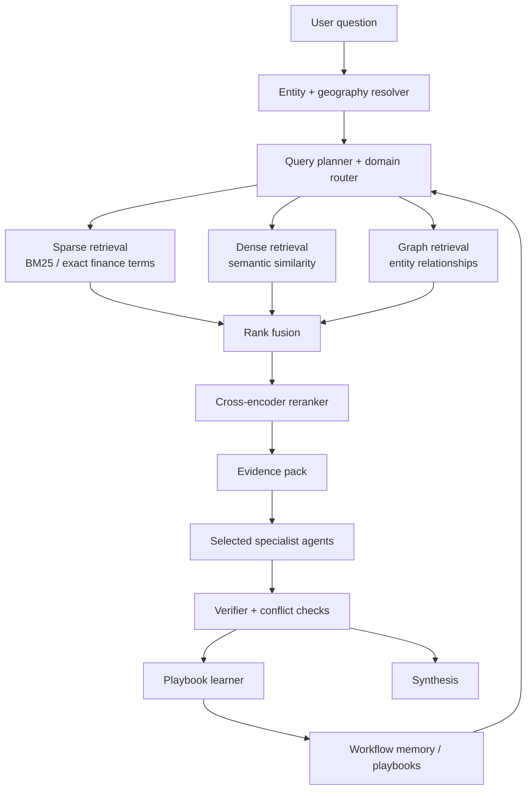
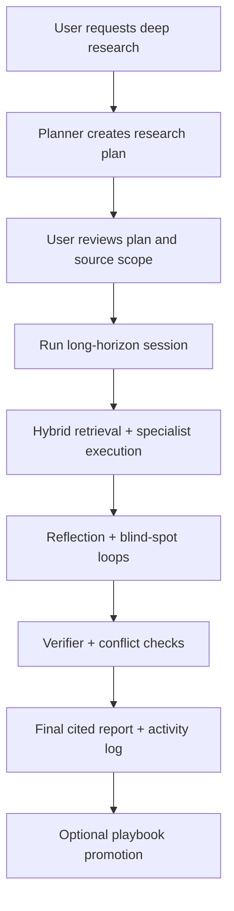

# FinAgent Accuracy And Reliability Strategy

This document answers five questions:

1. Can FinAgent integrate hybrid retrieval, specialist routing, workflow playbooks, and deep research?
2. Which of those will actually improve accuracy and reliability?
3. How should they be integrated into the current `finagent/` codebase?
4. What model strategy is best for the product?
5. How should FinAgent stop behaving like a US-only researcher and become geographically aware?

## 1. Short Answer

Yes, all four ideas are compatible with FinAgent, and three of them fit the current architecture very naturally:

- hybrid retrieval
- stronger specialist routing
- finance-aware workflow memory
- deep research mode
- contextual geographic search

FinAgent already has the right skeleton:

- long-running session runtime in `finagent/run_agent.py`
- multi-agent specialists in `finagent/agents/*`
- memory in `finagent/memory/store.py`
- reflection loop in `finagent/agent/reflection.py`
- streaming gateway in `finagent/gateway/run.py`

What it does not yet have is a real retrieval plane. Right now it is mostly:

- API enrichment
- web search and scraping
- SQLite fact memory

That is good for breadth, but not yet strong enough for institutional-grade retrieval quality on financial questions.

## 2. What FinAgent Already Has

### Strengths already present

- domain specialists already exist
- verifier already exists
- reflection loop already exists
- long-running session orchestration already exists
- persistent fact memory already exists
- memo synthesis already exists

### Gaps that matter most

- no dense semantic retrieval index
- no proper corpus-scale sparse lexical retrieval index for finance terms
- no entity graph for relationship questions
- no query-time reranking stage before evidence reaches the LLM
- specialists are dispatched as a fixed roster, not selected by a true finance router
- memory stores facts and summaries, but not reusable workflow playbooks
- entity resolution is still too US-centric because the strongest current enrichment path is SEC/Yahoo-first
- there is no country-aware source selection layer for India and other non-US markets

## 3. Recommended Target Architecture

## 4. Hybrid Retrieval: Yes, Add It

## 4.1 Why it helps

Financial questions are mixed-mode by nature:

- semantic similarity matters for narrative questions
  - example: "What changed in management tone versus last quarter?"
- exact match matters for tickers, ratios, debt series, and form names
  - example: `INFY`, `TCS`, `10-K`, `DRHP`, `Tier 1 capital`, `ISIN`
- relationship reasoning matters for issuers, subsidiaries, peers, directors, creditors, regulators, and counterparties

That means no single retriever is enough.

The strongest architecture for this use case is:

- dense retrieval for conceptual similarity
- sparse retrieval for exact finance vocabulary
- graph traversal for relationship-heavy questions
- reranking before the final evidence pack goes to the LLM

## 4.2 Research basis

Hybrid retrieval is a well-established production pattern.

- Azure AI Search documents hybrid search as parallel full-text plus vector search, merged with Reciprocal Rank Fusion, with semantic reranking after fusion.
- OpenAI File Search explicitly states that it uses semantic and keyword search together.
- Microsoft Research’s GraphRAG work shows graph-based retrieval helps on corpus-wide and relationship-heavy sensemaking questions.
- ColBERTv2 shows late-interaction retrieval can improve retrieval quality substantially compared with simpler dense setups.

## 4.3 What to build in FinAgent

Add a new package:

- `finagent/retrieval/`

Recommended modules:

- `chunking.py`
  - normalize filings, transcripts, research notes, and scraped docs into finance-aware chunks
- `metadata.py`
  - attach fields like ticker, exchange, issuer, document type, period, quarter, asset class, sector, country, currency
- `dense_index.py`
  - embedding creation and semantic retrieval
- `sparse_index.py`
  - BM25 or search-engine-backed exact retrieval
- `graph_index.py`
  - entity and relationship traversal
- `fusion.py`
  - RRF or weighted rank fusion
- `reranker.py`
  - cross-encoder or hosted rerank pass
- `planner.py`
  - decides which retrieval branches to run per query

## 4.3A Contextual geographic search: mandatory

This is not optional for FinAgent if you want reliable non-US coverage.

Right now, the architecture naturally leans US-first because:

- SEC EDGAR is one of the strongest enrichment sources
- Yahoo is used as a general market data fallback
- many search prompts and source assumptions are US public-market shaped

That causes problems for queries like:

- `Analyze TCS margins and management commentary`
- `Compare Infosys and Wipro valuation`
- `What changed in Nestle India's annual report?`
- `How is Toyota exposed to Japan rate policy?`
- `Review Adani Ports risk disclosures`

The problem is not only retrieval. It is entity resolution plus jurisdiction selection.

### What geographic search should do

Before retrieval, FinAgent should resolve:

- company canonical name
- country / domicile
- primary exchange
- local ticker format
- regulator
- filing system
- preferred currency
- preferred source domains

Examples:

- `TCS` -> India -> NSE/BSE -> `TCS.NS` / `500470.BO` -> SEBI / NSE / BSE / investor relations
- `Infosys` -> India -> NSE/BSE/NYSE ADR context -> SEBI + NSE + Infosys IR
- `Toyota` -> Japan -> TSE -> JP filings / IR / exchange sources
- `SAP` -> Germany -> Xetra -> BaFin / issuer IR / annual report sources

### What to build

Add a new package:

- `finagent/geo/`

Recommended modules:

- `entity_resolver.py`
  - map user input to canonical company entity
- `jurisdiction_profiles.py`
  - registry of country/exchange/regulator/source policies
- `ticker_mapper.py`
  - local ticker and exchange mapping
- `source_policy.py`
  - preferred domains by country and document type
- `query_localizer.py`
  - rewrite generic search prompts into country-aware prompts
- `currency_policy.py`
  - local market currency normalization

### Jurisdiction profile examples

For India, the profile should bias toward:

- `nseindia.com`
- `bseindia.com`
- `sebi.gov.in`
- company investor relations pages
- annual reports / con-call transcripts / shareholding and filings
- trusted Indian financial media only after primary sources

For the US:

- `sec.gov`
- issuer IR pages
- exchange and major financial data providers

For Japan:

- issuer IR pages
- exchange disclosures
- regulator filings

For Europe:

- issuer IR pages
- exchange announcements
- regulator disclosures

### Retrieval behavior change

Once the geography is known, the retrieval planner should:

- inject country-specific synonyms
- prefer local document names and filing types
- prefer local exchange and regulator domains
- prefer the right ticker form
- prefer local-language or English IR pages depending on availability

### Important truth

No system can literally guarantee perfect data for every company in the world.

The realistic goal should be:

- strong coverage for listed companies across major markets
- decent fallback behavior for smaller markets
- graceful explanation when primary data does not exist

That is the right product promise. Not "universal company coverage," but "country-aware, source-aware coverage with clear fallbacks."

## 4.4 Practical stack recommendation

For production, I would not keep this in SQLite.

Recommended stack:

- sparse + dense search:
  - `OpenSearch` or `Elasticsearch`
- graph:
  - `Neo4j` or a graph layer on top of Postgres if you want to stay simpler
- metadata / session / playbook store:
  - `PostgreSQL`

Why this is the safest path:

- exact lexical search for finance terms is stronger in search engines than in SQLite FTS alone
- vector retrieval and metadata filters are mature in modern search stacks
- graph traversal is easier to reason about and maintain in a proper graph store

If you want a lighter first step:

- Phase 1: OpenSearch/Elastic only, using BM25 + vector + RRF + reranking
- Phase 2: add graph retrieval only after you have enough entity-rich content

## 4.5 Reranking recommendation

Do not send raw top-k retrieved chunks directly into the LLM.

Add a reranking layer that scores:

- query-document relevance
- timeliness
- authority tier
- document-type fit
- entity match quality

For example, boost:

- official filings
- exchange/regulator sources
- issuer IR pages
- the latest quarter for time-sensitive questions

This is where reliability rises sharply, because the LLM sees cleaner evidence.

## 5. Specialist Router: Yes, Upgrade It

## 5.1 Current state

FinAgent already has specialist agents, but the system currently behaves more like:

- collect evidence
- run a default 8-agent roster

That is better than a single generalist, but not yet a true finance router.

## 5.2 What a better router should do

At query start, classify:

- geography
  - India, US, Europe, Japan, Middle East, global, unknown
- asset class
  - equities, credit, macro, crypto, commodities, private markets
- task type
  - valuation, event analysis, risk review, transcript analysis, peer comparison, regulatory review
- data mode
  - market data, filings, news, social, entity relationships
- urgency
  - current/live vs historical/deep

Then select:

- which specialists to run
- which retrieval branches to run
- which tools each specialist can access
- which country profile and source policy should govern the search

## 5.3 Example routing

Question:

`Why did bond duration risk rise after the latest policy meeting?`

Router should select:

- fixed income agent
- macro agent
- maybe news agent

Not:

- community
- technical equity agent
- generic competitor agent

Question:

`Is Solana volatility being driven by on-chain flows or macro beta?`

Router should select:

- crypto agent
- macro agent
- news agent

Question:

`Compare HDFC Bank and ICICI Bank provision coverage and funding mix`

Router should select:

- India banking jurisdiction profile
- bank financials specialist
- risk specialist
- peer comparison specialist

Question:

`Analyze TCS and Infosys recent commentary on deal wins`

Router should select:

- India IT services jurisdiction profile
- transcript / annual report / IR retrieval policy
- news specialist
- financials specialist

## 5.4 What to build

Add:

- `finagent/router/intent_router.py`
- `finagent/router/domain_taxonomy.py`
- `finagent/router/policies.py`
- `finagent/router/geography_router.py`

The router should output:

- `selected_agents`
- `selected_tools`
- `retrieval_plan`
- `confidence`
- `fallback_policy`

This should happen before the orchestration phase in `run_agent.py`.

## 6. Finance-Aware Learning Loop: Yes, But Store Workflows, Not Just Facts

## 6.1 Current state

Current memory stores:

- facts
- session summaries

That is useful, but it is not enough for reusable research behavior.

## 6.2 What playbooks should be

A playbook is not a note. It is a reusable research workflow template.

Example playbooks:

- earnings preview with transcript sentiment + estimate revisions + factor rotation
- bank credit risk workflow
- insurance float quality workflow
- bond duration sensitivity workflow
- crypto volatility decomposition workflow
- DRHP/RHP/prospectus comparison workflow

Each playbook should store:

- trigger pattern
- asset class
- question type
- preferred specialists
- preferred retrieval recipe
- tool sequence
- evidence quality thresholds
- failure modes
- success metrics
- last known good examples

## 6.3 Promotion rule

Do not auto-promote every successful session into a playbook.

Promote only when:

- verifier quality score is high
- conflict rate is low
- user accepts the answer or marks it useful
- the workflow is reusable across more than one target

## 6.4 What to build

Add:

- `finagent/playbooks/schema.py`
- `finagent/playbooks/store.py`
- `finagent/playbooks/retriever.py`
- `finagent/playbooks/promoter.py`
- `finagent/playbooks/executor.py`

At session start:

- retrieve candidate playbooks by intent + asset class + entity type
- load the top playbook as planning context

At session end:

- evaluate whether the run should become or update a playbook

This is the most important change if you want the system to stop rediscovering the same workflow repeatedly.

## 7. Deep Research: Yes, Make It A Product Mode

## 7.1 What deep research should mean in FinAgent

Deep research should not just mean "run longer."

It should mean:

- explicit research plan before execution
- user-approved source scope
- explicit jurisdiction-aware source scope
- long-running, interruptible session
- iterative evidence gathering
- progress streaming
- checkpoint resume
- structured final report with citations and activity log

This matches the operational pattern described in OpenAI’s deep research product:

- proposed plan first
- source selection
- live progress
- interruption and refinement
- final cited report

## 7.2 How to implement it in FinAgent

FinAgent already has much of the runtime required.

What to add:

- `deep_research` mode in `gateway/run.py`
- a `plan_review` step before `run_research_session(...)`
- source policy object:
  - allowed domains
  - preferred domains
  - blocked domains
  - source tier minimum
- jurisdiction policy object:
  - country
  - exchange
  - regulator
  - local filing types
  - preferred local sources
- budget policy object:
  - max time
  - max searches
  - max tokens
  - max tool cost
- checkpoint resume endpoint
- research report package:
  - answer
  - evidence table
  - citations
  - activity log
  - unresolved gaps

## 7.3 Recommended deep research flow

## 7.4 When to invoke deep research

Use deep research for:

- cross-document comparisons
- forensic due diligence
- complex asset-class questions
- long-horizon thematic research
- questions that require many steps and high documentation quality

Do not use it for:

- simple quote lookups
- single-ratio questions
- basic news retrieval

## 8. Best LLM Strategy For FinAgent

There is no single best model for every job. The best strategy is a model tiering strategy.

## 8.1 Best practice principle

Use different models for:

- routing
- extraction
- specialist reasoning
- verification
- final synthesis
- premium deep research

The system becomes cheaper, faster, and usually more reliable than using one expensive model for everything.

## 8.2 Best near-term strategy for your codebase

Because FinAgent is already Anthropic-first, the cleanest near-term strategy is:

### Default production path

- router / classification / metadata extraction:
  - Claude Haiku 4.5 or GPT-5.4-mini class
- specialist reasoning:
  - Claude Sonnet 4.6 as the default
- verifier and final synthesis for normal sessions:
  - Claude Sonnet 4.6
- premium deep research mode:
  - Claude Opus 4.7 or GPT-5.5

### Why

- Anthropic’s current docs position Claude Sonnet 4.6 as the best speed/intelligence balance and Claude Opus 4.7 as the most capable general model.
- OpenAI’s current docs position GPT-5.5 as the flagship for complex reasoning and GPT-5.4-mini as the lower-latency cheaper option.

## 8.3 Recommended model split

### Option A: Stay Anthropic-first

Use when:

- you want minimum refactor from current code
- you want strong long-context memo generation
- you prefer current synthesis stack

Recommended split:

- `Haiku 4.5`
  - routing
  - schema extraction
  - document tagging
  - entity normalization
- `Sonnet 4.6`
  - most specialist reasoning
  - verifier
  - standard memo synthesis
- `Opus 4.7`
  - premium deep research
  - especially difficult conflict-heavy or multi-document cases

Also use:

- Anthropic prompt caching for repeated system prompts, tool specs, and large static context
- Anthropic citations for document-grounded outputs where applicable
- Anthropic web search only if you handle tool-result errors in-body, not just HTTP status

### Option B: Hybrid Anthropic + OpenAI

Use when:

- you want a premium research tier
- you want managed file search / web search options
- you want to benchmark two top ecosystems

Recommended split:

- `GPT-5.4-mini`
  - routing
  - extraction
  - lightweight reasoning
- `Claude Sonnet 4.6`
  - standard specialist execution and memo writing
- `GPT-5.5`
  - premium synthesis / verifier / hard reasoning
- `o3-deep-research` or `o4-mini-deep-research`
  - optional managed deep-research tier for web-heavy investigations

### Option C: OpenAI-first

Use when:

- you want deeper alignment with Responses API tools
- you want hosted file search and web search as part of the model runtime

Recommended split:

- `GPT-5.4-mini`
  - routing
  - extraction
  - cheap sub-agent tasks
- `GPT-5.5`
  - standard high-value reasoning
  - verifier
  - final synthesis
- `o3-deep-research`
  - premium long-horizon research mode

## 8.4 My recommendation

For this repository, I would recommend:

1. Keep FinAgent Anthropic-first in the short term.
2. Introduce OpenAI as an optional premium research path, not a forced rewrite.
3. Use model tiering instead of a single-model strategy.

That gives you the least disruption and the most room to compare quality.

## 9. Concrete Integration Plan For This Codebase

## Phase 1: Geography and entity foundation

Before broad retrieval, add a geography-aware entity layer.

Add:

- `finagent/geo/*`

Modify:

- `run_agent.py`
  - resolve company + geography before enrichment and search
- `tools/data/*`
  - route enrichment through market-aware adapters instead of SEC-first assumptions

Outcome:

- FinAgent stops asking US-shaped questions for Indian or non-US companies

## Phase 2: Retrieval foundation

Add:

- `finagent/retrieval/*`
- corpus ingestion for:
  - SEC / filings
  - transcripts
  - memos
  - scraped docs
  - DRHP/RHP/prospectus PDFs

Modify:

- `run_agent.py`
  - replace direct search-first behavior with planner-driven retrieval
- `tools/web/scraper.py`
  - keep as one evidence source, not the whole retrieval strategy

Outcome:

- FinAgent gets a true evidence layer

## Phase 3: Router

Add:

- `finagent/router/*`

Modify:

- orchestration step in `run_agent.py`
- specialist selection in `agents/specialists/__init__.py`

Outcome:

- only relevant specialists run
- latency and noise both improve

## Phase 4: Playbooks

Add:

- `finagent/playbooks/*`

Modify:

- `memory/store.py`
- end-of-session promotion logic in `run_agent.py`

Outcome:

- FinAgent starts reusing successful finance workflows

## Phase 5: Deep research mode

Modify:

- `gateway/run.py`
- `events.py`
- `run_agent.py`

Add:

- plan approval
- source controls
- budget controls
- resume controls
- final report package

Outcome:

- FinAgent becomes a real long-form research product mode

## Phase 6: Premium model tier

Add:

- multi-provider abstraction instead of Anthropic-only `runtime_provider.py`
- task-to-model policy
- per-stage model telemetry

Outcome:

- cost and quality become tunable independently

## 10. Final Recommendation

The best accuracy/reliability move is not “add a bigger model.”

It is:

1. add geography-aware entity resolution first
2. build a true hybrid retrieval layer
3. add a real finance router
4. store workflow playbooks, not only facts
5. make deep research a first-class mode
6. use tiered models, not one model for everything

If you do only one thing first, do geography-aware entity resolution plus hybrid retrieval.

If you do two things, do:

- geography-aware routing
- hybrid retrieval
- router

If you want the product to feel genuinely smarter over time, the third thing should be playbooks.

## 11. Source Notes

These recommendations were informed by:

- OpenAI models guidance: [OpenAI Models](https://developers.openai.com/api/docs/models)
- OpenAI file search: [File Search](https://developers.openai.com/api/docs/guides/tools-file-search)
- OpenAI deep research patterns: [Deep research help article](https://help.openai.com/en/articles/10500283-deep-research)
- OpenAI deep research system card: [Deep research system card](https://openai.com/index/deep-research-system-card/)
- Anthropic model guidance: [Anthropic models overview](https://platform.claude.com/docs/en/about-claude/models/overview)
- Anthropic prompt caching: [Anthropic prompt caching](https://platform.claude.com/docs/es/build-with-claude/prompt-caching)
- Anthropic citations: [Anthropic citations](https://platform.claude.com/docs/en/build-with-claude/citations)
- Anthropic web search behavior: [Anthropic web search tool](https://platform.claude.com/docs/en/agents-and-tools/tool-use/web-search-tool)
- Hybrid retrieval and RRF: [Azure hybrid search overview](https://learn.microsoft.com/en-us/azure/search/hybrid-search-overview) and [RRF ranking](https://learn.microsoft.com/en-us/azure/search/hybrid-search-ranking)
- Graph retrieval: [Microsoft Research GraphRAG paper page](https://www.microsoft.com/en-us/research/publication/from-local-to-global-a-graph-rag-approach-to-query-focused-summarization/)
- Late-interaction retrieval: [ColBERTv2 paper](https://arxiv.org/abs/2112.01488)
- Reranking pattern: [Cohere rerank docs](https://docs.cohere.com/v2/docs/rerank)
