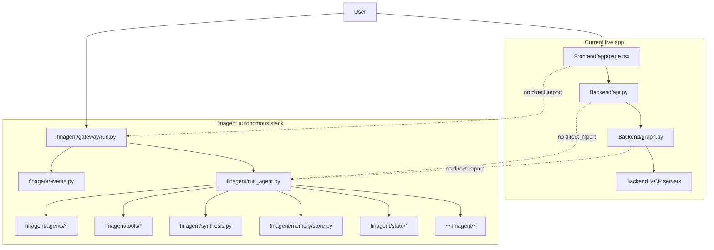
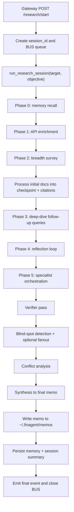
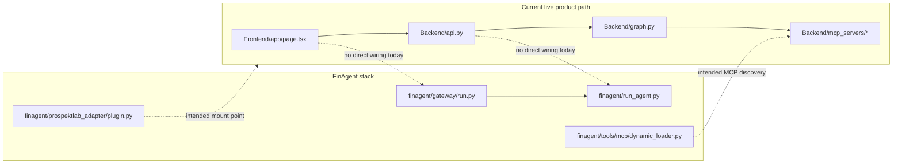
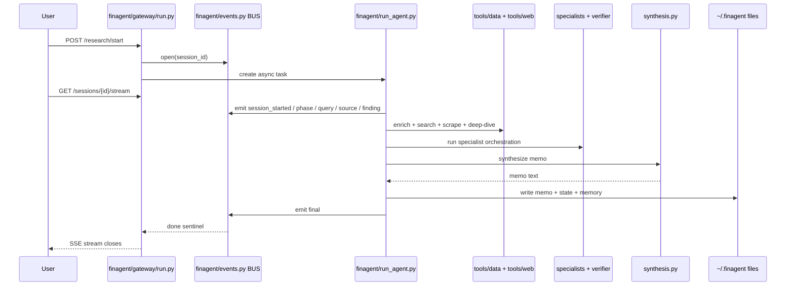

# FinAgent Architecture Blueprint

This document is based on the actual `finagent/` source code in this repository as of May 14, 2026. It describes:

1. what `finagent` is,
2. how its internal runtime works,
3. where it is integrated with the wider ProspektLab app,
4. where it is not yet integrated,
5. the end-to-end control flow.

## 1. Executive Summary

`finagent/` is a standalone autonomous research subsystem inside this repository. It is not the same runtime as the live ORACLE chat backend in `Backend/api.py` and `Backend/graph.py`.

What it does today:

- exposes its own FastAPI gateway in `finagent/gateway/run.py`
- starts long-running research sessions via `finagent/run_agent.py`
- streams progress through an in-process session bus in `finagent/events.py`
- uses API-backed enrichment, web search, scraping, reflection, specialist subagents, verification, synthesis, checkpointing, and long-term memory
- writes memos and state to `~/.finagent/*`

What it does not do today:

- it is not imported by the current Next.js frontend in `Frontend/`
- it is not imported by the current ORACLE backend in `Backend/`
- its host adapter `finagent/prospektlab_adapter/plugin.py` is still a stub
- its MCP discovery layer `finagent/tools/mcp/dynamic_loader.py` is still a stub

## 2. Top-Level Architecture

## 3. What FinAgent Is

FinAgent is a session-based research engine designed for deep company analysis, not a short request-response chatbot.

Its center of gravity is `finagent/run_agent.py`, which runs a multi-phase workflow:

- memory recall
- authoritative API enrichment
- breadth survey
- gap-driven deep dive
- self-reflection
- specialist multi-agent analysis
- verifier pass
- blind-spot expansion
- synthesis into a memo
- persistence into memory and session state

## 4. Package Map And Responsibilities

### Runtime entrypoints

| Path | Job |
| --- | --- |
| `finagent/run_agent.py` | Main research orchestrator and phase runner |
| `finagent/gateway/run.py` | Standalone FastAPI gateway and SSE streaming API |
| `finagent/cli.py` | CLI entry for local execution |
| `finagent/__main__.py` | Allows `python -m finagent` |

### Core control plane

| Path | Job |
| --- | --- |
| `finagent/events.py` | Per-session async queue bus for live events |
| `finagent/research_planner.py` | Builds a dependency-aware research plan |
| `finagent/prompt_builder.py` | Loads the FinAgent system prompt |
| `finagent/settings.py` | Environment-driven runtime settings |
| `finagent/runtime_provider.py` | Anthropic runtime config resolution |

### Agent system

| Path | Job |
| --- | --- |
| `finagent/agents/base.py` | Base contracts for specialists, findings, shared context |
| `finagent/agents/orchestrator.py` | Parallel wave scheduler for specialists |
| `finagent/agents/verifier.py` | Tier-1 evidence checks, corroboration, conflict surfacing |
| `finagent/agents/blindspot.py` | Detects missing coverage and creates follow-up queries |
| `finagent/agents/specialists/*` | Domain specialists |

Default specialist roster from `finagent/agents/specialists/__init__.py`:

- `financials`
- `risk`
- `technical`
- `news`
- `community`
- `competitor`
- `macro`
- `governance`

### Research quality and self-improvement

| Path | Job |
| --- | --- |
| `finagent/analysis/quality.py` | Heuristic research coverage scoring |
| `finagent/analysis/conflicts.py` | Numeric conflict detection across sources |
| `finagent/agent/reflection.py` | Reflection loop that keeps researching until quality improves |
| `finagent/accuracy_validator.py` | Claim confidence and source validation logic |

### Tooling and acquisition

| Path | Job |
| --- | --- |
| `finagent/tools/data/*` | Structured API-backed data sources |
| `finagent/tools/web/http_fetcher.py` | Shared HTTP client, retries, robots handling, optional browser fallback |
| `finagent/tools/web/scraper.py` | Search, fetch, parse, dedupe, and tier sources |
| `finagent/tools/social/viral_verifier.py` | Pump-and-dump style viral-risk scoring |
| `finagent/tools/file/*` | OCR, PDF parsing, tables |
| `finagent/tools/browser/*` | Browser-based fetch/crawl helpers |
| `finagent/tools/prospektlab/*` | ProspektLab-specific extension stubs/protocols |
| `finagent/tools/mcp/dynamic_loader.py` | Intended MCP discovery hook, currently placeholder |

### State, memory, and output

| Path | Job |
| --- | --- |
| `finagent/state/checkpoint.py` | Serializable checkpoint model |
| `finagent/state/research_state.py` | SQLite session/checkpoint storage |
| `finagent/state/citation_log.py` | Citation tracking |
| `finagent/state/compression.py` | Context compression stub |
| `finagent/memory/store.py` | Long-term memory store with SQLite + FTS5 |
| `finagent/output/*` | Memo formatting and confidence helpers |
| `finagent/synthesis.py` | Final memo composition |

## 5. Actual Runtime Blueprint

## 6. Runtime Phases In Detail

### 6.1 Gateway and session management

`finagent/gateway/run.py` is a complete standalone mini-application.

It provides:

- `/health`
- `/config`
- `/landing`, `/login`, `/signup`, `/profile`, `/settings`, `/app`
- `/auth/signup`
- `/auth/login`
- `/research/start`
- `/memos`
- `/sessions/{session_id}/memo`
- `/sessions/{session_id}/stream`

Important behavior:

- authentication is local-file based under `~/.finagent/users/*.json`
- active research tasks are kept in `_TASKS`
- session streaming uses Server-Sent Events
- the gateway consumes the session bus rather than calling the UI directly

### 6.2 Eventing model

`finagent/events.py` is the bridge between the agent loop and the UI/API stream.

Design:

- one `asyncio.Queue` per session
- `BUS.open(session_id)` creates the queue
- `BUS.emit(...)` pushes typed events
- `BUS.close(session_id)` sends the completion sentinel
- `/sessions/{session_id}/stream` drains the queue into SSE frames

This means FinAgent is event-driven internally even though it runs in one Python process.

### 6.3 Planning

`finagent/research_planner.py` defines `ResearchPlan` and `PlanStep`.

The default plan is small and high-level:

1. breadth survey
2. primary filings
3. metric triangulation
4. synthesis

The plan is emitted at session start, but the real runtime behavior is richer than the plan object. The actual control logic lives in `run_agent.py`.

### 6.4 Enrichment layer

The enrichment phase in `run_agent.py` fans out to authoritative and semi-structured sources in parallel:

- SEC EDGAR via `tools/data/sec_edgar.py`
- filing narrative extraction via `tools/data/sec_filings.py`
- Yahoo Finance via `tools/data/yahoo_finance.py`
- Wikipedia via `tools/data/wikipedia.py`
- FX via `tools/data/forex.py`
- Reddit via `tools/data/reddit.py`
- Hacker News via `tools/data/hackernews.py`
- StockTwits via `tools/data/stocktwits.py`
- Google News RSS style feed via `tools/data/news_feed.py`

This phase produces `EnrichmentBundle` from `finagent/synthesis.py`.

### 6.5 Search and scraping layer

`finagent/tools/web/scraper.py` is the acquisition engine for unstructured web evidence.

It does:

- DuckDuckGo HTML search
- Bing HTML search
- merge + dedupe of raw results
- fetch and parse top results
- assign source tier by domain
- preserve excerpts and metadata as `ScrapedDoc`

`finagent/tools/web/http_fetcher.py` underneath provides:

- pooled `httpx.AsyncClient`
- retry loop
- robots handling
- identified user-agent for SEC/Wikimedia-style hosts
- optional Playwright fallback

### 6.6 Processing and checkpointing

As docs are ingested, `run_agent.py` processes them into:

- citation log entries
- confidence summaries
- checkpoint progress

Checkpoint persistence is handled by:

- `finagent/harness/orchestrator.py`
- `finagent/state/research_state.py`

State lands in `~/.finagent/research_state.sqlite3`.

### 6.7 Reflection loop

`finagent/agent/reflection.py` is one of the most important differentiators in this subsystem.

It:

- scores the current research state with `analysis/quality.py`
- inspects gaps
- generates new targeted queries
- reruns search
- processes newly found docs through the same pipeline
- repeats until score threshold or max rounds is reached

This is why FinAgent behaves like a long-running researcher rather than a simple prompt wrapper.

### 6.8 Specialist multi-agent layer

The specialist system is not the same as the ORACLE LangGraph sub-agent setup.

FinAgent’s version uses:

- `SubAgentContext` from `agents/base.py`
- `Orchestrator` from `agents/orchestrator.py`
- `Finding` and `AgentTaskResult` as structured outputs

Execution model:

- specialists are grouped into dependency waves
- within a wave they run concurrently with `asyncio.gather`
- each has its own timeout
- findings and newly discovered docs are merged back into the shared session state

Default roster priorities:

- `financials` priority `10`
- `risk` priority `20`
- `news` priority `20`
- `community` priority `30`
- `technical` priority `30`
- `competitor` priority `40`
- `macro` priority `50`
- `governance` priority `60`

### 6.9 Verifier layer

`finagent/agents/verifier.py` acts as the trust-control layer after specialists finish.

It performs:

- tier-1 evidence checks
- cross-agent corroboration
- numeric conflict surfacing
- `AccuracyValidator` pass-through for findings-as-claims

This layer is important because FinAgent does not blindly trust every specialist output.

### 6.10 Blind-spot layer

After specialist analysis, `detect_blind_spots(...)` can create follow-up research prompts for missing coverage.

This layer can auto-dispatch new web queries and process the returned documents back into the main corpus.

### 6.11 Synthesis and memo output

`finagent/synthesis.py` turns all gathered evidence into the final memo.

It supports two modes:

- Anthropic-backed memo generation when `ANTHROPIC_API_KEY` is available
- structured prose fallback when it is not

Output behavior:

- memo tokens can stream live through `memo_token` events
- final memo is written to `~/.finagent/memos/{session_id}.md`
- final quality score and metadata are emitted in the `final` event

### 6.12 Long-term memory

`finagent/memory/store.py` persists reusable facts and session summaries in `~/.finagent/memory.sqlite3`.

It supports:

- normalized target keys
- fact persistence
- FTS5 recall
- last-summary retrieval
- session summary storage

This is how FinAgent can seed future research sessions with previous learnings.

## 7. Integration With The Wider App

## 7.1 What is directly integrated today

There are only a few real integration points today:

| Integration point | Status | Details |
| --- | --- | --- |
| Same repository | Yes | `finagent/` lives inside the main repo |
| Same Python environment intention | Partial | `finagent/requirements-finagent.txt` says install into the same backend venv |
| Shared product naming | Yes | FinAgent is branded as part of ProspektLab |
| Standalone web app surface | Yes | `finagent/gateway/run.py` + HTML pages |
| Shared environment settings | Partial | `settings.py` reads `PROSPEKTLAB_MCP_URL`, but no mounted MCP integration is active |

## 7.2 What is not directly integrated today

These are the important non-integrations:

| Path | Current state |
| --- | --- |
| `Frontend/` -> `finagent/` | No import or request path found |
| `Backend/api.py` -> `finagent/` | No import or call path found |
| `Backend/graph.py` -> `finagent/` | No import or orchestration path found |
| `finagent/prospektlab_adapter/plugin.py` | Stub, raises `NotImplementedError` |
| `finagent/tools/mcp/dynamic_loader.py` | Stub, returns `[]` |

That means the current live ORACLE app and FinAgent are siblings in the repo, not one integrated runtime.

## 7.3 Accurate integration diagram

## 8. Standalone FinAgent App Flow

This is the actual user-facing path if someone uses FinAgent directly:

## 9. Where Each Major File Sits In The Blueprint

### User and API surface

- `finagent/gateway/run.py`
- `finagent/gateway/widget.html`
- `finagent/gateway/landing.html`
- `finagent/gateway/login.html`
- `finagent/gateway/signup.html`
- `finagent/gateway/profile.html`
- `finagent/gateway/settings.html`

### Session/event transport

- `finagent/events.py`
- `finagent/gateway/session.py`

### Core research engine

- `finagent/run_agent.py`
- `finagent/research_planner.py`
- `finagent/settings.py`
- `finagent/prompt_builder.py`
- `finagent/runtime_provider.py`

### Agent intelligence

- `finagent/agents/base.py`
- `finagent/agents/orchestrator.py`
- `finagent/agents/verifier.py`
- `finagent/agents/blindspot.py`
- `finagent/agent/reflection.py`
- `finagent/agents/specialists/*`

### Data and retrieval

- `finagent/tools/data/*`
- `finagent/tools/web/http_fetcher.py`
- `finagent/tools/web/scraper.py`
- `finagent/tools/social/viral_verifier.py`

### Persistence

- `finagent/state/checkpoint.py`
- `finagent/state/research_state.py`
- `finagent/state/citation_log.py`
- `finagent/memory/store.py`

### Output

- `finagent/synthesis.py`
- `finagent/output/*`

### Intended but incomplete host integration

- `finagent/prospektlab_adapter/plugin.py`
- `finagent/tools/mcp/dynamic_loader.py`
- `finagent/tools/prospektlab/*`

## 10. Important Truths About The Codebase

### Truth 1

FinAgent is real and substantial. It is not a placeholder folder.

### Truth 2

FinAgent already has a complete standalone runtime path:

- gateway
- session streaming
- research engine
- memo generation
- persistence

### Truth 3

FinAgent is not the engine behind the current ORACLE frontend/backend path.

### Truth 4

The intended integration hooks exist, but they are not finished:

- `prospektlab_adapter/plugin.py`
- `tools/mcp/dynamic_loader.py`

### Truth 5

FinAgent currently leans on US-oriented public data sources:

- SEC EDGAR
- Yahoo Finance
- Wikipedia
- Reddit
- Hacker News
- StockTwits

That is architecturally different from the current ORACLE stack, which is centered on Indian-market MCP servers.

## 11. Final Blueprint Statement

The accurate architecture is:

- the live app today is the ORACLE `Frontend/ + Backend/ + MCP servers` stack
- `finagent/` is a parallel autonomous research subsystem
- it already works as its own session-based research application
- it is only loosely related to the live app through repo co-location, shared deployment intent, and incomplete adapter hooks
- full integration into the main app will require explicit mounting, API wiring, and MCP bridging work

If you want to study the code in the right order, read:

1. `finagent/run_agent.py`
2. `finagent/gateway/run.py`
3. `finagent/agents/base.py`
4. `finagent/agents/orchestrator.py`
5. `finagent/agents/verifier.py`
6. `finagent/agent/reflection.py`
7. `finagent/tools/web/scraper.py`
8. `finagent/tools/data/__init__.py`
9. `finagent/synthesis.py`
10. `finagent/memory/store.py`
11. `finagent/state/research_state.py`
12. `finagent/prospektlab_adapter/plugin.py`

