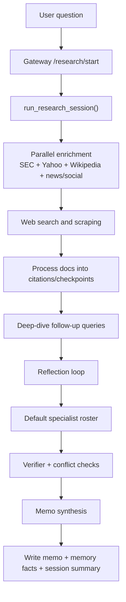
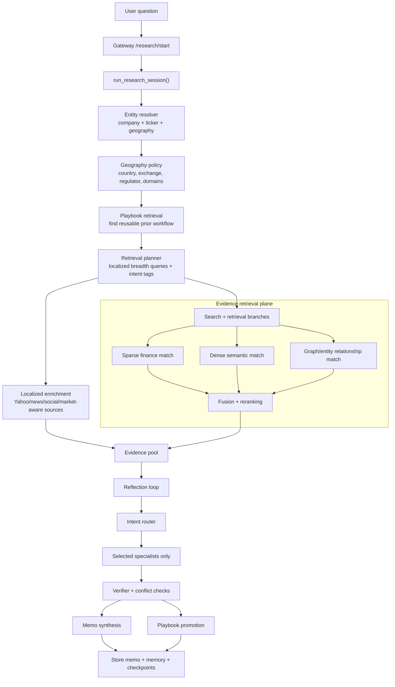

# FinAgent Architecture Workflow

This document explains the current FinAgent architecture after the new reliability and geography-aware upgrades, and how it differs from the previous architecture.

It answers three things:

1. what the old workflow was,
2. what the new workflow is,
3. why the new design is better.

## 1. Short Version

Previously, FinAgent mostly behaved like:

- run enrichment,
- run web search,
- send evidence to a broad fixed specialist roster,
- synthesize a memo,
- save facts and session summaries.

Now, FinAgent behaves more like:

- resolve entity and geography first,
- localize search and source policy by country,
- load reusable playbooks if a similar workflow worked before,
- build a retrieval plan before searching,
- rerank evidence before it spreads through the system,
- route only the right specialists,
- run deep research mode more deliberately,
- save both facts and reusable workflow patterns.

That is the core difference.

## 2. Previous Architecture

## 2.1 Old mental model

The old architecture was strong in depth, but it was still mostly search-first and US-shaped.

Main characteristics:

- SEC/Yahoo/Wikipedia enrichment was the strongest early path
- search was broad, but not geography-aware
- specialist execution used the default roster more often
- memory stored facts and summaries, but not reusable research workflows
- search relevance depended more on source tiering than on a richer retrieval/rerank plan

## 2.2 Old flowchart

## 2.3 Old limitations

- Indian and other non-US companies could still be researched, but the search behavior was not properly localized.
- Questions like `TCS`, `Infosys`, `Toyota`, or `SAP` could inherit US-shaped query assumptions.
- Specialist selection was better than a single generalist, but not yet strongly intent-routed.
- There was no workflow memory for "this exact style of financial analysis worked before."
- Retrieval quality came mostly from live search and heuristics, not from a more explicit retrieval architecture.

## 3. Current Architecture

## 3.1 New mental model

The new architecture adds a pre-research decision layer before the old research loop starts expanding.

That decision layer now answers:

- who is the entity,
- which country/exchange/regulator applies,
- which domains should be preferred,
- which retrieval recipe fits the question,
- which specialists are actually needed,
- whether a previous successful workflow can be reused.

## 3.2 Current flowchart

## 3.3 Current component map

### Geography and entity layer

- `finagent/geo/entity_resolver.py`
- `finagent/geo/jurisdiction_profiles.py`
- `finagent/geo/ticker_mapper.py`
- `finagent/geo/source_policy.py`
- `finagent/geo/query_localizer.py`
- `finagent/geo/currency_policy.py`

Job:

- identify the company correctly
- understand whether it belongs to India, US, Japan, EU, or fallback global mode
- choose ticker format and source bias
- rewrite search queries in a country-aware way

### Retrieval layer

- `finagent/retrieval/planner.py`
- `finagent/retrieval/sparse_index.py`
- `finagent/retrieval/dense_index.py`
- `finagent/retrieval/graph_index.py`
- `finagent/retrieval/fusion.py`
- `finagent/retrieval/reranker.py`

Job:

- build a better evidence pack before the LLM reasons over it
- preserve exact finance terms
- preserve semantic similarity
- capture related-entity signals
- rerank toward better evidence

### Routing layer

- `finagent/router/intent_router.py`
- `finagent/router/domain_taxonomy.py`
- `finagent/router/geography_router.py`
- `finagent/router/policies.py`

Job:

- decide which specialists should run
- decide when deep research should expand
- make forecast, comparison, risk, and financial prompts route more intelligently

### Playbook layer

- `finagent/playbooks/schema.py`
- `finagent/playbooks/store.py`
- `finagent/playbooks/retriever.py`
- `finagent/playbooks/executor.py`
- `finagent/playbooks/promoter.py`

Job:

- remember reusable research workflows
- load a known-good pattern before rediscovering it from scratch
- promote high-quality sessions into future planning context

### Core orchestration layer

- `finagent/run_agent.py`
- `finagent/agents/*`
- `finagent/agent/reflection.py`
- `finagent/agents/verifier.py`
- `finagent/synthesis.py`

Job:

- merge all of the new layers into the actual runtime session
- keep the reflection, verification, and synthesis loop intact

## 4. Side-By-Side Difference

| Area | Previous architecture | Current architecture |
| --- | --- | --- |
| Entry behavior | Start research loop quickly | Start with entity/geography/retrieval decisions |
| Company resolution | Mostly target text plus SEC/Yahoo support | Explicit company + exchange + country + ticker resolution |
| Geography awareness | Weak to moderate | Stronger and intentional |
| Source policy | Broad heuristics | Preferred domains per jurisdiction |
| Query shaping | Mostly generic | Localized for India and non-US contexts |
| Retrieval style | Search-first | Planned retrieval with sparse/dense/graph/rerank scaffolding |
| Specialist selection | Often default roster | Intent-driven selected specialists |
| Learning | Facts and summaries | Facts, summaries, and workflow playbooks |
| Deep research | Mostly "run longer" behavior | More explicit research-mode behavior |
| Reliability | Good, but fragile on global market coverage | Better coverage, reuse, and routing discipline |

## 5. Example: TCS vs Infosys

Take this query:

`Compare TCS with Infosys and provide their future outlook`

## 5.1 Old behavior

Likely old path:

1. start session
2. run SEC/Yahoo/Wikipedia/news/social enrichment
3. run broad search
4. send evidence through a relatively broad specialist path
5. synthesize answer

Weaknesses:

- the query could stay too generic
- India-specific source preference was not explicit enough
- future outlook might not reliably pull the right mix of financial, macro, and news specialists
- prior successful India-IT comparison workflows were not reused

## 5.2 New behavior

Current path:

1. resolve `TCS` as India, `TCS.NS`, NSE/BSE, SEBI-oriented profile
2. apply India source preference like NSE, BSE, SEBI, IR-style pages
3. build localized queries such as:
   - annual report India NSE BSE
   - quarterly results concall transcript India NSE BSE
4. route the prompt as a comparison plus forecast/outlook style task
5. select relevant specialists such as:
   - financials
   - competitor
   - news
   - macro
6. run evidence through reranking logic
7. synthesize the memo
8. if the session is high quality, promote it into a reusable India-comparison playbook

That is a much more finance-aware workflow.

## 6. Example: Why geography changes the result

Take this query:

`Analyze Toyota risk disclosures`

### Old architecture risk

- could lean too hard on generic English web search
- could still behave like a US-public-company lookup pattern

### New architecture path

1. resolve `Toyota` into a Japan profile
2. prefer Japan exchange and issuer IR style sources
3. localize search queries for annual report, IR, governance, and risk context
4. route to risk, governance, and financial specialists
5. rerank around issuer and local-market relevance

That produces a more jurisdiction-correct evidence pack.

## 7. Why the new architecture is better

The new architecture is better for five reasons:

1. It resolves the company before it starts reasoning.
2. It reduces US bias by making geography part of the research plan.
3. It improves evidence quality before the LLM sees the evidence.
4. It routes work to more relevant specialists instead of overusing the whole roster.
5. It lets FinAgent learn reusable financial workflows over time.

## 8. Important reality check

The current implementation is materially better than the previous architecture, but it is still an evolving system.

What is implemented now:

- geography-aware entity resolution
- localized query shaping
- preferred source policy
- retrieval planning
- sparse/dense/graph/rerank scaffolding
- playbook persistence
- intent-based routing improvements

What is still a next-level future improvement:

- production-grade search engine infrastructure
- production-grade vector store
- production-grade graph database
- stronger asset-class-specific specialists beyond the current roster

So the architecture has clearly advanced, but this is still a strong foundation rather than the final institutional version.

## 9. Final Summary

The previous architecture was:

- deep,
- capable,
- reflective,
- multi-agent,
- but still somewhat search-first and US-shaped.

The current architecture is:

- entity-first,
- geography-aware,
- retrieval-planned,
- specialist-routed,
- workflow-learning,
- and more reliable for global company analysis.

That is the real architectural difference.
