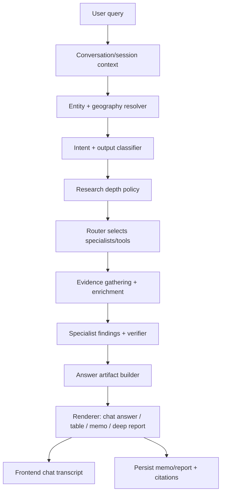
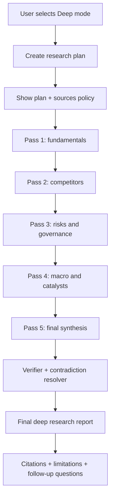
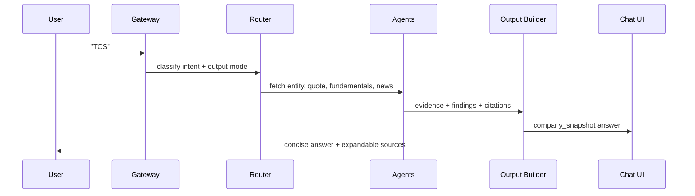

# FinAgent Contextual Output Implementation Plan

Date: 2026-05-15

## Goal

FinAgent should feel like a financial chat model during normal use and like a deep research analyst when deep mode is selected.

That means:

- A short query like `TCS` should return a clean company snapshot, not a long generic memo.
- A comparison query should return a comparison table, key differences, and a short verdict.
- A valuation query should return assumptions, model output, sensitivity, and caveats.
- A DRHP/RHP/prospectus query should return document-driven sections with source-backed change tables.
- Deep mode should behave like a true research workflow: plan, gather, reflect, browse sources, synthesize one final deep report, and expose citations/source trail.

## External Product References

### Gemini / Gemini Deep Research

Useful patterns to adopt:

- Gemini Deep Research uses a planning, searching, reasoning, and reporting workflow, not a single prompt response.
- Google describes Deep Research as decomposing complex tasks into subtasks, searching/browsing, then synthesizing findings into a comprehensive report.
- Gemini Deep Research exposes runtime visibility such as `Show thinking` and `Sites browsed`.
- Gemini Deep Research supports user-requested report structures, for example a technical report with named sections and tables.
- Gemini lets users ask follow-up questions after the report; it may answer from existing research or return to the web.

Sources:

- Google Deep Research overview: https://gemini.google/ml/overview/deep-research/
- Google Deep Research tips: https://blog.google/products-and-platforms/products/gemini/tips-how-to-use-deep-research/
- Gemini API Deep Research docs: https://ai.google.dev/gemini-api/docs/interactions/deep-research

### Claude / Claude Research

Useful patterns to adopt:

- Claude default chat is direct and conversational, while Research mode is reserved for multi-step investigation.
- Claude Research performs multiple searches that build on each other and explores different angles automatically.
- Claude web search responses include citations so users can verify claims.
- Claude API web search citation metadata includes source URL, title, and cited text.
- Claude documentation notes that structured output needs explicit citation instructions, otherwise citations can become weaker.

Sources:

- Claude Research help: https://support.anthropic.com/en/articles/11088861-using-research-on-claude-ai
- Claude web search docs: https://platform.claude.com/docs/en/agents-and-tools/tool-use/web-search-tool
- Claude web search help: https://support.claude.com/en/articles/10684626-enabling-and-using-web-search
- Claude citations docs: https://docs.anthropic.com/en/docs/build-with-claude/citations

## Current Codebase Diagnosis

### 1. Output is memo-first, not chat-first

Current files:

- `finagent/synthesis.py`
- `finagent/output/memo_formatter.py`

Current behavior:

- `synthesize_memo(...)` always thinks in terms of a research memo.
- `_openai_memo(...)` hardcodes a large memo section list.
- `_structured_memo(...)` also emits a fixed section list.
- `format_memo(...)` always starts with `# Research memo: {entity}` and appends metadata, data quality log, and citation log.

Problem:

- This is good for full research reports, but poor for chat-like answers.
- A user asking `TCS` or `What is Infosys PE?` should not receive the same report skeleton as a due diligence request.

### 2. There is no explicit output intent contract

Current files:

- `finagent/router/intent_router.py`
- `finagent/router/domain_taxonomy.py`
- `finagent/synthesis.py`

Current behavior:

- The router selects specialist agents.
- The output layer does not receive a formal answer shape such as `company_snapshot`, `comparison_table`, `valuation_model`, or `deep_report`.

Problem:

- Agent selection and output structure are mixed loosely through prompt wording.
- The final response can look generic even when the correct agents ran.

### 3. Deep mode is multi-pass but not a true final deep report

Current files:

- `finagent/gateway/run.py`
- `finagent/run_agent.py`

Current behavior:

- `/research/deep` runs several full research sessions using the same `master_session`.
- Each pass calls `run_research_session(...)`.
- `run_research_session(...)` synthesizes a memo and calls `BUS.close(session_id)` at the end.

Problem:

- Deep mode can close the stream after the first pass because each pass closes the shared bus.
- Each pass emits its own memo instead of collecting evidence and producing one final deep research report.
- There is no final cross-pass synthesis layer.

### 4. The frontend already has activity visibility, but the final answer is still a memo panel

Current files:

- `finagent/gateway/widget.html`

Current behavior:

- The UI already shows phases, sources, queries, subagents, quality score, findings, and memo streaming.
- It fetches `/sessions/{session_id}/memo` and renders markdown into `memoBody`.

Problem:

- The frontend can show rich runtime activity, but it does not yet support chat turns, answer cards, tables, or follow-up questions against the existing research context.

### 5. Specialist findings are still underused in synthesis

Current files:

- `finagent/run_agent.py`
- `finagent/synthesis.py`
- `finagent/agents/specialists/*`

Current behavior:

- Specialists emit findings during runtime.
- `orchestration_findings` are streamed and verified, but they are not first-class synthesis input.

Problem:

- The final output misses some of the agent intelligence already produced.

## Target Output Model

Create a new output layer that separates:

- what the user asked
- what evidence was gathered
- which specialists contributed
- what answer shape is best
- how much depth the user requested
- how citations should be rendered

### Output Modes

| User query type | Output mode | Expected structure |
|---|---|---|
| `TCS` | `company_snapshot` | Price, business, key metrics, recent news, risks, sources |
| `Compare TCS with Infosys` | `company_comparison` | Summary verdict, comparison table, valuation table, strengths/risks |
| `DCF valuation of TCS` | `valuation_model` | Assumptions, model output, sensitivity, caveats |
| `Latest news on TCS` | `news_brief` | Top stories, why it matters, market impact, sources |
| `Analyze Absolute Projects DRHP` | `filing_analysis` | Business, issue details, risk factors, financials, red flags |
| `Compare DRHP, RHP and prospectus` | `document_version_comparison` | Version table, added/removed disclosures, source URLs |
| `Should I buy TCS?` | `investment_view` | Thesis, valuation, risks, what would change the view |
| Deep mode query | `deep_research_report` | Research plan, methodology, findings, tables, citations, limitations |
| Simple factual query | `direct_answer` | Concise answer, source if current/data-based |

## Proposed Architecture



## New Modules To Add

### 1. `finagent/output/contracts.py`

Purpose:

- Define stable data structures for answers.

Proposed types:

```python
class OutputMode(str, Enum):
    DIRECT_ANSWER = "direct_answer"
    COMPANY_SNAPSHOT = "company_snapshot"
    COMPANY_COMPARISON = "company_comparison"
    VALUATION_MODEL = "valuation_model"
    NEWS_BRIEF = "news_brief"
    FILING_ANALYSIS = "filing_analysis"
    DOCUMENT_VERSION_COMPARISON = "document_version_comparison"
    INVESTMENT_VIEW = "investment_view"
    DEEP_RESEARCH_REPORT = "deep_research_report"

class ResponseDepth(str, Enum):
    CHAT = "chat"
    STANDARD = "standard"
    DEEP = "deep"

@dataclass
class ResponseSection:
    title: str
    body: str
    confidence: str = "MEDIUM"
    citations: list[str] = field(default_factory=list)

@dataclass
class AnswerArtifact:
    mode: OutputMode
    depth: ResponseDepth
    title: str
    summary: str
    sections: list[ResponseSection]
    tables: list[dict]
    citations: list[dict]
    follow_up_suggestions: list[str]
    limitations: list[str]
```

### 2. `finagent/output/intent_classifier.py`

Purpose:

- Determine the final answer structure.

Inputs:

- raw objective
- resolved entity
- selected specialists
- deep mode flag
- evidence availability

Rules:

- If deep mode is selected, return `DEEP_RESEARCH_REPORT`.
- If query has `compare`, `vs`, `versus`, return `COMPANY_COMPARISON`.
- If query has `DCF`, `WACC`, `intrinsic value`, `valuation`, return `VALUATION_MODEL`.
- If query has `DRHP`, `RHP`, `prospectus`, return filing/document modes.
- If query is a bare ticker/company name, return `COMPANY_SNAPSHOT`.
- If query asks a direct factual question, return `DIRECT_ANSWER`.

Later enhancement:

- Add an LLM fallback classifier only when rules are ambiguous.

### 3. `finagent/output/templates.py`

Purpose:

- Provide context-specific section plans.

Example:

```python
COMPANY_SNAPSHOT = [
    "Quick Take",
    "Business",
    "Live Market Snapshot",
    "Key Financials",
    "Recent Developments",
    "Main Risks",
    "Sources",
]

COMPANY_COMPARISON = [
    "Bottom Line",
    "Side-by-Side Comparison",
    "Valuation",
    "Growth and Profitability",
    "Risks",
    "Which Looks Better For What Type Of Investor",
    "Sources",
]
```

### 4. `finagent/output/artifact_builder.py`

Purpose:

- Convert bundle, docs, citations, specialist findings, conflicts, and quality report into `AnswerArtifact`.

This should be deterministic as much as possible:

- Use facts from enrichment.
- Use verified specialist findings.
- Use citations from checkpoint.
- Build tables from structured data.
- Add limitations when evidence is missing.

### 5. `finagent/output/renderer.py`

Purpose:

- Render `AnswerArtifact` into Markdown for the current UI.
- Later, render JSON for richer frontend components.

Render modes:

- `render_chat_markdown(artifact)`
- `render_report_markdown(artifact)`
- `render_deep_report_markdown(artifact)`

## Changes To Existing Files

### `finagent/synthesis.py`

Replace the current memo-only surface with:

```python
async def synthesize_answer(..., output_mode, depth, specialist_findings=None) -> SynthesisResult:
    artifact = build_answer_artifact(...)
    if should_use_llm(artifact):
        return await polish_artifact_with_llm(...)
    return render_artifact(...)
```

Keep `synthesize_memo(...)` as a compatibility wrapper at first.

Important:

- The LLM should polish and explain.
- The artifact builder should own structure, tables, citations, and missing-data disclosure.

### `finagent/run_agent.py`

Add fields to `AgentLoopConfig`:

```python
response_depth: str = "chat"
output_mode: str | None = None
close_bus_on_finish: bool = True
emit_memo: bool = True
return_artifact: bool = False
```

Pass into synthesis:

- `output_mode`
- `response_depth`
- `orchestration_findings`
- `final_quality`
- `entity`
- `routing`

Emit new SSE events:

- `output_plan`
- `answer_section`
- `answer_table`
- `citation`
- `followups`

### `finagent/gateway/run.py`

Update request model:

```python
class StartResearchRequest(BaseModel):
    target: str
    objective: str = ""
    mode: Literal["chat", "standard", "deep"] = "chat"
    output_mode: str | None = None
    conversation_id: str | None = None
```

Standard endpoint behavior:

- Chat mode: short adaptive answer.
- Standard mode: richer structured answer.
- Deep mode: call the deep pipeline.

Deep endpoint behavior:

- Do not call `run_research_session(...)` in a way that closes the master stream after every pass.
- Use `close_bus_on_finish=False` for intermediate passes.
- Suppress per-pass memo synthesis.
- Store pass artifacts/evidence.
- Run one final `deep_research_report` synthesis after all passes.

### `finagent/gateway/widget.html`

Move from a single memo surface to a chat transcript:

- User message bubble.
- Assistant answer bubble.
- Expandable source drawer.
- Tables rendered as tables, not plain markdown only.
- Deep mode progress panel with pass cards.
- Follow-up input should continue against the same `conversation_id`.

Keep the current activity timeline because it is already useful.

### `finagent/output/memo_formatter.py`

Keep this for report rendering, but stop using it for every response.

Add:

- `format_chat_answer(...)`
- `format_structured_answer(...)`
- `format_deep_report(...)`

## Deep Mode Target Workflow



Deep report sections:

1. Executive Summary
2. Research Plan and Scope
3. Company and Business Model
4. Financial Profile
5. Valuation and Sensitivity
6. Competitive Position
7. Risks and Red Flags
8. Macro and Sector Overlay
9. Catalysts and Watchlist
10. Bull Case, Bear Case, Base Case
11. Evidence Quality and Limitations
12. Citations / Works Cited

Deep mode should also include:

- a source coverage table
- a confidence matrix
- a contradiction log
- explicit unanswered questions
- follow-up prompts

## Chat Mode Target Workflow



For `TCS`, expected shape:

```markdown
### TCS Quick Snapshot

Tata Consultancy Services is an Indian IT services company listed on NSE/BSE. The stock is trading at ...

| Metric | Value |
|---|---:|
| Market cap | Rs ... Cr |
| Revenue | Rs ... Cr |
| Net margin | ...% |
| ROE | ...% |

Main watchpoints: demand in BFSI, deal pipeline, margin pressure, rupee movement, and attrition.

Sources: Yahoo Finance, NSE/BSE/company IR, recent news.
```

For `compare TCS with Infosys`, expected shape:

```markdown
### Bottom Line

TCS looks stronger on scale and margin stability, while Infosys may offer ...

| Factor | TCS | Infosys | Edge |
|---|---:|---:|---|
| Revenue growth | ... | ... | ... |
| Net margin | ... | ... | ... |
| ROE | ... | ... | ... |
| Valuation | ... | ... | ... |

### What Would Change The View

...
```

## Implementation Phases

### Phase 1: Output Contracts and Classification

Files:

- add `finagent/output/contracts.py`
- add `finagent/output/intent_classifier.py`
- add `finagent/output/templates.py`
- update `finagent/router/intent_router.py`

Acceptance checks:

- `TCS` maps to `company_snapshot`.
- `compare TCS with Infosys` maps to `company_comparison`.
- `DCF valuation of TCS` maps to `valuation_model`.
- `analyze DRHP` maps to `filing_analysis`.
- Deep mode always maps to `deep_research_report`.

### Phase 2: Artifact Builder

Files:

- add `finagent/output/artifact_builder.py`
- update `finagent/synthesis.py`
- update `finagent/run_agent.py`

Acceptance checks:

- Artifact includes title, summary, sections, tables, citations, limitations, and follow-up suggestions.
- Specialist findings are included in the artifact.
- Missing data is clearly disclosed.

### Phase 3: Markdown Renderer

Files:

- add `finagent/output/renderer.py`
- update `finagent/output/memo_formatter.py`

Acceptance checks:

- Chat answer is concise.
- Standard answer has tables.
- Deep report has a full research structure.
- Citations render consistently.

### Phase 4: Gateway and Frontend Chat Behavior

Files:

- update `finagent/gateway/run.py`
- update `finagent/gateway/widget.html`

Acceptance checks:

- User can ask multiple follow-up questions in one session.
- UI shows each user question and assistant answer as a transcript.
- Sources remain expandable.
- Runtime process panel remains visible.

### Phase 5: Deep Research Refactor

Files:

- update `finagent/gateway/run.py`
- update `finagent/run_agent.py`
- add `finagent/deep_research.py`

Acceptance checks:

- Deep mode does not close stream after the first pass.
- Intermediate passes do not each overwrite the final answer.
- Final report is synthesized once from all pass artifacts.
- UI shows pass progress and then one final report.

### Phase 6: Tests and Regression Cases

Add tests for:

- output mode classifier
- artifact builder
- renderer snapshots
- deep mode stream lifecycle
- `TCS`, `AAPL`, `Infosys`, `compare TCS Infosys`, `DRHP analysis`, `DCF valuation`

Suggested files:

- `finagent/tests/test_output_intent.py`
- `finagent/tests/test_artifact_builder.py`
- `finagent/tests/test_renderer.py`
- `finagent/tests/test_deep_mode_lifecycle.py`

## Recommended Model Strategy

Use one model family through `OPENAI_API_KEY`, but choose model by job:

| Job | Suggested model class | Why |
|---|---|---|
| intent classification | small/fast | deterministic, cheap |
| answer polishing | balanced chat model | good style and reasoning |
| deep synthesis | stronger reasoning model | long context, contradiction handling |
| table/data formatting | small/fast or deterministic code | cheaper and more reliable |

Do not rely on the LLM to invent the response structure. Build the structure in code, then let the LLM polish explanation text.

## Final Target Behavior

The end state should feel like this:

- Normal mode: works like a financial chat assistant.
- Standard mode: gives structured analyst-style answers with tables.
- Deep mode: behaves like Gemini Deep Research for finance, with a visible plan, pass-by-pass progress, source trail, final deep report, citations, limitations, and follow-up handling.

## First Implementation Sprint

Recommended first sprint:

1. Add output contracts and classifier.
2. Add artifact builder for `company_snapshot`, `company_comparison`, and `direct_answer`.
3. Refactor `synthesize_memo(...)` to call the new artifact builder while keeping old memo fallback.
4. Add `output_plan` SSE event.
5. Update widget to render chat answer plus tables.
6. Fix deep mode stream closing by adding `close_bus_on_finish=False`.

This first sprint gives the largest visible improvement without rewriting the whole agent.
