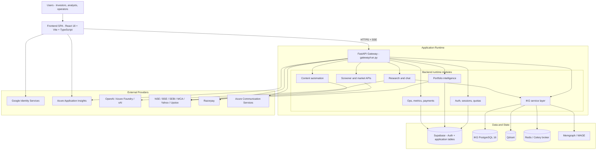
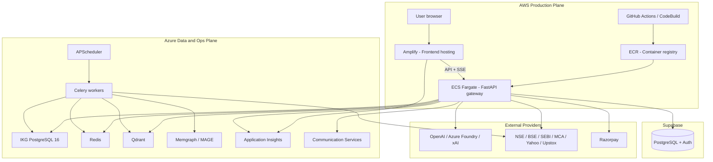
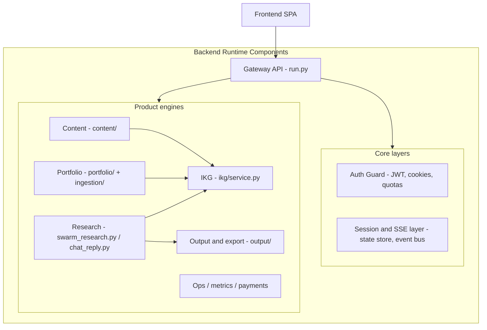
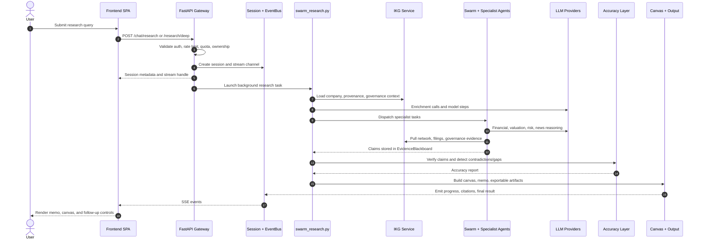
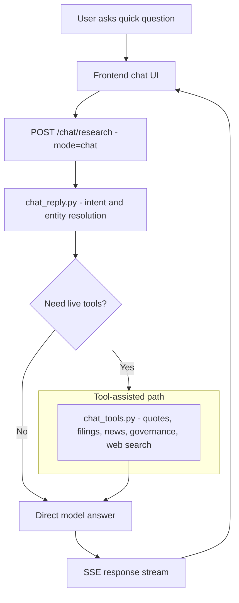
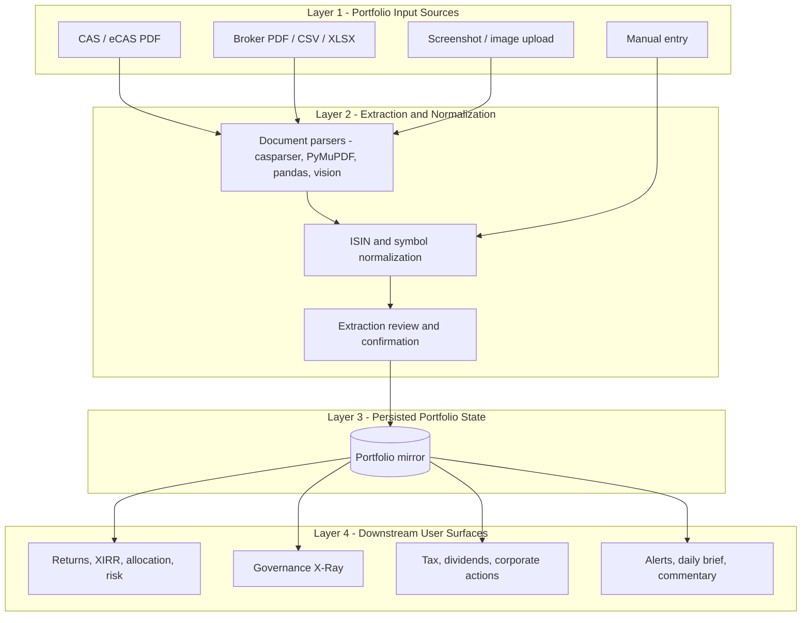
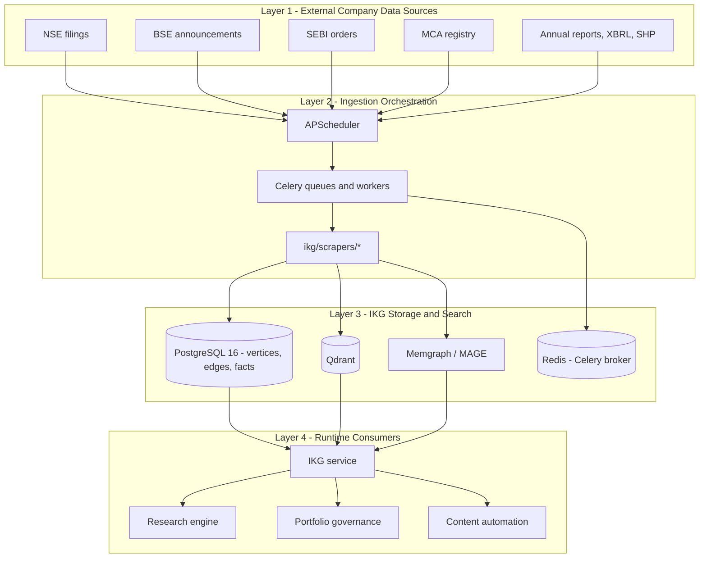
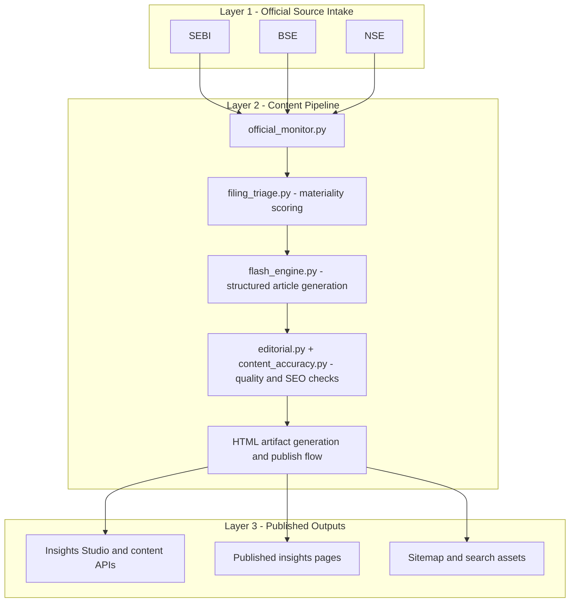
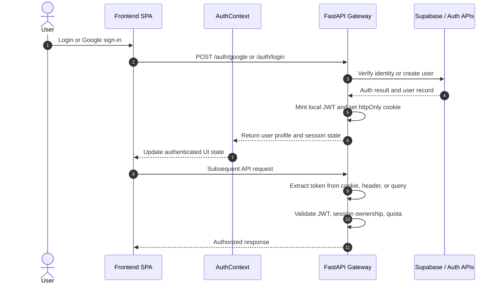
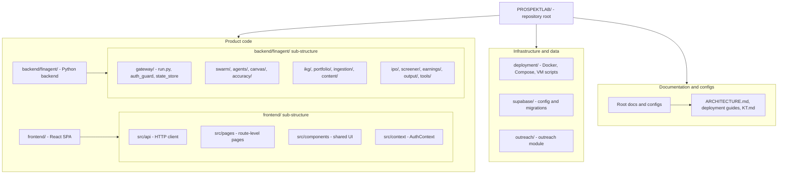

# ProspektLab Knowledge Transfer

## Table of Contents

1. [Executive Summary](#1-executive-summary)
2. [System Architecture and Workflow](#2-system-architecture-and-workflow)
3. [Technology Stack](#3-technology-stack)
4. [Repository Structure](#4-repository-structure)

## 1. Executive Summary

ProspektLab is a financial intelligence platform focused on Indian capital markets. It is not a single-purpose application. The codebase combines a research assistant, a portfolio intelligence workspace, a corporate knowledge graph, a market screener, an IPO intelligence surface, content publishing automation, and operating tools for platform administration.

At the product level, the application is designed to help users do four kinds of work from one place:

- Ask finance questions and receive structured, citation-backed research.
- Upload or maintain a portfolio and get analytics, governance overlays, tax summaries, alerts, and commentary.
- Explore companies through screener, governance, and company-intelligence workflows.
- Turn filings, regulatory updates, and market events into publishable research content.

The system is built as a multi-surface web application:

- The frontend is a React 18 + Vite + TypeScript single-page application.
- The main backend is a FastAPI gateway that owns the full HTTP API surface.
- User identity, subscription, and operational tables live in Supabase PostgreSQL.
- The corporate intelligence layer is powered by a separate Intelligent Knowledge Graph (IKG) stack running on PostgreSQL, Redis, Qdrant, Celery, and scheduled scrapers.
- AI workflows are integrated throughout the platform for research, synthesis, extraction, scoring, and commentary.

### Product Surfaces

The application currently exposes several major product surfaces.

#### Research and Chat

The research stack supports multiple modes rather than a single chat endpoint:

- Standard research for structured, citation-backed memos.
- Deep research for larger multi-pass workflows with higher budget and more analysis depth.
- Interactive research canvas support for progressive output and user steering.

This is implemented through the main FastAPI gateway, the `swarm_research.py` orchestration path, the `chat_reply.py` lightweight response path, and the supporting swarm, accuracy, output, and canvas subsystems.

#### Portfolio Intelligence

The portfolio surface is a core product area, not an add-on. Users can:

- Upload CAS and other broker documents.
- Upload screenshots for vision-based extraction.
- Enter holdings manually.
- Maintain a portfolio mirror.
- View returns, risk, concentration, factor-like metrics, governance overlays, dividends, tax summaries, corporate actions, alerts, and daily commentary.

This makes the platform usable as a day-to-day investing workspace, not just as a research tool.

#### Intelligent Knowledge Graph (IKG)

The IKG is one of the most important proprietary assets in the system. It consolidates data from sources such as NSE, BSE, SEBI, MCA, annual reports, XBRL filings, and shareholding disclosures. It supports:

- Company provenance and evidence-backed facts.
- Governance scoring.
- Director network analysis.
- Data freshness and graph health checks.
- Downstream consumption by research agents, portfolio governance overlays, and content workflows.

The live architecture uses PostgreSQL as the graph system of record with adjacency-list style tables such as `ikg_vertices` and `ikg_edges`, plus staging and fact tables. Qdrant adds vector search, and Memgraph/MAGE is available for graph algorithms.

#### Screener, IPO, Earnings, and Company Intelligence

The application includes additional domain-specific product areas:

- Screener for company discovery, snapshot, financials, technicals, and event views.
- IPO intelligence for DRHP/RHP parsing, tracking, scoring, and post-listing workflows.
- Earnings surfaces and related backend APIs.
- Company governance and network endpoints backed by IKG.

These modules are important because they extend the platform from a single workflow into an operating system for equity research and portfolio analysis.

#### Content Automation

The system includes a large publishing pipeline that monitors official sources, triages filings, generates structured articles, performs editorial checks, and publishes HTML output. This means the codebase serves both internal user workflows and outward-facing publishing use cases.

### Business and Technical Positioning

From a business perspective, ProspektLab sits at the intersection of:

- Financial research tooling.
- Portfolio intelligence.
- Governance and forensic analysis.
- Market data workflows.
- Automated financial content generation.

From a technical perspective, it is a multi-cloud system:

- AWS hosts the main customer-facing application surfaces.
- Azure supports monitoring and the IKG worker stack.
- Supabase handles identity and application data.
- External providers supply market data, LLM capability, payments, and communication services.

This architecture reflects a pragmatic split of responsibilities rather than a single-cloud design. The codebase has evolved into a large operational platform, so a good mental model is:

> ProspektLab is a finance workflow platform with a shared API gateway, shared identity layer, shared telemetry, and several deeply integrated product engines behind it.


### What Matters Most for Knowledge Transfer

For KT purposes, the most important system truths are:

- `frontend/` is the main UI surface used to access the platform.
- `backend/finagent/gateway/run.py` is the central runtime gateway and the first backend file most engineers need to understand.
- `backend/finagent/swarm_research.py` and related swarm modules power the newer research path.
- `backend/finagent/ikg/` is the heart of the proprietary company intelligence stack.
- `backend/finagent/portfolio/` is the heart of the portfolio analytics and governance user experience.
- `backend/finagent/content/` and `content_automation.py` drive a major automation and publishing surface.
- `deployment/` and `supabase/` define how the system is actually operated, not just how it is coded.

If you understands those seven points, you will be able to orient themselves quickly in the rest of the codebase.

## 2. System Architecture and Workflow

### High-Level Architecture

At a high level, ProspektLab is a browser-based SPA talking to a central FastAPI gateway, which then fans out into internal modules, databases, AI providers, and external data sources.

#### System Context Diagram



### Cloud and Runtime Topology

The live system is distributed across multiple platforms.

#### Deployment Diagram



| Layer | Platform | Purpose |
| --- | --- | --- |
| Frontend hosting | AWS Amplify | Serves the React SPA |
| Main backend API | AWS ECS Fargate | Runs FastAPI gateway and API logic |
| Container registry and build pipeline | AWS ECR / CodeBuild / GitHub Actions | Builds and deploys backend images |
| Identity and app database | Supabase | Auth, user profiles, subscription and operational tables |
| IKG worker stack | Azure VMs | Runs PostgreSQL, Redis, Qdrant, Celery, scheduler |
| Monitoring | Azure Application Insights | Frontend and backend telemetry |
| Messaging | Azure Communication Services | Email and SMS delivery |

This topology matters because debugging often crosses cloud boundaries. A failure in a single user workflow may involve Amplify, ECS, Supabase, Azure telemetry, and one or more external providers.

### Application Component Diagram



### Core Runtime Components

#### 1. Frontend SPA

The frontend under `frontend/` is the main user interface. It is responsible for:

- Routing and page composition.
- Auth state handling and onboarding state.
- Calling backend APIs through `src/api/client.ts`.
- Streaming and rendering long-running research sessions.
- Displaying dashboard, portfolio, screener, IPO, and content experiences.
- Emitting frontend telemetry.

Important frontend entry files:

- `frontend/src/main.tsx`
- `frontend/src/App.tsx`
- `frontend/src/context/AuthContext.tsx`
- `frontend/src/api/client.ts`
- `frontend/src/pages/*`

#### 2. FastAPI Gateway

The gateway in `backend/finagent/gateway/run.py` is the central application server. It is the single most important backend file in the repository because it:

- Creates the FastAPI app.
- Defines the route surface.
- Wires authentication, rate limits, background tasks, and session handling.
- Exposes research, portfolio, market, screener, company intelligence, content, payments, and ops endpoints.
- Streams events over SSE for long-running tasks.

In practical terms, the gateway is both an API facade and a product orchestrator.

#### 3. Research Engine

The research engine is split across multiple layers:

- `swarm_research.py` for the newer orchestrated research path.
- `swarm/` for blackboard, orchestrator, models, supervisor, runner, and skill dispatch.
- `agents/` for specialist agents.
- `accuracy/layer.py` for source verification and contradiction detection.
- `canvas/` for interactive research state.
- `output/` for synthesis, formatting, export, and reporting.
- `chat_reply.py` and `chat_tools.py` for lightweight conversational mode.

This architecture allows different response modes while reusing common context, tooling, and session infrastructure.

#### 4. Portfolio Engine

The portfolio engine covers ingestion, storage, analytics, and overlays. It includes:

- Upload and extraction flows.
- Position mirror management.
- Portfolio analytics and commentary.
- Governance overlays using IKG.
- Risk, tax, corporate actions, dividends, and alert workflows.

It is implemented mainly in `backend/finagent/portfolio/`, `backend/finagent/ingestion/`, and portfolio-related gateway routes.

#### 5. IKG Service Layer

The IKG subsystem exists as both a runtime service and a data platform:

- Runtime service files such as `ikg/service.py`, `graph_client.py`, and `governance_score.py` serve user-facing requests.
- The pipeline under `ikg/pipeline/` and `ikg/scrapers/` continuously ingests and refreshes corporate intelligence data.
- The output feeds research, governance, portfolio, and company intelligence workflows.

#### 6. Content Automation Layer

The content system watches official sources, identifies high-signal events, generates structured articles, runs editorial checks, and publishes output. The main code lives in:

- `backend/finagent/content/`
- `backend/finagent/content_automation.py`

This is an important architectural point: the platform is both a user application and a content production system.

### Key End-to-End Workflows

### Workflow A: Standard and Deep Research

This is the most important interactive workflow in the application.



Detailed sequence:

1. The user asks a company or market question from the UI.
2. The frontend sends the request to a research endpoint.
3. The gateway validates auth state, quotas, rate limits, and ownership context.
4. A session record is created and an event stream is opened.
5. `swarm_research.py` launches a multi-phase workflow.
6. The enrichment phase gathers structured inputs such as quote data, filings, news, and IKG bundle information.
7. The swarm layer dispatches specialist agents like financials, valuation, governance, risk, macro, and news.
8. Agent outputs land in an `EvidenceBlackboard`.
9. The accuracy layer checks source coverage, contradiction risk, and thin evidence areas.
10. The synthesis layer builds the final research result, including memo and canvas structures.
11. The frontend receives progress and result events over SSE.
12. The user can request follow-up work through canvas steering.

This workflow is central because it ties together UI, session state, AI providers, IKG, output rendering, and quota logic.

### Workflow B: Conversational Chat

Chat mode is intentionally lighter than the full research workflow.



Key differences from deep research:

- Faster and more direct.
- Less report structure.
- No full memo scaffolding.
- Uses targeted tools instead of the full swarm pipeline where possible.

### Workflow C: Portfolio Onboarding and Analytics

This workflow turns raw investor data into a normalized portfolio workspace.



Detailed sequence:

1. The user enters holdings manually or uploads a source file.
2. The ingestion layer selects an extraction path based on document type.
3. Parsers such as CAS extraction, PDF parsing, spreadsheets, or vision are used.
4. Holdings are normalized to market identifiers.
5. The user confirms extracted positions.
6. The portfolio mirror is updated.
7. Downstream analytics endpoints compute value, return, risk, sector exposure, governance overlays, tax summaries, dividend history, and alerts.

This workflow is important because it combines file ingestion, AI extraction, structured validation, portfolio persistence, and downstream analytical APIs.

### Workflow D: IKG Pipeline Refresh

The IKG pipeline is the main background data platform workflow.



This workflow gives the product fresh company intelligence without manual intervention. It is what makes governance, provenance, and research context credible over time.

### Workflow E: Content Automation and Publishing

The content workflow transforms official filings and market events into publishable research content.



Detailed sequence:

1. Scheduled monitors scan official data sources.
2. New events are triaged for importance.
3. High-signal events enter article generation.
4. Generated output is reviewed by editorial and accuracy components.
5. Approved output is published as HTML and becomes available in public or semi-public surfaces.

### Cross-Cutting System Concerns

Several concerns show up in almost every workflow.

#### Authentication and Session Ownership

The platform supports multiple auth flows and validates identity through JWTs, cookies, or bearer tokens. Session ownership checks matter especially for research sessions, exports, and portfolio operations.



#### Rate Limiting and Quotas

High-cost flows like research and auth are rate limited. Token usage and deep research quotas are plan-aware.

#### Telemetry

Frontend and backend telemetry are both active. This matters for debugging because issues often need to be traced across UI routes, API requests, and downstream dependency calls.

#### SSE Streaming

Research and chat workflows stream progress and result events to the UI, so request handling is not purely request/response. Any engineer touching these flows needs to think in terms of long-running session state rather than only synchronous endpoints.

#### Provider Fallbacks

LLM execution uses provider resolution and fallbacks. That means behavior, cost, and latency can vary by path and provider availability.

## 3. Technology Stack

### Backend Stack

| Area | Technology | Role in System |
| --- | --- | --- |
| Language | Python 3.11 | Main backend language |
| Web framework | FastAPI | Main API and app gateway |
| ASGI server | Uvicorn | Runtime server for FastAPI |
| Validation | Pydantic | Request/response and settings validation |
| Auth | PyJWT | JWT creation and verification |
| HTTP clients | httpx, aiohttp | External API and scraper requests |
| Database client | psycopg | PostgreSQL access |
| Scheduler | APScheduler | Timed background jobs |
| Queue/workers | Celery + Redis | Background pipeline execution |
| Finance/data | pandas, numpy, yfinance, openpyxl | Analytics and ingestion support |
| Document parsing | pypdf, PyMuPDF, docling, msoffcrypto-tool, Azure Document Intelligence | PDF/document extraction |
| Browser automation/scraping | patchright, playwright-stealth, crawl4ai | Scraping and dynamic page access |
| Vector search | Qdrant | Semantic retrieval over documents |
| Graph processing | PostgreSQL adjacency-list model, Memgraph/MAGE | Company graph and graph algorithms |
| MCP | fastmcp | Tool server support for model/tool workflows |
| Testing | pytest | Test execution |

### AI and Model Stack

| Area | Technology | Usage |
| --- | --- | --- |
| Primary LLM provider | OpenAI SDK | Main reasoning, synthesis, and generation workloads |
| Fallback LLM provider | Azure AI Foundry | Runtime fallback for resilience |
| Additional fallback | xAI Grok | Alternate provider path |
| Embeddings | OpenAI text-embedding models | Vectorization for retrieval/search |
| Vision extraction | GPT-4o style vision path | Screenshot and image-based extraction |

### Frontend Stack

| Area | Technology | Role in System |
| --- | --- | --- |
| Language | TypeScript 5.x | Main frontend language |
| UI framework | React 18 | Component and page rendering |
| Build tool | Vite 5.x | Dev server and production builds |
| Routing | React Router DOM | SPA routing |
| Charts | Chart.js, react-chartjs-2, chartjs-chart-treemap | Visual analytics and dashboard charts |
| Icons | lucide-react | UI iconography |
| Payments integration | Razorpay Checkout | Client-side checkout flow |
| Auth integration | Google Identity Services | Social login flow |
| Telemetry | Azure Application Insights | Page and event tracking |

### Data and Persistence Stack

| Area | Technology | Role in System |
| --- | --- | --- |
| User and app database | Supabase PostgreSQL | Profiles, auth-linked tables, payments, outreach, exports |
| Graph system of record | PostgreSQL 16 | IKG vertices, edges, facts, and corp data |
| In-memory/cache | Redis | Celery broker and optional caching |
| Vector search | Qdrant | Embedding search over documents |
| Local/session state | SQLite and local files | Lightweight operational state in some flows |
| Logs/artifacts | JSONL, cache directories, generated HTML | Audit logs, pipeline logs, published artifacts |

### Cloud and Infrastructure Stack

| Area | Technology | Role in System |
| --- | --- | --- |
| Frontend hosting | AWS Amplify | SPA hosting |
| Backend compute | AWS ECS Fargate | Containerized API runtime |
| Container registry | AWS ECR | Image registry |
| CI/CD | GitHub Actions, AWS CodeBuild | Build and deployment workflows |
| Worker infrastructure | Azure VMs with Docker Compose | IKG and pipeline services |
| Monitoring | Azure Application Insights / Azure Monitor | Observability |
| Messaging | Azure Communication Services | Email and SMS delivery |

### External Integrations

| Integration | Usage |
| --- | --- |
| NSE, BSE, SEBI, MCA | Core data ingestion for company intelligence and content |
| Yahoo Finance | Quotes, history, and market data enrichment |
| Upstox | Real-time market feed workflows |
| Google Identity Services | Frontend auth flow |
| Razorpay | Subscription and payment handling |
| Azure Document Intelligence | Structured document extraction |

### Runtime Characteristics Worth Knowing

The stack is best understood as a layered operating environment rather than just a web app stack:

- The frontend is stateful and dashboard-heavy.
- The backend includes both synchronous APIs and long-running streaming workflows.
- The IKG layer behaves like an internal data platform.
- AI is a first-class runtime dependency, not a side utility.
- The codebase has both user-facing and operator-facing functions.

## 4. Repository Structure

### Root-Level Structure

The repository root contains product code, deployment assets, scripts, data, documentation, and operational artifacts.

```text
PROSPEKTLAB/
|-- backend/ # Main Python backend package and services
|-- frontend/ # Main React + Vite frontend application
|-- deployment/ # Infra files, docker-compose, VM scripts, SQL/bootstrap assets
|-- supabase/ # Supabase config and SQL migrations
|-- outreach/ # Outreach/email workflow module
|-- scripts/ # Utility and automation scripts
|-- data/ # Static/source data files
|-- pipeline_logs/ # Pipeline execution logs
|-- audit_logs/ # Audit trail files
|-- cache/ # Local caches and generated intermediates
|-- Dockerfile # Main backend image definition
|-- pyproject.toml # Python project metadata and dependencies
|-- uv.lock # Python dependency lock file
|-- package.json # Root-level Node tooling
|-- buildspec.yml # AWS build pipeline spec
|-- buildspec-prod.yml # Production build pipeline spec
|-- task-def.json # ECS task definition
|-- ARCHITECTURE.md # Primary architecture documentation
|-- SCREENER_ARCHITECTURE.md # Screener-specific architecture note
|-- WATCHLIST_ARCHITECTURE.md # Watchlist-specific architecture note
|-- IGS_IMPLEMENTATION_PLAN.md # Governance/IGS planning document
|-- DEPLOYMENT_GUIDE.md # Deployment guidance
|-- KT.md # This knowledge transfer document
```

### Repository Map Diagram



### How to Read the Repository

For a new engineer, the repository is easiest to understand in this order:

1. `frontend/` for the main user-facing experience.
2. `backend/finagent/gateway/run.py` for the full API and app surface.
3. `backend/finagent/swarm_research.py` and `backend/finagent/swarm/` for research orchestration.
4. `backend/finagent/portfolio/` for user-facing investment workflows.
5. `backend/finagent/ikg/` for the proprietary intelligence layer.
6. `backend/finagent/content/` for publishing automation.
7. `deployment/` and `supabase/` for operational reality.

### Backend Structure

The backend lives under `backend/finagent/` and contains the primary business logic of the platform.

```text
backend/finagent/
|-- gateway/ # Main FastAPI gateway, auth guard, delivery, state store
|-- swarm/ # Swarm orchestration primitives and blackboard model
|-- agents/ # Specialist agents and orchestration helpers
|-- canvas/ # Interactive research canvas state and control
|-- accuracy/ # Post-agent verification and contradiction handling
|-- ikg/ # Intelligent Knowledge Graph service, schema, pipeline, scrapers
|-- portfolio/ # Portfolio analytics, risk, tax, commentary, governance overlay
|-- ingestion/ # Portfolio and document ingestion logic
|-- content/ # Content automation, monitoring, editorial workflow
|-- ipo/ # IPO intelligence and analysis services
|-- screener/ # Screener and company analysis support
|-- earnings/ # Earnings-related logic and API support
|-- output/ # Memo/export/rendering/report generation
|-- tools/ # Tool ecosystem, market/web/social adapters, MCP tooling
|-- memory/ # Session and memory features
|-- retrieval/ # Retrieval and RAG-related logic
|-- news/ # News aggregation and support logic
|-- ops/ # Control tower and operational reporting
|-- router/ # Intent and routing logic
|-- prompts/ # System prompts and prompt assets
|-- chat_reply.py # Lightweight conversational mode
|-- chat_tools.py # Finance tool definitions for chat mode
|-- swarm_research.py # Main modern research orchestrator
|-- run_agent.py # Legacy research path
|-- runtime_provider.py # LLM provider resolution and fallback behavior
|-- telemetry.py # Application telemetry integration
|-- api.py # Standalone chat API surface
|-- settings.py # Central backend settings and environment handling
```

### Backend Subsystem Notes

#### `gateway/`

This folder contains the most operationally important backend files.

- `run.py`: main FastAPI app and route definitions.
- `auth_guard.py`: auth verification, token handling, rate limiting.
- `supabase_client.py`: interaction with Supabase APIs.
- `state_store.py`: token/session-related persistence helpers.
- `email_delivery.py` and `sms_delivery.py`: messaging delivery through Azure Communication Services.

#### `agents/` and `swarm/`

These folders together represent the research brain of the system.

- `agents/` contains specialist logic and orchestration helpers.
- `swarm/` contains the runtime orchestration primitives used to coordinate dynamic sub-work.

The specialist agent set includes accounting, community, competitor, financials, governance, macro, news, risk, technical, and valuation.

#### `ikg/`

This folder is the data intelligence core of the platform.

- Runtime-facing files expose governance, provenance, and network information.
- `pipeline/` handles scheduling, orchestration, and run tracking.
- `scrapers/` contains the ingestion fleet for multiple Indian market and regulatory sources.

#### `portfolio/`

This folder is the investor workspace engine.

Representative modules include:

- `analytics.py`
- `stress_test.py`
- `tax.py`
- `dividends.py`
- `corporate_actions.py`
- `governance_xray.py`
- `commentary.py`
- `mf_analytics.py`

#### `content/`

This folder powers the publishing system.

Representative modules include:

- `flash_engine.py`
- `official_monitor.py`
- `filing_triage.py`
- `editorial.py`
- `content_accuracy.py`

### Frontend Structure

The main frontend lives under `frontend/`.

```text
frontend/
|-- public/ # Runtime config and published public assets
|-- src/
| |-- api/ # Central API client for backend communication
| |-- components/ # Shared UI components by domain
| |-- context/ # React context providers such as AuthContext
| |-- data/ # Static UI-side data sets
| |-- pages/ # Route-level pages
| |-- utils/ # UI utility helpers
| |-- App.tsx # Route definitions and app shell composition
| |-- main.tsx # Frontend bootstrap entry point
| |-- telemetry.ts # Frontend telemetry integration
|-- package.json # Frontend dependencies and scripts
|-- vite.config.mjs # Vite configuration
|-- amplify.yml # Amplify build config
```

### Frontend Subsystem Notes

#### `src/api/client.ts`

This is the single most important frontend integration file. It contains the HTTP functions used throughout the UI for auth, research, sessions, portfolio, screener, content, and other backend interactions.

#### `src/context/AuthContext.tsx`

This file manages application auth state, user state, onboarding status, and related session/UI behaviors.

#### `src/pages/`

This folder contains route-level pages such as:

- `LandingPage.tsx`
- `GatewayPage.tsx`
- `Dashboard.tsx`
- `DashboardOverviewPage.tsx`
- `DashboardPortfolioPage.tsx`
- `DashboardScreenerPage.tsx`
- `InsightsStudio.tsx`
- IPO and other product pages

These pages define the main user experience layers.

### Deployment and Data Structure

#### `deployment/`

This folder contains infrastructure and operational assets, including:

- Dockerfiles for worker/runtime images.
- Docker Compose files for IKG deployment.
- Azure VM scripts.
- SQL/bootstrap files.
- Infrastructure definitions such as Bicep or service configuration.

This directory matters because it describes how the code is actually run outside local development.

#### `supabase/`

This folder contains:

- `config.toml`
- SQL migrations for profiles, payments, outreach, export, scraping, and other operational tables.

This is the source of truth for app-level database schema evolution.

#### `outreach/`

This folder contains a more standalone operational module for outreach-related workflows, templates, and support scripts.

### Important Documents at the Root

Several root-level markdown files are important for future KT work:

- `ARCHITECTURE.md`: full architecture reference.
- `SCREENER_ARCHITECTURE.md`: screener-specific details.
- `WATCHLIST_ARCHITECTURE.md`: watchlist-specific details.
- `IGS_IMPLEMENTATION_PLAN.md`: roadmap for the governance intelligence model.
- `DEPLOYMENT_GUIDE.md` and `README-DEPLOYMENT.md`: deployment guidance.
- `PORTFOLIO_ANALYTICS_UPGRADE.md`: future portfolio roadmap context.

### Practical Reading Order for a New Developer

If someone joins the project and needs fast orientation, the most useful file reading order is:

1. `KT.md`
2. `ARCHITECTURE.md`
3. `frontend/src/App.tsx`
4. `frontend/src/api/client.ts`
5. `backend/finagent/gateway/run.py`
6. `backend/finagent/swarm_research.py`
7. `backend/finagent/ikg/service.py`
8. `backend/finagent/portfolio/analytics.py`
9. `backend/finagent/content/flash_engine.py`
10. `deployment/docker-compose.ikg.yml`

This reading order gives a new engineer a good top-down understanding before they go deep into individual modules.
