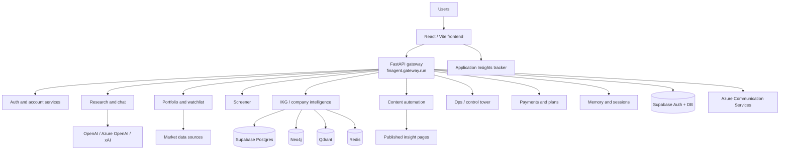

# ProspektLab Architecture, Features, and Azure Tracker Stats

ProspektLab is a multi-surface financial intelligence platform that combines a React/TypeScript front-end, a large FastAPI-based Python backend, a multi-agent research engine, an Indian corporate knowledge graph pipeline, portfolio analytics, and content automation/publishing workflows.

This document reflects the current workspace state and live Azure telemetry pulled on 2026-06-19.

## 1. System Overview



At a high level:

- The root `frontend/` app is the production React/Vite build path.
- `backend/finagent/gateway/run.py` is the main FastAPI gateway and contains the largest route surface.
- `backend/finagent/api.py` provides a smaller chat-only API for standalone use.
- `backend/finagent/ikg/` and `backend/finagent/ikg/pipeline/` run the corporate knowledge graph and ingestion jobs.
- `backend/finagent/content/` and `backend/finagent/content_automation.py` handle article generation, review, and publish gating.
- `frontend/public/insights/` and `frontend/dist-sandbox/` contain generated article pages and preview artifacts.

## 2. Frontend Architecture

### 2.1 Production Frontend

The root front-end package lives under [`frontend/`](D:/PROSPEKTLAB/frontend) and is built with React 18, TypeScript, and Vite. The production HTML entry loads:

- `/src/main.tsx`
- `/src/App.tsx`
- `/env-config.js` injected at build time

The build is configured to emit root-level assets so Amplify can serve the SPA without depending on a separate `/assets/` folder.

Key front-end behaviors:

- Route-based telemetry is sent on every location change.
- Legacy hash routes are normalized so older deep links still resolve.
- Bootstrap tokens can be hydrated from URL parameters for local and ops flows.
- The UI uses a dark glassmorphism financial-terminal visual language.

### 2.2 Frontend Routes

The main route map in [`frontend/src/App.tsx`](D:/PROSPEKTLAB/frontend/src/App.tsx) includes:

- Marketing pages: `/`, `/pricing`, `/testimonials`, `/features`, `/contact`
- Authentication: `/login`, `/signup`
- Onboarding: `/onboarding`
- Main workspace: `/dashboard`
- Operations: `/ops`

The page-view telemetry captured from Azure confirms those routes are actively used, with `/signup` currently the most visited route in the tracker window.

### 2.3 Dashboard Experience

The main workspace in [`frontend/src/pages/Dashboard.tsx`](D:/PROSPEKTLAB/frontend/src/pages/Dashboard.tsx) is organized into feature tabs defined in [`frontend/src/components/layout/FeatureTabs.tsx`](D:/PROSPEKTLAB/frontend/src/components/layout/FeatureTabs.tsx):

- Overview
- Portfolio
- Watchlist
- Screener
- Earnings
- Governance

The dashboard pulls together:

- Market tickers and quote strips
- Portfolio tables and allocation views
- Watchlist workspaces
- Screener workspace
- Research chat and streaming agent responses
- Export panels for memo/artifact output

### 2.4 Landing, Onboarding, and Power-User UI

The landing page is not static marketing copy. It personalizes the hero area using:

- Referrer source
- Visit count
- Market open/close timing
- Time of day

The onboarding flow in [`frontend/src/pages/GatewayPage.tsx`](D:/PROSPEKTLAB/frontend/src/pages/GatewayPage.tsx) lets users choose between:

- Manual portfolio entry
- File upload
- Investing style profile

The front-end also includes a command palette, article reader, draft review drawer, and a rich insights studio for publishing workflows.

### 2.5 Secondary Frontend Surface

The repo also contains a smaller `frontend/app/` surface with its own `HashRouter`, dashboard pages, and command palette. The production build path in this workspace is the root `frontend/` package, so I treat `frontend/app/` as a secondary UI surface unless deployment config says otherwise.
## 3. Backend Architecture

### 3.1 Gateway

[`backend/finagent/gateway/run.py`](D:/PROSPEKTLAB/backend/finagent/gateway/run.py) is the central application server. It contains 128 `@app` declarations and covers the entire product surface:

- Auth
- Research
- Market data
- Portfolio
- Screener
- IKG
- Memory
- Content automation
- Ops
- Payments
- Outreach
- Page rendering

The gateway also implements:

- Middleware for request handling and telemetry
- Custom exception handlers
- Rate limiting for auth and research flows
- SSE/streaming endpoints for long-running research sessions
- Static page routes for the marketing app and published insights pages

[`backend/finagent/api.py`](D:/PROSPEKTLAB/backend/finagent/api.py) exposes the chat-only API with `/api/chat`, `/api/chat/stream`, and `/api/health/mcp`.

### 3.2 Core Route Groups

| Domain | Representative Routes | Purpose |
|---|---|---|
| Auth | `/auth/google`, `/auth/login`, `/auth/signup`, `/auth/logout`, `/auth/me`, `/auth/forgot-password`, `/auth/reset-password`, `/auth/send-verification` | Google auth, JWT session management, recovery, profile sync |
| Payments | `/api/create-order`, `/api/verify-payment`, `/user/subscription`, `/user/upgrade-plan` | Razorpay checkout and plan/quota tracking |
| Market | `/market/history`, `/market/quotes`, `/market/news`, `/market/indices`, `/public/market/ticker` | Live market data and ticker feeds |
| Research | `/research/start`, `/research/deep`, `/chat/research`, `/sessions/{id}/stream`, `/sessions/{id}/result`, `/research/export` | Long-form research sessions and exports |
| Portfolio | `/portfolio/mirror`, `/api/portfolio/upload-cas`, `/api/portfolio/upload-document`, `/api/portfolio/upload-screenshot`, `/portfolio/analytics`, `/portfolio/governance`, `/portfolio/news`, `/portfolio/tax-summary`, `/portfolio/stress-test` | Portfolio import, analysis, governance, and risk tools |
| Screener | `/screener/search`, `/screener/company/{identifier}/snapshot`, `/financials`, `/technicals`, `/events`, `/analyze`, `/screener/query` | Company discovery and analysis |
| IKG | `/company/{cin}/governance`, `/network`, `/provenance`, `/health`, `/staleness`, `/admin/ikg/health`, `/filings/triage` | Corporate intelligence and data freshness |
| Memory | `/memory/stats`, `/memory/facts`, `/memory/sessions`, `/memory/clear/{target}` | Cross-session memory and fact store |
| Content | `/api/content/articles`, `/api/content/articles/{slug}`, `/api/content/articles/generate`, `/api/content/flash/generate`, `/api/content/automation/status`, `/api/content/automation/run-now`, `/insights/{slug}` | Article generation, review, publish, and rendered insight pages |
| Ops | `/ops`, `/ops/control-tower`, `/api/ops/control-tower`, `/metrics/snapshot` | Control tower and operational visibility |
| Outreach | `/api/outreach/unsubscribe` | Public unsubscribe workflow |

### 3.3 Supporting Backend Modules

Important backend subsystems include:

- `agents/` for specialist multi-agent orchestration
- `router/` for intent, geography, and tool selection
- `retrieval/` for sparse, dense, fusion, HYDE, and reranking
- `research_planner.py`, `run_agent.py`, `synthesis.py`, `prompt_builder.py`, `rich_builder.py`
- `ikg/` for company provenance, board network, governance scoring, graph health, and staleness
- `content/` for editorial gating and flash publishing
- `portfolio/` for analytics, alerts, dividends, corporate actions, tax, commentary, and stress testing
- `ingestion/` for PDF, CAS, screenshot, image, and document parsing
- `output/` for memo formatting, compliance, charts, report export, and PPTX generation
- `tools/` for web scraping, browser automation, data adapters, social signals, and MCP servers
- `harness/` for preflight, human gates, error recovery, and footprint enforcement
- `state/` for session context, compression, checkpoints, and citation logs
- `learning/` and `swarm/` for newer orchestration and reflexion flows
- `ops/` for control tower metrics and warehouse logic

## 4. Product Features

### 4.1 Research and Chat

The platform is designed as a financial research OS rather than a single chat box. It supports:

- Standard and deep research sessions
- Streaming agent events
- Session replay and result retrieval
- Memo synthesis and artifact export
- Multi-agent review with blind-spot detection and verification

The specialized research stack includes 10 domain agents:

- Accounting
- Community
- Competitor
- Financials
- Governance
- Macro
- News
- Risk
- Technical
- Valuation

### 4.2 Portfolio Intelligence

Portfolio features cover:

- Holdings import from CAS, documents, and screenshots
- Manual entry for quick setup
- Portfolio mirror management
- Allocation and analytics views
- Watchlists
- Holding-specific news
- Sector breakdowns
- Corporate actions
- Alerts
- Tax summary
- Dividend tracking
- Stress testing
- Mutual fund analytics
- Daily brief and commentary views

### 4.3 Screener

The screener module supports:

- Search by company or identifier
- Company snapshot views
- Financials
- Technicals
- Events
- Analysis runs
- Structured screener queries

### 4.4 Content Studio

The content system is one of the biggest product surfaces in the repo. It supports:

- Automated article generation
- Batch generation
- Flash generation for fast market-moving stories
- Editorial review and draft inspection
- Publish and unpublish flows
- Automation status and run-now controls
- Official-monitor and filing-triage workflows
- Published insight pages under `/insights/...`

### 4.5 Governance and IKG

The IKG surface provides:

- Company governance summaries
- Director network analysis
- Provenance-backed company facts
- Data freshness/staleness checks
- Graph health reporting
- Integrity audit support
- Board and filing intelligence

### 4.6 Operations and Memory

The ops and memory layers add:

- Token usage and capability reporting
- Control tower snapshots
- Memory statistics and session inspection
- Session cancellation and deletion
- Utility views for the platform operators

## 5. Data Model

### 5.1 Supabase / PostgreSQL Tables

The migration set shows the following main persisted objects:

| Table | Purpose |
|---|---|
| `public.contacts` | Core lead/contact records with SEBI and source metadata |
| `public.scrape_jobs` | Scraper job status, progress, and counters |
| `public.scrape_checkpoints` | Per-source extraction checkpoints and cursors |
| `public.extraction_rules` | Domain-specific scraping rules and healing state |
| `public.export_jobs` | Export job tracking |
| `public.sebi_verified_leads` | Verified leads and compliance-safe enrichment |
| `public.outreach_campaigns` | Campaign definitions, scheduling, and templates |
| `public.outreach_leads` | Targeted leads and personalization payloads |
| `public.outreach_suppressions` | Suppression list / manual exclusions |
| `public.outreach_messages` | Rendered outbound messages and provider delivery state |
| `public.outreach_events` | Delivery events and webhook-like lifecycle records |
| `public.outreach_replies` | Inbound replies and reply metadata |
| `public.outreach_unsubscribes` | Public unsubscribe and opt-out records |
| `public.payments` | Razorpay payment verification and plan billing |

Other notable account fields:

- `public.profiles.plan`
- `public.profiles.deep_runs_used`
- `public.profiles.deep_runs_period_start`

### 5.2 Access Control

The schema uses row-level security heavily:

- Service-role access is granted to operational tables.
- Authenticated users are isolated by owner email for outreach data.
- Payments are readable by the owning authenticated user and fully manageable by the service role.
- Outreach and lead tables use owner-isolation policies.

### 5.3 Local and Derived Storage

The codebase also uses:

- SQLite for some lightweight session/state storage
- JSONL logs for pipeline and audit trails
- Cache directories for annual reports and GraphRAG chunks
- Generated HTML/SVG/PNG insight artifacts for published content

## 6. Deployment and Infrastructure

### 6.1 Cloud Topology

| Layer | Platform | Notes |
|---|---|---|
| Frontend hosting | AWS Amplify | Root Vite SPA build |
| Backend gateway | AWS ECS Fargate | FastAPI / Uvicorn service |
| CI/CD | AWS CodeBuild / CodePipeline | Build and deployment automation |
| IKG workers | Azure VMs | Docker Compose-based pipeline workers |
| Monitoring | Azure Application Insights + Log Analytics | Frontend and backend telemetry |
| Database | Supabase | Auth + PostgreSQL |
| Email / SMS | Azure Communication Services | Delivery layer for outreach and alerts |

### 6.2 Key Deployment Files

- `frontend/amplify.yml`
- `buildspec.yml`
- `buildspec-prod.yml`
- `Dockerfile`
- `deploy-production.sh`
- `README-DEPLOYMENT.md`
- `deployment/deploy_frontend.py`
- `deployment/deploy_react_frontend.py`
- `deployment/deploy-backend.ps1`
- `deployment/docker-compose.ikg.yml`
- `deployment/Dockerfile.ikg-worker`
- `deployment/azure-monitoring.bicep`

### 6.3 Runtime Behavior

- The front-end injects runtime config through `env-config.js`.
- The front-end telemetry role is set to `prospektlab-frontend`.
- The back-end telemetry role is set to `prospektlab-backend`.
- The platform supports SSE/event streaming for long-running research jobs.
- The IKG stack is designed to run as scheduled and/or worker-based jobs.
## 7. Azure Tracker Stats

### 7.1 How the Stats Were Pulled

I used Azure CLI to:

```bash
az resource list --name prospektlab-tracker
az resource show --ids /subscriptions/67f5fdc5-9822-4705-b758-9e9dc59af6f6/resourceGroups/prospektlab-workspace/providers/microsoft.insights/components/prospektlab-tracker
az resource show --ids /subscriptions/67f5fdc5-9822-4705-b758-9e9dc59af6f6/resourcegroups/prospektlab-workspace/providers/Microsoft.OperationalInsights/workspaces/67f5fdc5-9822-4705-b758-9e9dc59af6f6-prospektlab-workspac-CID
az account get-access-token --resource https://api.loganalytics.io
az rest --method post --uri https://api.loganalytics.io/v1/workspaces/<customerId>/query --resource https://api.loganalytics.io --body @query.json
```

The tracker component is:

| Property | Value |
|---|---|
| Name | `prospektlab-tracker` |
| Resource group | `prospektlab-workspace` |
| Location | `centralindia` |
| Type | `microsoft.insights/components` |
| Kind | `web` |
| Provisioning state | `Succeeded` |
| Created | `2026-05-31T16:25:04.121294+00:00` |
| Changed | `2026-05-31T16:35:05.162436+00:00` |
| Ingestion mode | `LogAnalytics` |
| Retention | `90 days` |
| Query access | Enabled |
| Ingestion access | Enabled |

### 7.2 Live Log Analytics Summary

The tracker has active data in the 90-day window. Summary counts:

| Table | Count | Earliest UTC | Latest UTC | Notes |
|---|---:|---|---|---|
| `AppRequests` | 61,421 | `2026-06-10T08:28:28.377155Z` | `2026-06-15T12:03:13.892616Z` | 4,624 failed requests, about 7.5% |
| `AppPageViews` | 246 | `2026-06-01T16:58:59.414Z` | `2026-06-16T13:37:30.642Z` | Route telemetry is working |
| `AppDependencies` | 232,968 | `2026-05-31T21:46:29.937784Z` | `2026-06-16T13:37:31.666Z` | Heavy downstream dependency volume |
| `AppEvents` | 316 | `2026-05-31T21:48:48.412805Z` | `2026-06-16T13:37:30.483Z` | Custom events are being emitted |
| `AppExceptions` | 667 | `2026-06-09T04:33:47.268Z` | `2026-06-10T07:32:01.444Z` | Exception burst in the window |
| `AppTraces` | 0 | - | - | No trace rows returned |

### 7.3 Most Visited Frontend Routes

| Route | Page Views |
|---|---:|
| `/signup` | 129 |
| `/` | 39 |
| `/login` | 12 |
| `/features` | 10 |
| `/pricing` | 10 |
| `/onboarding` | 10 |
| `/testimonials` | 10 |
| `/dashboard` | 10 |
| `/contact` | 10 |

Interpretation:

- The signup funnel is the dominant tracked route.
- Landing-page traffic is still meaningful, but the app is clearly being driven by onboarding and account creation.
- The presence of `AppRequests` health traffic and a large dependency count suggests a mix of synthetic checks, API calls, and backend fan-out.

### 7.4 Most Frequent Requests

| Request | Count |
|---|---:|
| `GET /health` | 29,262 |
| `GET /market/quotes` | 8,604 |
| `GET /portfolio/news` | 8,524 |
| `GET /market/news` | 8,519 |
| `GET /` | 493 |
| `GET /portfolio/analytics` | 352 |
| `GET /market/indices` | 347 |
| `GET /auth/me` | 119 |
| `GET /.env` | 79 |
| `POST /` | 63 |

Notes:

- `GET /health` is the largest single request source and accounts for nearly half of request volume.
- The top business-facing request groups are market quotes, market news, and portfolio news.
- `GET /.env` appears in the telemetry as probe traffic, which is common internet scan noise.

## 8. Upcoming Features and Development

The next development track should move ProspektLab from a research-and-portfolio workspace into a broader market intelligence operating system. The highest-priority upcoming modules are Earnings Analysis, IPO Analysis, and Governance IGS.

### 8.1 Earnings Analysis

Earnings Analysis should become a first-class module, not only a content category. The current stack already has the right building blocks: market data routes, content automation, research agents, company intelligence, and portfolio context.

Target capabilities:

- Quarterly and annual result ingestion from exchange filings, PDFs, transcripts, and press releases.
- KPI extraction for revenue, EBITDA, PAT, margins, guidance, order book, deal wins, asset quality, ARPU, volume growth, and sector-specific metrics.
- YoY, QoQ, trailing twelve-month, and consensus-versus-actual analysis.
- Earnings surprise detection and management commentary summarization.
- Segment-level analysis for banks, IT, autos, FMCG, pharma, infrastructure, telecom, and financial services.
- Portfolio impact view showing which owned holdings have upcoming or recently reported earnings.
- Earnings calendar and watchlist alerts.
- Post-result research memos with valuation, risk, and governance context.
- Content Studio integration for publishing result explainers and earnings briefs.

Recommended development path:

1. Add an earnings ingestion adapter for NSE/BSE result filings and transcripts.
2. Create structured earnings schemas by sector.
3. Add `/earnings/calendar`, `/earnings/company/{symbol}`, and `/portfolio/earnings-impact` style API surfaces.
4. Reuse `content/flash_engine.py` for fast earnings articles.
5. Feed extracted earnings metrics into the research agent and dashboard cards.

### 8.2 IPO Analysis

IPO Analysis should cover the full IPO lifecycle: pre-issue discovery, document parsing, valuation, risk scoring, subscription tracking, listing-day review, and post-listing monitoring.

Target capabilities:

- IPO calendar with upcoming, open, closed, allotment, listing, SME, and mainboard views.
- DRHP/RHP ingestion and section extraction.
- Offer structure analysis: fresh issue, OFS, promoter selling, objects of issue, price band, lot size, and implied market cap.
- Financial trend extraction from offer documents.
- Peer comparison and valuation banding.
- Promoter, group, related-party, litigation, and pledge checks through IKG.
- Risk summary for debt, customer concentration, margin volatility, working capital, related-party transactions, and auditor notes.
- Subscription and GMP tracking where compliant and available.
- Listing-day analysis and post-listing scorecard.
- Portfolio/watchlist integration for users tracking new listings.

Recommended development path:

1. Add an IPO data model for issuer, issue terms, dates, documents, risks, financials, and subscription snapshots.
2. Build DRHP/RHP parsing using the existing document ingestion and Azure Document Intelligence pipeline.
3. Add IPO-specific valuation and peer-comparison tools.
4. Add an IPO dashboard tab or screener mode.
5. Use Content Studio to publish IPO explainers and listing-day reviews.

### 8.3 Governance: IGS

IGS stands for India Governance Standard. This should be the next-generation governance intelligence layer built on top of the IKG, moving the current governance score from a single-company rules engine toward a validated, graph-aware, predictive governance system.

Current foundation:

- Existing IKG schema, scraper fleet, graph store, and governance score skeleton.
- Existing governance routes such as `/portfolio/governance`, `/company/{cin}/governance`, `/company/{cin}/network`, and `/company/{cin}/provenance`.
- Existing sources for shareholding, annual reports, enforcement orders, directors, and corporate governance filings.

IGS target dimensions:

- Director network risk.
- Auditor change and audit-quality risk.
- Promoter pledge and ownership dilution trajectory.
- Related-party transaction density.
- Enforcement proximity across companies, directors, promoters, and related entities.
- Board churn, independence, tenure, and concentration signals.
- Failure labels from delisting, debarment, insolvency, struck-off status, and trading suspension data.

Recommended development path:

1. Create a `failure_events` table and backfill delisted, debarred, IBC/NCLT, struck-off, and suspended companies.
2. Densify `DIRECTOR_OF`, `AUDITOR_OF`, `RELATED_PARTY_TRANSACTION`, and `ENFORCEMENT_ACTION_AGAINST` graph edges.
3. Add graph algorithms for shortest-path enforcement proximity, director centrality, and risky-community detection.
4. Build a temporal feature store per company and quarter.
5. Train an interpretable model such as LightGBM/XGBoost with SHAP explanations.
6. Keep the current governance score contract stable while replacing internals with IGS when coverage is sufficient.
7. Add portfolio-level IGS exposure, IGS trend, peer percentile, and alerting.

### 8.4 Roadmap Priority

| Priority | Module | Why It Matters | Current Readiness |
|---:|---|---|---|
| 1 | Earnings Analysis | Highest recurring user need; ties directly to portfolio, content, and market activity | Medium-high: content, market, and agent layers already exist |
| 2 | Governance IGS | Strongest proprietary moat; turns IKG into a defensible intelligence asset | Medium: core infra exists, data density and predictive layer need work |
| 3 | IPO Analysis | High-search, high-interest workflow; natural fit for document intelligence and IKG | Medium: document ingestion exists, IPO-specific schemas and UI needed |

## 9. Architecture Highlights

1. The platform is multi-cloud by design: AWS for app hosting, Azure for monitoring and IKG workers, Supabase for identity and data, and external market/data providers for research inputs.
2. The backend is not a thin API wrapper. It contains a complete research, content, portfolio, and graph intelligence runtime.
3. The product surface is split between a marketing/auth shell, a dashboard shell, and a publishing/ops shell.
4. The research engine is explicitly multi-agent, with planner, specialist, blind-spot, grader, verifier, and synthesis stages.
5. The content layer is operational, not just editorial. It supports automation, review, publish, and static insight page generation.
6. Telemetry is active and currently shows real usage, not an empty tracker.

## 10. Files Most Worth Reading Next

- [`frontend/src/App.tsx`](D:/PROSPEKTLAB/frontend/src/App.tsx)
- [`frontend/src/pages/Dashboard.tsx`](D:/PROSPEKTLAB/frontend/src/pages/Dashboard.tsx)
- [`frontend/src/pages/InsightsStudio.tsx`](D:/PROSPEKTLAB/frontend/src/pages/InsightsStudio.tsx)
- [`backend/finagent/gateway/run.py`](D:/PROSPEKTLAB/backend/finagent/gateway/run.py)
- [`backend/finagent/run_agent.py`](D:/PROSPEKTLAB/backend/finagent/run_agent.py)
- [`backend/finagent/content_automation.py`](D:/PROSPEKTLAB/backend/finagent/content_automation.py)
- [`backend/finagent/ikg/service.py`](D:/PROSPEKTLAB/backend/finagent/ikg/service.py)
- [`IGS_IMPLEMENTATION_PLAN.md`](D:/PROSPEKTLAB/IGS_IMPLEMENTATION_PLAN.md)
- [`PORTFOLIO_ANALYTICS_UPGRADE.md`](D:/PROSPEKTLAB/PORTFOLIO_ANALYTICS_UPGRADE.md)
- [`backend/finagent/README.md`](D:/PROSPEKTLAB/backend/finagent/README.md)
- [`supabase/migrations/20260603081825_prospektlab_core_tables.sql`](D:/PROSPEKTLAB/supabase/migrations/20260603081825_prospektlab_core_tables.sql)
- [`supabase/migrations/20260606054201_outreach_personalized_setup.sql`](D:/PROSPEKTLAB/supabase/migrations/20260606054201_outreach_personalized_setup.sql)
- [`supabase/migrations/20260613180000_subscription_payments.sql`](D:/PROSPEKTLAB/supabase/migrations/20260613180000_subscription_payments.sql)

## 11. Bottom Line

ProspektLab is a real operating system for finance workflows, not just a single research app. The current repository combines:

- Public-facing marketing and onboarding
- Authenticated dashboard experiences
- Deep research and streaming chat
- Portfolio import and analytics
- Market data and screener tools
- Corporate intelligence and governance graphing
- Upcoming Earnings Analysis, IPO Analysis, and Governance IGS modules
- Content automation and publishing
- Outreach and subscription workflows
- Active Azure telemetry with real user activity


