# Remaining Features Knowledge Transfer

## Table of Contents

1. [Scope](#1-scope)
2. [Coverage Map](#2-coverage-map)
3. [Research and Chat System](#3-research-and-chat-system)
4. [Insights Studio and Content Automation](#4-insights-studio-and-content-automation)
5. [Public Publishing and Research Hub](#5-public-publishing-and-research-hub)
6. [Auth and Identity](#6-auth-and-identity)
7. [Onboarding and Portfolio Setup](#7-onboarding-and-portfolio-setup)
8. [Marketing and Public Web Surface](#8-marketing-and-public-web-surface)
9. [Payments, Subscription, and Usage Limits](#9-payments-subscription-and-usage-limits)
10. [Ops, Metrics, and Control Tower](#10-ops-metrics-and-control-tower)
11. [Memory, Sessions, Canvas, and Exports](#11-memory-sessions-canvas-and-exports)
12. [Outreach and Unsubscribe Surface](#12-outreach-and-unsubscribe-surface)
13. [Standalone API Surface](#13-standalone-api-surface)
14. [Maintenance Notes](#14-maintenance-notes)

## 1. Scope

This document covers the major application features that are not already described in:

- `KT.md`
- `DASHBOARD_TABS_KT.md`

This file is focused on the remaining product and platform surfaces, especially:

- Research and chat orchestration
- Insights Studio and content automation
- Auth and account management
- Onboarding and portfolio setup
- Marketing and public publishing
- Payments, subscriptions, and token limits
- Ops and control tower
- Memory, sessions, canvas, and export features
- Outreach unsubscribe flow
- Standalone API surface

## 2. Coverage Map

### Already Covered Elsewhere

| Area | Covered In |
| --- | --- |
| Executive summary, architecture, stack, repo structure | `KT.md` |
| Dashboard tabs: overview, portfolio, watchlist, screener, IPO, governance, earnings | `DASHBOARD_TABS_KT.md` |

### Covered In This File

| Area | Primary Surface |
| --- | --- |
| Research and chat | Shared right-rail chat on multiple pages plus backend sessions |
| Content automation | `InsightsStudio.tsx` and backend content pipeline |
| Auth and identity | `Login.tsx`, `AuthContext.tsx`, backend auth endpoints |
| Onboarding | `GatewayPage.tsx`, `ManualEntry.tsx`, `UploadPage.tsx`, `WatchlistStep.tsx` |
| Marketing and public publishing | `LandingPage.tsx`, `/research/`, published insight pages |
| Payments and plan management | Razorpay endpoints, subscription and token usage |
| Ops | `/ops/control-tower` and metrics backend |
| Memory and exports | session routes, memory routes, canvas, export jobs |
| Outreach unsubscribe | public unsubscribe API and static page |
| Standalone chat API | `backend/finagent/api.py` |

### Overall Remaining-Features Diagram

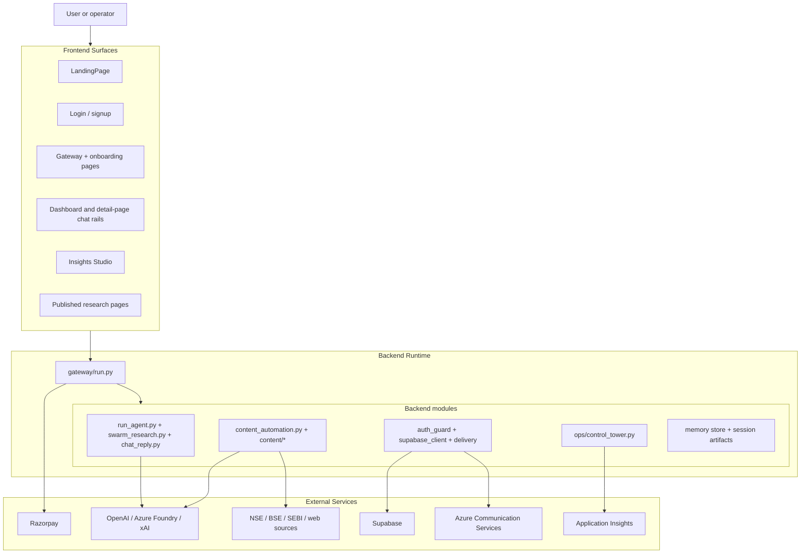

## 3. Research and Chat System

### What This Feature Is

This is the shared AI interaction layer across the application. It powers:

- Dashboard chat
- Earnings chat
- Governance chat
- IPO chat
- Export requests for deep research sessions
- Session streaming, polling, and result retrieval

It is one of the most important cross-cutting systems in the codebase.

### Key Frontend Files

| File | Role |
| --- | --- |
| `frontend/src/api/client.ts` | Starts sessions, opens SSE streams, fetches final results |
| `frontend/src/components/chat/ChatInput.tsx` | Shared prompt input component |
| `frontend/src/components/chat/AgentThinking.tsx` | Progress and phase rendering from SSE events |
| `frontend/src/components/chat/MessageBubble.tsx` | Unified message and rich-output rendering |
| `frontend/src/components/chat/ExportPanel.tsx` | User-triggered export of deep research sessions |
| `frontend/src/components/chat/HtmlArtifact.tsx` | HTML artifact rendering when rich output provides it |
| `frontend/src/components/chat/SectionBlock.tsx` | Structured output block rendering |
| `frontend/src/components/chat/CalloutBlock.tsx` | Structured highlight/callout rendering |

### Main Backend Files

| File | Role |
| --- | --- |
| `backend/finagent/gateway/run.py` | Main research/session entrypoints and session control APIs |
| `backend/finagent/swarm_research.py` | New swarm-based standard/deep research implementation |
| `backend/finagent/chat_reply.py` | Conversational chat mode implementation |
| `backend/finagent/run_agent.py` | Legacy heavy agent loop and deep research backbone |
| `backend/finagent/events.py` | Event bus used for SSE streaming |
| `backend/finagent/canvas/*` | Interactive research canvas state |
| `backend/finagent/output/export_jobs.py` | Async export job handling |

### Main Frontend API Functions

| Function | What It Does |
| --- | --- |
| `startResearch()` | Starts a chat or deep research session |
| `streamSession()` | Connects to `/sessions/{id}/stream` and handles reconnect logic |
| `stopSession()` | Cancels a running session |
| `getSessionResult()` | Fetches the final synthesized output |
| `requestExport()` | Starts PDF, DOCX, XLSX, or PPTX export |
| `pollExport()` | Polls export job status |
| `downloadExportAndSave()` | Downloads completed export job |

### Main Backend Routes

| Endpoint | Role |
| --- | --- |
| `POST /chat/research` | Primary frontend entrypoint for research/chat requests |
| `POST /research/start` | Legacy direct research start |
| `POST /research/deep` | Deep research entrypoint |
| `GET /sessions/{session_id}/stream` | SSE event stream |
| `GET /sessions/{session_id}/result` | Final result payload |
| `GET /sessions/{session_id}/status` | Session status polling |
| `POST /sessions/{session_id}/stop` | Cancel running session |
| `DELETE /sessions/{session_id}` | Delete session artifacts and history |

### Important Implementation Reality

The frontend `startResearch()` function does not map modes the way a new developer might expect.

Current behavior in `frontend/src/api/client.ts`:

- `standard` is sent to the backend as `mode=chat`
- `deep` is sent as `mode=deep`

That means most "standard" user requests currently run through the lightweight conversational backend mode instead of a heavy standard memo pipeline.

This is one of the most important implementation details in the app.

### Research Routing Diagram

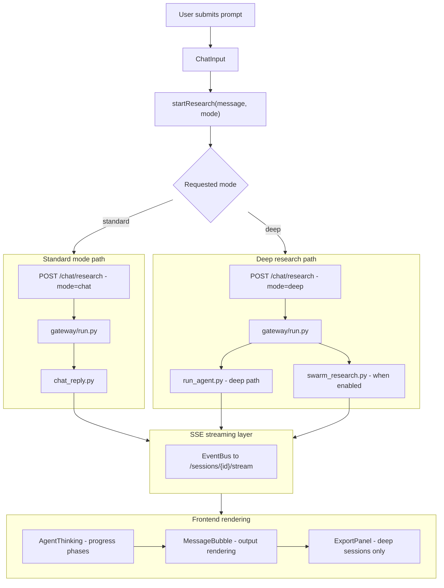

### How the Frontend Streaming Works

`streamSession()` in `frontend/src/api/client.ts` is not a trivial EventSource wrapper.

It handles:

- authenticated fetch-based SSE
- proactive reconnect at 25 seconds
- terminal event handling
- fallback finalization through `getSessionResult()`
- last-event-id resume support
- timeout and reconnect caps

This is a critical file for debugging research UX issues.

### Chat and Research UX Components

#### `AgentThinking.tsx`

This component converts raw backend event types into human-readable progress states such as:

- starting research
- specialist review
- checking source coverage
- writing your answer

It is a translation layer between low-level backend events and user-facing phase copy.

#### `MessageBubble.tsx`

This component renders both plain text and rich structured content. It is the primary output renderer for AI responses across multiple pages.

#### `ExportPanel.tsx`

This component is only meaningful for deep research sessions. It:

1. starts an export job
2. polls until completion
3. downloads the file to the browser

### Research Workflow Diagram

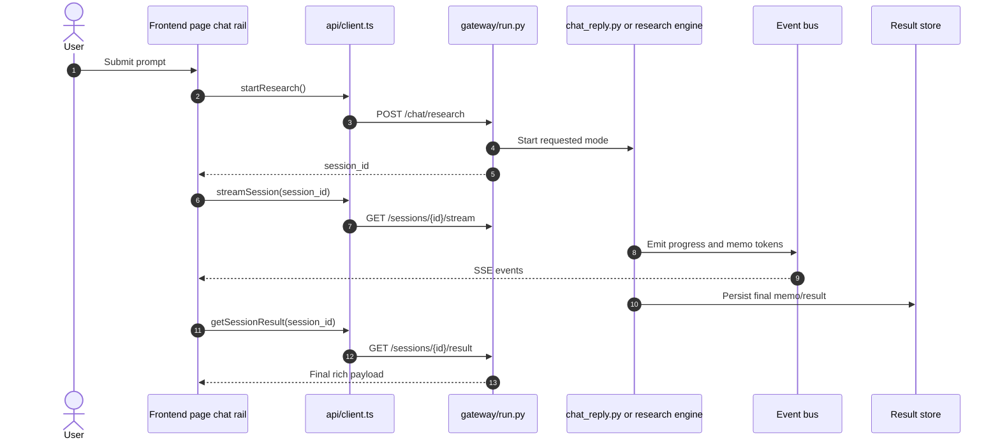

### Deep Research Export Flow

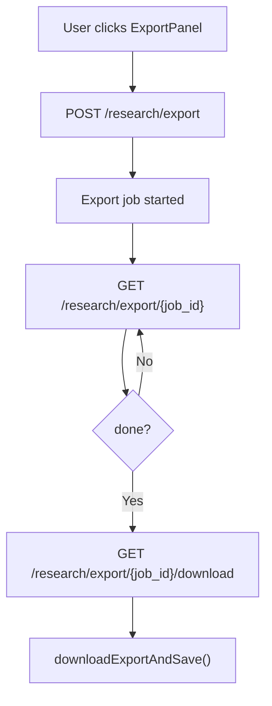

### Related But Less-Used Research APIs

The backend also exposes:

- `GET /sessions/{session_id}/memo`
- `GET /sessions/{session_id}/canvas`
- `POST /sessions/{session_id}/canvas/steer`
- `POST /research/export-all`

These exist as part of the session and artifact system, but the current mainstream UI relies more heavily on the main result flow and explicit export panel.

## 4. Insights Studio and Content Automation

### What This Feature Is

Insights Studio is the operator/editorial surface for generating, monitoring, reviewing, and publishing research content.

This is not just an article list. It combines:

- manual article generation
- active workflow monitoring
- article review and queue management
- automation health monitoring
- official-source monitoring controls
- public publishing actions

### Frontend Route and Files

| Surface | File |
| --- | --- |
| Route | `frontend/src/App.tsx` -> `/insights-studio` |
| Main page | `frontend/src/pages/InsightsStudio.tsx` |
| Workflow monitor | `frontend/src/components/insights/FlashJobMonitor.tsx` |
| Queue table | `frontend/src/components/insights/ArticleQueueTable.tsx` |
| Draft review | `frontend/src/components/insights/DraftReviewDrawer.tsx` |
| Article reader | `frontend/src/components/insights/ArticleReader.tsx` |
| Styles | `frontend/src/components/insights/insightsStudio.css` |

### Backend Files

| File | Role |
| --- | --- |
| `backend/finagent/content_automation.py` | Deterministic article packaging, mirroring, and sitemap handling |
| `backend/finagent/content/flash_engine.py` | Research-driven multi-pass content generation engine |
| `backend/finagent/content/official_monitor.py` | 24/7 official-source monitor and sweep state |
| `backend/finagent/content/editorial.py` | Editorial gating rules |
| `backend/finagent/content/content_accuracy.py` | Content accuracy checks |
| `backend/finagent/content/filing_triage.py` | Materiality triage |
| `backend/finagent/content/livemint_blocker.py` | Duplicate/overlap protection |

### Frontend API Functions Used by Insights Studio

| Function | Purpose |
| --- | --- |
| `generateFlashArticle()` | Start a research article workflow |
| `runContentAutomationNow()` | Trigger immediate official-source sweep |
| `getContentAutomationStatus()` | Load automation health and activity |
| `listContentArticles()` | Load article queue |
| `getContentArticle()` | Load article detail for review/reader |
| `publishContentArticle()` | Publish a draft |
| `unpublishContentArticle()` | Move a published item back to draft |
| `getMarketIndices()` | Market snapshot panel |
| `getMarketQuotes()` | Ticker strip panel |

### Backend Content Routes

| Endpoint | Purpose |
| --- | --- |
| `POST /api/content/flash/generate` | Start async research article workflow |
| `POST /api/content/automation/run-now` | Trigger official-source sweep |
| `GET /api/content/automation/status` | Return monitor/scheduler health |
| `GET /api/content/articles` | List generated articles |
| `GET /api/content/articles/{slug}` | Fetch article manifest/detail |
| `GET /api/content/articles/{slug}/html` | Fetch raw article HTML |
| `POST /api/content/articles/{slug}/publish` | Publish article |
| `POST /api/content/articles/{slug}/unpublish` | Unpublish article |
| `POST /api/content/articles/generate` | Deterministic article-generation endpoint |
| `POST /api/content/articles/generate-batch` | Batch deterministic generation |
| `POST /api/content/events/ingest` | Event-driven article generation |
| `POST /api/content/flash/ingest-events` | Flash/event ingest path |

### Important Naming Reality

The frontend page uses `generateFlashArticle()` even when the user clicks "Start research article".

That means the Insights Studio manual generation flow is currently built on the flash/deep content pipeline, not just on the simpler deterministic `content_automation.py` article endpoint.

### Insights Studio UI Structure

`InsightsStudio.tsx` contains three major UI areas:

1. Left operator rail
2. Active workflow stack
3. Right content area with market context and publication queue

Main page subsections:

- manual article generation form
- active workflow monitors
- automation health dashboard
- market snapshot and ticker strip
- article queue in cards or table mode
- review drawer and article reader overlays

### Content Automation Architecture Diagram

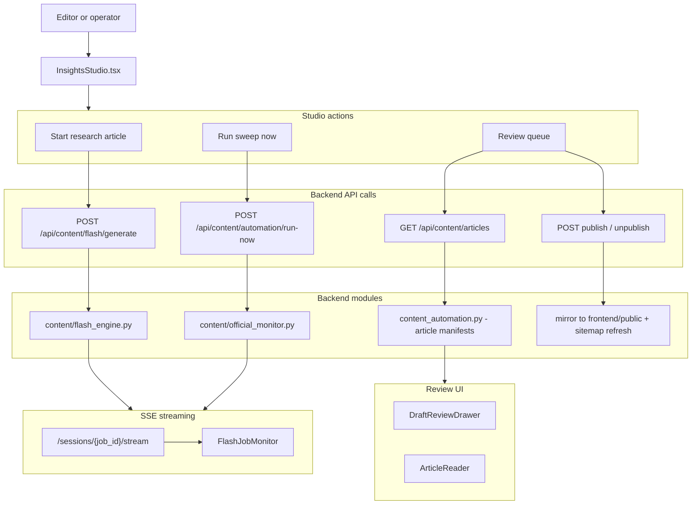

### Manual Research-Article Workflow

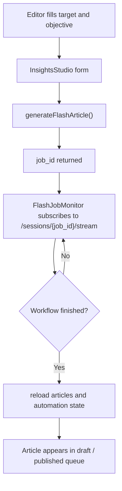

### Official-Source Sweep Workflow

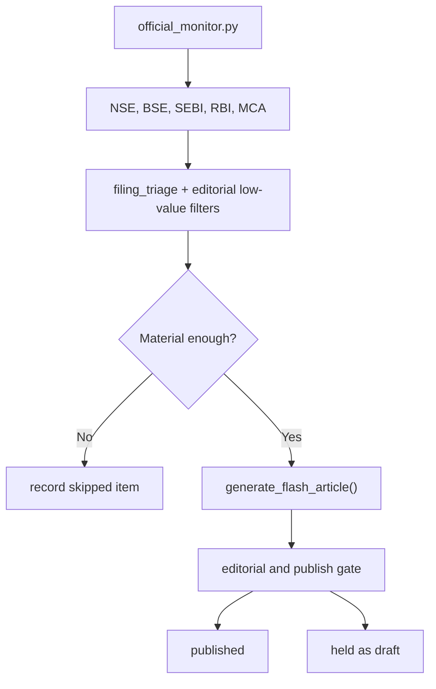

### How Article Generation Actually Works

There are two distinct content-generation styles in the backend.

#### 1. Deterministic Article Packaging

Implemented in `content_automation.py`.

This layer is responsible for:

- generating article packages
- writing `article.json` and `index.html`
- mirroring published output into `frontend/public`
- refreshing the public research hub
- updating the sitemap

#### 2. Research-Driven Flash/Deep Generation

Implemented in `content/flash_engine.py`.

This layer is responsible for:

- research-pass orchestration
- IKG context enrichment
- full article generation from market or official-source prompts
- job-based streaming progress via the shared session SSE system

### Publishing Workflow Reality

Publishing is not only a status flip.

When an article is published, the backend may:

1. mirror HTML into `frontend/public/{route_base}/{slug}/`
2. mirror the cover image asset
3. update sitemap content
4. refresh the public research hub
5. submit the sitemap to Google Search Console

### Review and Reader Components

#### `DraftReviewDrawer.tsx`

This is an operator-facing editorial review panel that exposes:

- quality score
- publish urgency
- issue list
- section review
- source list
- publish readiness

#### `ArticleReader.tsx`

This is a full article-reader overlay with:

- newsroom-style presentation
- hero, metrics, sections, FAQ, and sources
- keyboard close behavior
- reading progress indicator

### Important Implementation Notes for Content Automation

- Insights Studio uses the same session SSE system as research, but for content jobs.
- Article status is effectively governed by both `publish_status` and `publish_gate_status`.
- The publish route enforces editorial approval before a draft can go live.
- Public URLs are rewritten to root-relative paths when returned to API clients so local development links still work.
- Article storage lives under the backend data path first, then is optionally mirrored into frontend public directories.

## 5. Public Publishing and Research Hub

### What This Feature Is

This is the outward-facing publishing surface for generated content.

It includes:

- canonical research hub routes
- published article routes
- legacy redirect paths
- public assets for published insight pages

### Main Backend Routes

| Route | Purpose |
| --- | --- |
| `/research/` | Canonical public research hub |
| `/research/{slug}` | Published research article page |
| `/insights/{slug}` | Published insight article page |
| `/insights/research/` | Legacy redirect to `/research/` |
| `/api/content/articles/{slug}/html` | HTML retrieval API |

### Publishing Files and Functions

| File | Role |
| --- | --- |
| `backend/finagent/content_automation.py` | Loads generated article HTML and manifests |
| `backend/finagent/gateway/run.py` | Serves hub and published article routes |
| `frontend/public/...` | Mirrored published static content |

### Public Publishing Diagram

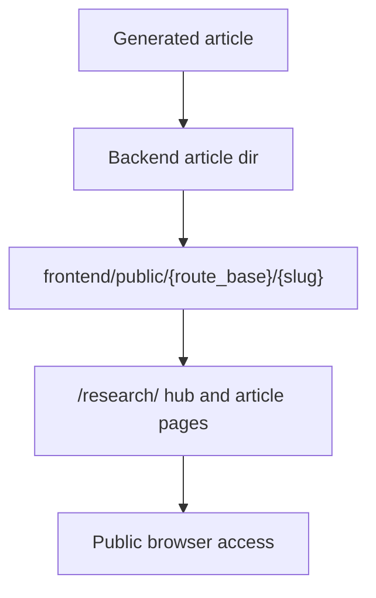

### Important Public-Surface Notes

- The canonical production public URL stored in manifests is absolute, but the API rewrites it to a relative path for local-dev usability.
- `/research/` is the canonical public hub.
- `/insights/research/` exists mainly as a legacy redirect path.
- Published article serving is gated by `publish_status == published` and `publish_gate_status == publish`.

## 6. Auth and Identity

### What This Feature Is

The auth system supports:

- email/password signup and login
- Google sign-in via GIS
- password reset
- email or SMS verification flows
- post-Google mobile completion
- subscription-aware user state in the frontend

### Key Frontend Files

| File | Role |
| --- | --- |
| `frontend/src/pages/Login.tsx` | Login, signup, forgot-password, reset-password, Google auth UI |
| `frontend/src/context/AuthContext.tsx` | User/session state, onboarding state, toasts, subscription refresh |
| `frontend/src/api/client.ts` | Auth API client and token/cookie helpers |

### Key Backend Files

| File | Role |
| --- | --- |
| `backend/finagent/gateway/run.py` | Auth endpoints and auth cookie issuance |
| `backend/finagent/gateway/auth_guard.py` | Token decoding and access control helpers |
| `backend/finagent/gateway/supabase_client.py` | Supabase identity/profile integration |
| `backend/finagent/gateway/email_delivery.py` | Email sending for codes |
| `backend/finagent/gateway/sms_delivery.py` | SMS sending for codes |
| `frontend/src/context/AuthContext.tsx` | Frontend auth state orchestration |

### Frontend Auth API Functions

| Function | Purpose |
| --- | --- |
| `apiLogin()` | Email/password login |
| `apiSignup()` | Email/password signup |
| `apiGoogleAuth()` | Google auth exchange |
| `apiForgotPassword()` | Start reset flow |
| `apiResetPassword()` | Complete reset flow |
| `apiUpdateMobile()` | Complete required mobile step |
| `getAuthMe()` | Read current session from cookie-backed auth |
| `getUserSubscription()` | Refresh plan info |

### Backend Auth Routes

| Endpoint | Purpose |
| --- | --- |
| `POST /auth/google` | Verify Google identity token and set local session cookie |
| `POST /auth/google/update-mobile` | Complete mobile profile step |
| `GET /auth/me` | Return authenticated user record |
| `POST /auth/send-verification` | Send signup verification code |
| `POST /auth/forgot-password` | Send reset code |
| `POST /auth/reset-password` | Reset password |
| `POST /auth/signup` | Create account and mint local JWT |
| `POST /auth/login` | Login via Supabase and mint local JWT |
| `POST /auth/logout` | Clear auth cookie |

### Important Auth Reality

The frontend keeps lightweight cached auth state, but the httpOnly cookie is the actual source of truth.

This is explicitly reflected in `frontend/src/api/client.ts` and `AuthContext.tsx`.

### Auth Workflow Diagram

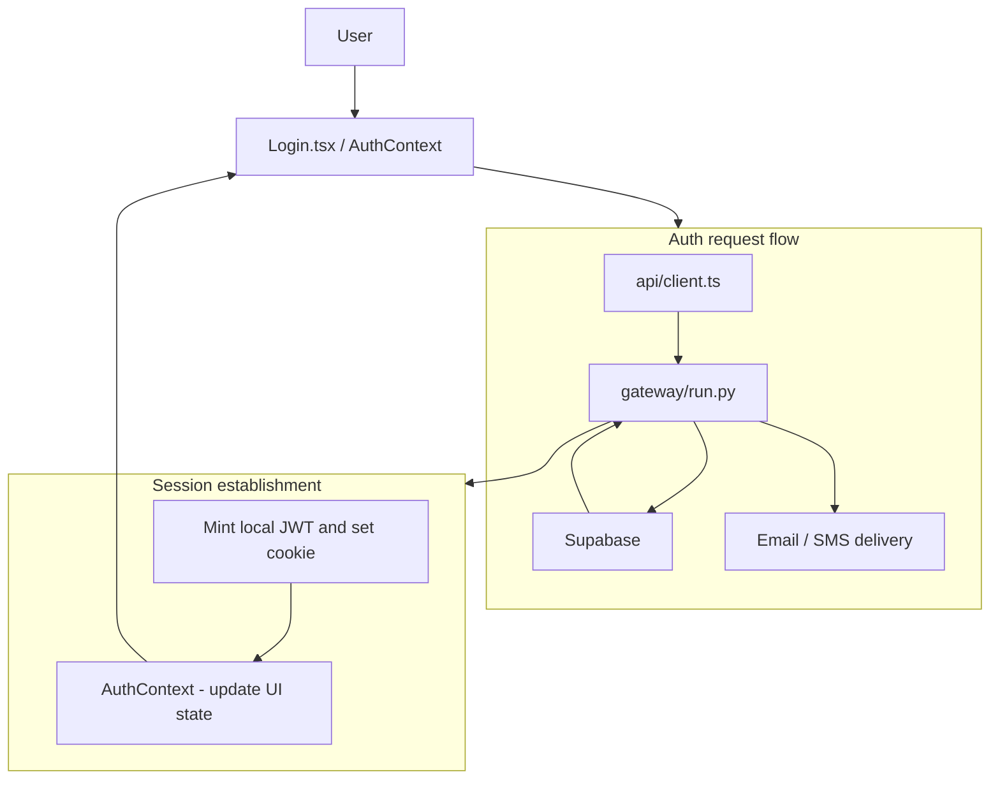

### Open-Access Build Reality

`AuthContext.tsx` currently sets `isReadOnly = false`.

That means the application is operating in an open-access style build right now, even though the full auth system remains implemented.

### Additional Auth UX Behavior

`AuthContext.tsx` also handles:

- onboarding state persistence per email
- syncing a guest manual portfolio into the backend mirror after login
- plan refresh
- WhatsApp community invite modal after signup
- telemetry user binding

## 7. Onboarding and Portfolio Setup

### What This Feature Is

This is the guided entry flow that gets a user from public landing into a usable dashboard state.

### Frontend Pages

| Route | File | Purpose |
| --- | --- | --- |
| `/get-started` | `frontend/src/pages/GatewayPage.tsx` | Setup entry and style selection |
| `/onboarding/manual` | `frontend/src/pages/ManualEntry.tsx` | Manual holdings entry |
| `/onboarding/upload` | `frontend/src/pages/UploadPage.tsx` | Upload-based holdings ingestion |
| `/onboarding/watchlist` | `frontend/src/pages/WatchlistStep.tsx` | Watchlist curation |

### How Onboarding Is Structured

#### `GatewayPage.tsx`

This page lets the user:

- enter a preferred name
- choose an investing style
- choose manual entry or upload-based setup

The style and name are stored in localStorage.

#### `ManualEntry.tsx`

This page:

- collects holdings rows
- resolves names/tickers against `INDIAN_STOCKS`
- writes valid holdings into `MANUAL_PORTFOLIO_KEY`
- then routes the user into the dashboard

#### `UploadPage.tsx`

This page:

- accepts PDF, CSV, XLSX, and image uploads
- optionally asks for a PDF password
- calls document or screenshot extraction endpoints
- handles review-required flows
- confirms extracted positions
- verifies the backend mirror state
- persists local fallback holdings when necessary

#### `WatchlistStep.tsx`

This page:

- collects watchlist names or tickers
- stores them in localStorage
- marks onboarding complete
- routes to the dashboard

### Onboarding Workflow Diagram

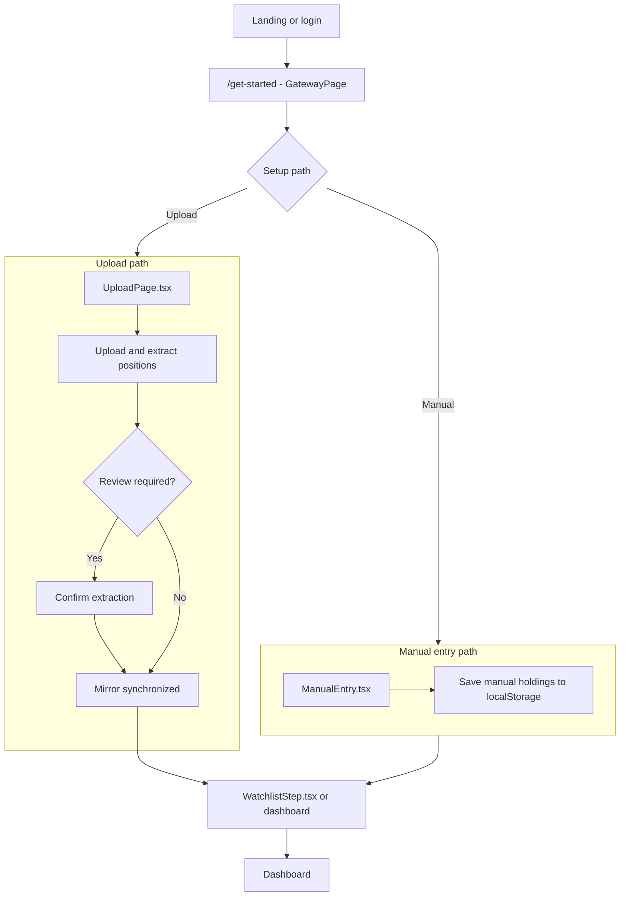

### Backend Routes Used by Onboarding

| Endpoint | Purpose |
| --- | --- |
| `POST /portfolio/mirror/sync-manual` | Sync manual guest holdings into backend mirror |
| `POST /api/portfolio/upload-cas` | Document upload parse path |
| `POST /api/portfolio/upload-document` | Alias path for document upload |
| `POST /api/portfolio/upload-screenshot` | Screenshot parse path |
| `POST /api/portfolio/confirm-extraction` | Confirm reviewed extraction |
| `POST /api/portfolio/cancel-extraction` | Cancel pending extraction |
| `GET /portfolio/mirror` | Verify mirror state after sync |

### Important Onboarding Notes

- Onboarding relies heavily on localStorage as a resilience layer.
- `UploadPage.tsx` is intentionally defensive: it treats local storage as a fallback source of truth if the cloud mirror is temporarily unavailable.
- `GatewaySetupCard` is reusable and can also be embedded in other contexts.

## 8. Marketing and Public Web Surface

### What This Feature Is

This includes the public landing and some static/public routes.

### Main Frontend File

| File | Role |
| --- | --- |
| `frontend/src/pages/LandingPage.tsx` | Public marketing/positioning page |

### What the Landing Page Contains

`LandingPage.tsx` includes:

- hero and CTA
- capabilities section
- workflow explanation
- proof/evidence section
- pricing section
- FAQ section
- final CTA and footer disclaimer

### Important Routing Reality

Although the landing page contains internal sections for pricing, capabilities, workflow, and FAQ, direct routes like `/pricing`, `/features`, and `/contact` in `App.tsx` currently redirect into `/dashboard/overview` rather than rendering landing-page section variants.

That means section navigation is primarily intended to happen on the `/` landing page itself.

### Other Public Assets

| Surface | File / Route |
| --- | --- |
| Public unsubscribe page | `frontend/public/unsubscribe.html` |
| Public research hub | `/research/` |
| Published research articles | `/research/{slug}` and `/insights/{slug}` |

### Public Web Surface Diagram

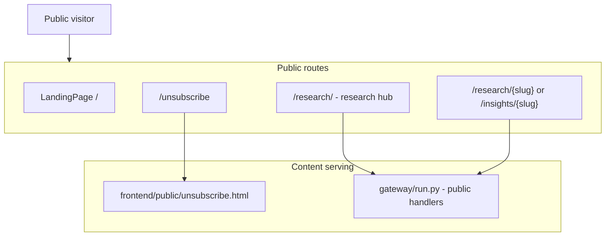

## 9. Payments, Subscription, and Usage Limits

### What This Feature Is

This feature set manages:

- subscription plan state
- token usage visibility
- deep-run limits
- Razorpay order creation and verification

### Frontend Touchpoints

| File | Role |
| --- | --- |
| `frontend/src/context/AuthContext.tsx` | Subscription refresh and `isPro` state |
| `frontend/src/pages/LandingPage.tsx` | Free-tier marketing section |
| multiple chat pages | Pro upgrade prompts when deep mode or limits are hit |
| `frontend/src/api/client.ts` | subscription and payment client methods |

### Backend Routes

| Endpoint | Purpose |
| --- | --- |
| `GET /user/token-usage` | Weekly token usage, remaining quota, reset time |
| `GET /user/subscription` | Plan, token, and deep-run status |
| `POST /api/create-order` | Razorpay order creation |
| `POST /api/verify-payment` | Verify Razorpay signature and upgrade user |
| `POST /user/upgrade-plan` | Manual upgrade path |

### Payment and Plan Workflow Diagram

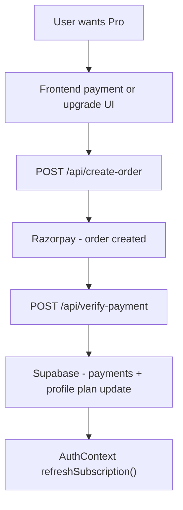

### Important Subscription Notes

- `AuthContext.tsx` computes `isPro` from the cached `user.plan`.
- `refreshSubscription()` re-fetches plan state through `getUserSubscription()`.
- Deep-mode prompts across the UI can show upgrade CTAs when the backend returns limit-related codes such as `DEEP_PREMIUM_REQUIRED`.

## 10. Ops, Metrics, and Control Tower

### What This Feature Is

This is the operator/admin analytics surface for product and system activity.

### Main Backend Files

| File | Role |
| --- | --- |
| `backend/finagent/gateway/run.py` | Serves control tower HTML and API endpoints |
| `backend/finagent/ops/control_tower.py` | Builds aggregated operator snapshot data |

### Routes

| Route | Purpose |
| --- | --- |
| `/ops` | Redirect to control tower |
| `/ops/control-tower` | HTML control tower page served by backend |
| `/api/ops/control-tower` | JSON snapshot API |
| `/metrics/snapshot` | Internal metrics API |

### Control Tower Data Model

`ops/control_tower.py` groups telemetry into categories such as:

- frontend
- auth
- onboarding
- portfolio
- research
- content
- chat

It understands event families like:

- auth success/failure
- portfolio upload/sync states
- research stream and result events
- content generation events

### Ops Workflow Diagram

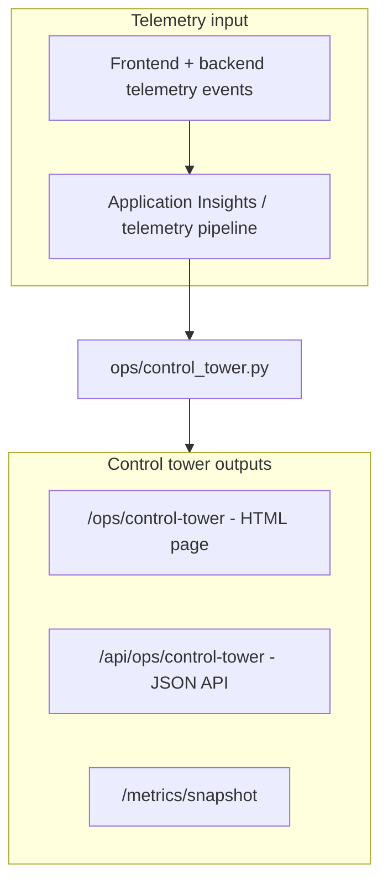

### Important Ops Notes

- The control tower page is served directly as HTML by the backend.
- Access can be restricted through allowlists and environment variables.
- It is an operator-only surface, not part of the main React SPA navigation.

## 11. Memory, Sessions, Canvas, and Exports

### What This Feature Is

This feature family manages:

- per-session lifecycle
- memory facts and session summaries
- interactive canvas retrieval and steering
- export jobs
- session deletion and cleanup

### Main Backend Routes

| Endpoint | Purpose |
| --- | --- |
| `GET /memory/stats` | Memory counts and backend info |
| `GET /memory/facts` | Browse facts by target |
| `GET /memory/sessions` | Session summaries from memory |
| `DELETE /memory/clear/{target}` | Clear facts for target |
| `GET /sessions/{id}/canvas` | Return interactive research canvas |
| `POST /sessions/{id}/canvas/steer` | Apply steer command |
| `POST /research/export` | Start export job |
| `GET /research/export/{job_id}` | Poll export status |
| `GET /research/export/{job_id}/download` | Download export |
| `POST /research/export-all` | Generate all formats |
| `DELETE /sessions/{id}` | Delete session and memory artifacts |

### Main Backend Components

| File | Role |
| --- | --- |
| `backend/finagent/memory/*` | Memory store and session memory |
| `backend/finagent/canvas/*` | Interactive research canvas model and steering |
| `backend/finagent/output/export_jobs.py` | Export job lifecycle |
| `backend/finagent/output/report_exporter.py` | Export capability rules |

### Session and Artifact Diagram

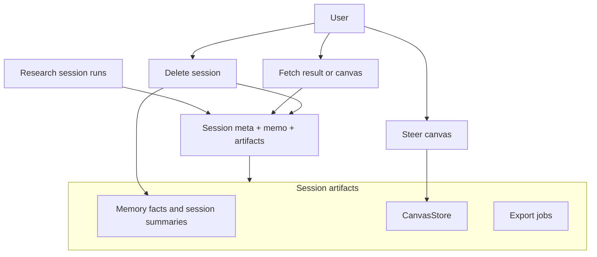

### Important Session Notes

- Deep-mode export remains explicit. The backend comment makes clear that exports are intended to require explicit user action.
- Memory routes are authenticated and more operational than user-facing in the current frontend.
- Canvas APIs exist, but the current mainstream UI relies more on final result rendering than on a rich steerable canvas surface.

## 12. Outreach and Unsubscribe Surface

### What This Feature Is

This is the public-facing email unsubscribe flow for outreach communications.

### Main Files and Routes

| Surface | File / Route |
| --- | --- |
| Public page | `frontend/public/unsubscribe.html` |
| Backend redirect | `GET /unsubscribe` and `GET /unsubscribe/` |
| Unsubscribe API | `POST /api/outreach/unsubscribe` |

### How It Works

1. A public visitor lands on `/unsubscribe`.
2. The backend redirects to the static frontend unsubscribe page.
3. The form submits to `/api/outreach/unsubscribe`.
4. The backend stores the unsubscribe in Supabase, along with hashed IP and user-agent note fields.

### Unsubscribe Workflow Diagram

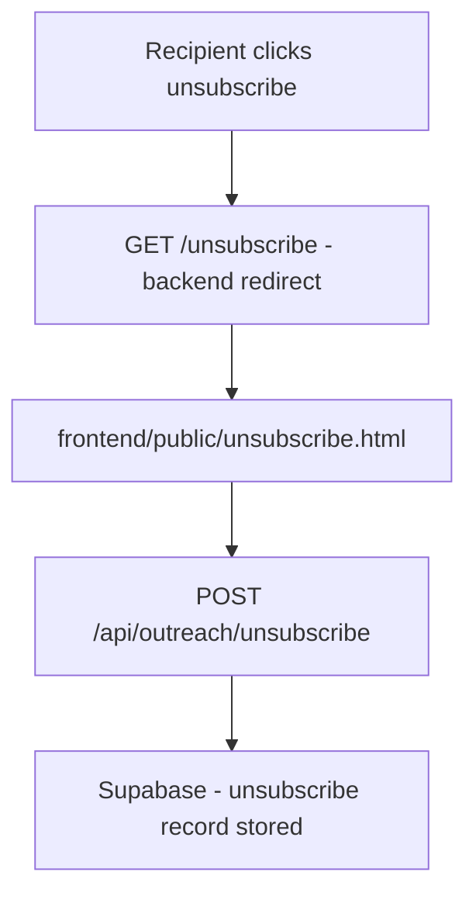

## 13. Standalone API Surface

### What This Feature Is

In addition to the main gateway app, the repository contains a smaller standalone FastAPI app in `backend/finagent/api.py`.

This is a separate, programmatic API surface primarily for chat use cases.

### File

| File | Role |
| --- | --- |
| `backend/finagent/api.py` | Secondary standalone chat API |

### Routes

| Endpoint | Purpose |
| --- | --- |
| `POST /api/chat` | JSON chat endpoint |
| `POST /api/chat/stream` | Streaming chat endpoint |
| `GET /api/health/mcp` | MCP health check |

### Important API Reality

This standalone API still uses the legacy `run_agent.py` style execution path rather than the main gateway's dashboard-oriented session APIs.

It applies its own standard/deep-lite logic and emits final chat responses directly.

### Standalone API Diagram

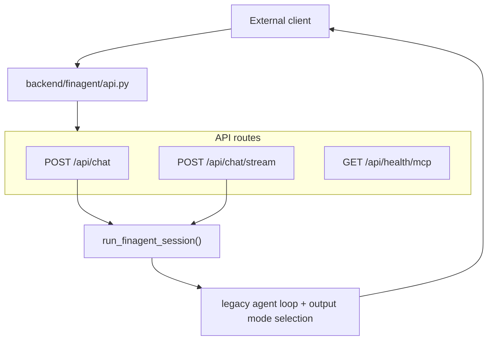

## 14. Maintenance Notes

### 1. Some Major Features Are Split Across Frontend and Backend Naming Conventions

Examples:

- Insights Studio uses `generateFlashArticle()` for what the UI labels as article research generation.
- "Standard" frontend research currently routes to backend `mode=chat`.
- The dashboard IPO tab reuses standalone IPO dashboard content.

### 2. Several Public and Operator Surfaces Bypass the Main SPA Navigation

Examples:

- `/ops/control-tower`
- `/research/`
- `/insights/{slug}` and `/research/{slug}`
- `/unsubscribe`

### 3. localStorage Is a Real Product Dependency

The system uses localStorage for:

- guest/manual portfolio onboarding
- watchlists
- conversations and messages
- user display preferences
- chat-rail width

Do not treat localStorage as incidental. It is part of the product behavior.

### 4. Generated Content Is Dual-Homed

Generated articles first exist in backend-managed storage, then may be mirrored into frontend public directories for public serving.

### 5. Control Tower and Memory Are More Operational Than Productized

The backend has real capabilities for:

- control tower reporting
- memory browsing and clearing
- session cleanup

But these are not yet deeply surfaced in the main frontend experience.

### 6. Recommended Reading Order for These Remaining Features

1. `frontend/src/context/AuthContext.tsx`
2. `frontend/src/pages/Login.tsx`
3. `frontend/src/pages/GatewayPage.tsx`
4. `frontend/src/pages/ManualEntry.tsx`
5. `frontend/src/pages/UploadPage.tsx`
6. `frontend/src/pages/WatchlistStep.tsx`
7. `frontend/src/pages/InsightsStudio.tsx`
8. `frontend/src/components/insights/FlashJobMonitor.tsx`
9. `frontend/src/components/insights/ArticleQueueTable.tsx`
10. `frontend/src/components/insights/DraftReviewDrawer.tsx`
11. `frontend/src/components/insights/ArticleReader.tsx`
12. `frontend/src/components/chat/AgentThinking.tsx`
13. `frontend/src/components/chat/MessageBubble.tsx`
14. `frontend/src/components/chat/ExportPanel.tsx`
15. `frontend/src/pages/LandingPage.tsx`
16. `frontend/public/unsubscribe.html`
17. `frontend/src/api/client.ts`
18. `backend/finagent/gateway/run.py`
19. `backend/finagent/swarm_research.py`
20. `backend/finagent/chat_reply.py`
21. `backend/finagent/run_agent.py`
22. `backend/finagent/content_automation.py`
23. `backend/finagent/content/flash_engine.py`
24. `backend/finagent/content/official_monitor.py`
25. `backend/finagent/ops/control_tower.py`
26. `backend/finagent/api.py`
