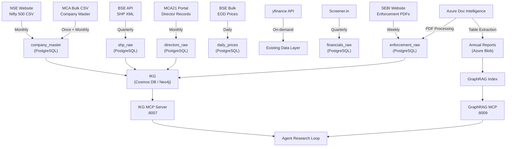

# ProspektLab Master Roadmap — Complete Implementation Plan

# Current Sprint Addendum

This sprint is focused on getting the public research surface, the always-on automation loop, and the SEO/discovery plumbing into a production-safe state.

## Immediate Delivery Scope

- Fix `/insights/research` so it always renders from live published manifests instead of serving a stale static count or stale empty state.
- Keep `/insights-studio` and `/insights/research` on the same source of truth for published article counts.
- Make the public research empty state responsive so the card never collapses into a narrow unreadable column on smaller widths.
- Add a fallback publishing path for quiet days:
  - If NSE, BSE, and SEBI do not produce a publishable story, generate one high-conviction article from recent business and market coverage.
  - Cap fallback publishing at 3 posts per IST day, 1 per sweep, with at least 2 hours between automatic fallback publishes.
  - Use only official sources and tier-1 business media for automatic publishing decisions.
  - Prefer durable topics with organic-search upside, such as company analysis, debt reduction, margin resilience, capital cycle shifts, and sector trend explainers.
- Upgrade official-source automation to a document-first flow:
  - resolve and classify filing attachments before article generation
  - require successful extraction for material filings such as results, shareholding, governance, voting, RPT, secretarial compliance, and structured XBRL disclosures
  - use local-first extraction with PDF/XML/ZIP/XLSX support and Docling as the fallback parser
  - stage extracted evidence to disk before generation so retries do not re-download and re-parse the same filing
  - pass staged filing evidence into article generation as the primary event source, with company graph context used as complementary background
  - surface attachment extraction status, parser used, and review reasons in `/insights-studio`
- Extend automation status so the dashboard shows:
  - official sweep status
  - fallback activity and next fallback window
  - scheduler heartbeat
  - recent automation actions
  - Google Search Console connection state
- Integrate Google Search Console support:
  - submit the sitemap after publish/unpublish events
  - surface Search Console connection and top-page status in the automation UI
  - keep sitemap, canonical URLs, and article routes aligned with public content
- Rebalance the research copy so it reads like a professional financial publication:
  - stronger hierarchy
  - clearer public-facing wording
  - no internal workflow/tool names leaking into user-visible copy
  - remove mojibake and broken special characters such as `—`, `•`, and similar artifacts
- Audit and install missing Python dependencies in the project virtual environment, including `yfinance`, APScheduler, and Google API client libraries required by automation and Search Console.
- Verify the end-to-end flow after installation:
  - backend import checks
  - research hub render check
  - frontend build check
  - automation status payload check

> **Scope**: Full implementation of [prospektlab_master_roadmap.md](file:///d:/PROSPEKTLAB/prospektlab_master_roadmap.md) mapped against the live codebase, replacing third-party tools with Azure/AWS managed services, and with automated Nifty 500 data ingestion.

---

## User Review Required

> [!IMPORTANT]
> **Azure/AWS Service Decisions** — The plan replaces Oracle Cloud + Neo4j with Azure-native services (Cosmos DB Gremlin for IKG graph, Azure Document Intelligence for PDF extraction, Azure Blob for document storage, Azure Functions for cron jobs). Confirm you have or can create:
> - Azure account with Cosmos DB (Gremlin API) — free tier covers 1000 RU/s + 25GB
> - Azure AI Document Intelligence (formerly Form Recognizer) — free tier = 500 pages/month
> - AWS S3 (or Azure Blob) for document corpus storage
> - PostgreSQL (existing Supabase or Azure Database for PostgreSQL Basic tier ~$5/mo)

> [!WARNING]
> **SEBI Compliance is Phase 0** — The current codebase has `"STRONG BUY"`, `"verdict"`, and `"UNDERVALUED"` language in [valuation_engine.py](file:///d:/PROSPEKTLAB/finagent/tools/valuation_engine.py#L799-L800) and [compliance.py](file:///d:/PROSPEKTLAB/finagent/output/compliance.py) already strips some of this, but the valuation engine itself still generates verdict strings. This must be fixed before any user-facing deployment.

> [!CAUTION]
> **Data Residency** — Current deployment appears to use AWS (buildspec.yml exists). If DPDP Act requires data residency, plan migration to AWS ap-south-1 (Mumbai) or Azure Central India region. Flag for legal review.

## Open Questions

1. **LLM Provider Strategy** — Roadmap mentions RouteLLM for cost optimization. Currently you use OpenAI + xAI (Grok) fallback via [runtime_provider.py](file:///d:/PROSPEKTLAB/finagent/runtime_provider.py). Should we add Azure OpenAI Service as a provider (cheaper for cached prompts via PTU)?
2. **Memory Backend** — Current memory is [tiered_store.py](file:///d:/PROSPEKTLAB/finagent/memory/tiered_store.py) (41KB, substantial). The roadmap says "SQLite → Letta" but your store is already tiered and backed by Supabase. Do you want a full Letta rewrite, or should we evolve the existing tiered store with the Dreaming Layer features?
3. **Neo4j vs. Cosmos DB Gremlin** — The roadmap specifies Neo4j on Oracle Always Free. Since you prefer Azure, Cosmos DB with Gremlin API gives a managed graph DB with free tier. However, Cypher → Gremlin query translation is needed. Alternatively, Neo4j Aura Free (cloud) gives native Cypher. Which do you prefer?
4. **BSE SHP Data Format** — BSE Shareholding Pattern data is available as XML from BSE corporate filings API. This requires scrip code → CIN mapping. The Nifty 500 list is downloadable from NSE as CSV. Confirm you're okay with automated BSE API scraping (rate-limited, respectful).

---

## Proposed Changes

The plan is organized into **7 execution phases**, mapped to the roadmap's timeline but reordered for dependency correctness.

---

### Phase 0: Stop the Bleeding (Week 1-2) — SEBI Compliance + Quick Wins

This is the most urgent work. No features, only fixes.

#### Synthesis Template & Valuation Engine SEBI Compliance

##### [MODIFY] [valuation_engine.py](file:///d:/PROSPEKTLAB/finagent/tools/valuation_engine.py)
- Remove all `"verdict"` keys that emit `"STRONG BUY"`, `"BUY"`, `"UNDERVALUED"`, `"OVERVALUED"` strings (lines ~176, 238, 444, 508, 798-810)
- Replace with scenario-conditional framing:
  - `"verdict": "STRONG BUY"` → `"scenario_assessment": "Model outputs are favorable under stated assumptions"`
  - `"verdict": "UNDERVALUED"` → `"position_vs_model": "below_model_implied_value"`
- Replace `graham_valuation` verdict with `"position_vs_model"` enum
- Replace `analyze_ratios` scoring labels (`STRONG BUY`, `ACCUMULATE`, `HOLD`) with `"quality_tier": "strong" | "moderate" | "weak"`

##### [MODIFY] [compliance.py](file:///d:/PROSPEKTLAB/finagent/output/compliance.py)
- Extend `_PHRASE_REPLACEMENTS` to catch remaining patterns from valuation engine outputs
- Add post-processing for `verdict` → `scenario_assessment` key renaming in JSON outputs
- Add semantic-level check: scan for sentences containing both a ticker symbol and directional language

##### [MODIFY] [finagent_system.txt](file:///d:/PROSPEKTLAB/finagent/prompts/finagent_system.txt)
- Already mostly compliant (line 35 has good SEBI-safe rules)
- Remove any remaining "helpfulness theater" language
- Add explicit Scenario Implication Matrix instruction block

##### [MODIFY] [synthesis.py](file:///d:/PROSPEKTLAB/finagent/synthesis.py)
- The `_LLM_STYLE_GUIDE` (lines 492-567) already has SEBI rules at lines 798-800
- Strengthen: add explicit "Produce Scenario Implication Matrix for any valuation conclusion" instruction
- Replace `"Bottom Line Summary"` in PROTOCOL A template (line 523) with `"Key Takeaways & Scenario Read"`

##### [NEW] [output_scrubber.py](file:///d:/PROSPEKTLAB/finagent/output/output_scrubber.py)
- Standalone module that runs AFTER `enforce_sebi_compliance()`
- Deeper semantic scan: regex + keyword density for advisory language
- Logs every scrub action to compliance audit trail
- Scans both prose text AND JSON structured blocks (kpi/chart titles)

---

#### Prompt Caching

##### [MODIFY] [synthesis.py](file:///d:/PROSPEKTLAB/finagent/synthesis.py) — `_openai_memo()` function
- Add `cache_control` header for system prompt portion on Anthropic calls
- For OpenAI: use `seed` parameter + identical system prompts to enable server-side caching
- Expected: 30-50% cost reduction on repeat system prompt tokens

##### [MODIFY] [intent_router.py](file:///d:/PROSPEKTLAB/finagent/router/intent_router.py) — `_invoke_llm()` method
- Add `seed=42` to LLM contextualizer calls for deterministic caching

---

#### JSON Structured Outputs for Extraction

##### [MODIFY] All LLM extraction calls across the codebase
- Add `response_format={"type": "json_object"}` + JSON schema to:
  - Entity extraction in [intent_router.py](file:///d:/PROSPEKTLAB/finagent/router/intent_router.py) (already done ✓)
  - Document analysis calls in [artifact_builder.py](file:///d:/PROSPEKTLAB/finagent/output/artifact_builder.py)
  - Any IKG entity extraction (new code in Phase 1)

---

### Phase 1: Intelligence Infrastructure (Month 1-3)

---

#### 1A. Pre-Flight Intent Clarification Gate

##### [MODIFY] [intent_router.py](file:///d:/PROSPEKTLAB/finagent/router/intent_router.py)
- Add `confidence` field to `RoutingDecision` (currently exists as string "medium")
- Add entity disambiguation logic: when `resolve_entities()` returns multiple candidates with confidence < 0.80, return a `NEEDS_CLARIFICATION` routing decision
- New `AmbiguityResolution` dataclass with `candidates: list[ResolvedEntity]`

##### [MODIFY] [api.py](file:///d:/PROSPEKTLAB/finagent/api.py)
- Handle `NEEDS_CLARIFICATION` routing: return a clarification SSE event before launching agent loop
- Frontend shows one-tap disambiguation cards

##### [MODIFY] [run_agent.py](file:///d:/PROSPEKTLAB/finagent/run_agent.py)
- Add `interrupt()` call at Blueprint Specification step (after spec generated, before agents launch)
- Add `interrupt()` for material unexpected findings (SEBI action, pledge > 50%)

---

#### 1B. Context Engineering for All 10 Agents

##### [MODIFY] All 10 specialist agents in [finagent/agents/specialists/](file:///d:/PROSPEKTLAB/finagent/agents/specialists)
Files to modify:
- [governance.py](file:///d:/PROSPEKTLAB/finagent/agents/specialists/governance.py)
- [valuation.py](file:///d:/PROSPEKTLAB/finagent/agents/specialists/valuation.py)
- [risk.py](file:///d:/PROSPEKTLAB/finagent/agents/specialists/risk.py)
- [news.py](file:///d:/PROSPEKTLAB/finagent/agents/specialists/news.py)
- [financials.py](file:///d:/PROSPEKTLAB/finagent/agents/specialists/financials.py)
- [accounting.py](file:///d:/PROSPEKTLAB/finagent/agents/specialists/accounting.py)
- [technical.py](file:///d:/PROSPEKTLAB/finagent/agents/specialists/technical.py)
- [competitor.py](file:///d:/PROSPEKTLAB/finagent/agents/specialists/competitor.py)
- [community.py](file:///d:/PROSPEKTLAB/finagent/agents/specialists/community.py)
- [macro.py](file:///d:/PROSPEKTLAB/finagent/agents/specialists/macro.py)

Each agent gets:
- Agent-specific context loader function that injects ONLY relevant pre-loaded data
- Governance Agent: IKG subgraph + pledge trend + governance failure patterns
- Valuation Agent: normalized financials + comparable multiples + India cost of capital
- Risk Agent: beta/volatility + sector cyclicality + pledge exposure
- News Agent: last 90 days verified items + management commentary
- Synthesis Agent: other agents' verified outputs ONLY
- Context utilization tracking: log which portion of context was cited in output

##### [NEW] [finagent/agents/context_loaders.py](file:///d:/PROSPEKTLAB/finagent/agents/context_loaders.py)
- Agent-specific context factory functions
- `load_governance_context(cin)`, `load_valuation_context(ticker)`, etc.
- Each function queries the relevant data sources and returns a compact, agent-specific context block

---

#### 1C. Blueprint Specification Architecture

##### [NEW] [finagent/agents/blueprint.py](file:///d:/PROSPEKTLAB/finagent/agents/blueprint.py)
- `BlueprintSpec` dataclass: `goals`, `boundaries`, `non_goals`, `success_criteria`, `data_sources`
- `generate_blueprint(query, entity, routing_decision)` function
- Spec is presented to user before research launches (via SSE interrupt event)
- Agents receive the spec as part of their context

---

#### 1D. LLM Cost Optimization (RouteLLM replacement)

> [!NOTE]
> Instead of RouteLLM (requires a separate proxy), implement a simpler model router directly in the existing [runtime_provider.py](file:///d:/PROSPEKTLAB/finagent/runtime_provider.py).

##### [MODIFY] [runtime_provider.py](file:///d:/PROSPEKTLAB/finagent/runtime_provider.py)
- Add `resolve_openai_config(complexity: str)` overload
- `"simple"` queries → GPT-4o-mini (or Azure OpenAI GPT-4o-mini)
- `"moderate"` / `"complex"` → GPT-4o (or Azure OpenAI GPT-4o)
- Use the `query_complexity` from `RoutingDecision` to select model
- Expected: 40-60% API cost reduction

---

#### 1E. HyDE for Retrieval

##### [NEW] [finagent/retrieval/hyde.py](file:///d:/PROSPEKTLAB/finagent/retrieval/hyde.py)
- Hypothetical Document Embedding wrapper
- `hyde_retrieve(query, retriever)`: generates hypothetical answer → embeds → retrieves using better embedding
- Apply specifically to annual report and SEBI filing retrieval

##### [MODIFY] [finagent/retrieval/](file:///d:/PROSPEKTLAB/finagent/retrieval) existing retrieval modules
- Wrap retrieval calls with HyDE for document-type queries

---

#### 1F. Outcome Rubric Grader

##### [NEW] [finagent/agents/grader.py](file:///d:/PROSPEKTLAB/finagent/agents/grader.py)
- Post-synthesis independent grader
- Evaluates against structured rubric:
  - WACC consistency (valuation vs risk sections)
  - Governance completeness (pledge % addressed if > 15%?)
  - Source coverage (minimum 3 Tier 1-2 sources)
  - SEBI compliance check (no advisory language leaked)
  - Internal contradiction detection
- Outputs: `ResearchQualityScore` (0-100) + specific flags
- Flags feed into Reflexion step (Phase 2)

---

### Phase 2: IKG Phase 1 — Indian Corporate Knowledge Graph (Month 2-4)

This is the highest-impact moat builder.

---

#### 2A. Infrastructure — Azure Cosmos DB (Gremlin API)

> [!IMPORTANT]
> **Azure Alternative to Neo4j + Oracle Free**: Cosmos DB Gremlin API provides a managed graph database with free tier (1000 RU/s, 25GB). No VM management needed.
> 
> If you prefer Neo4j: use **Neo4j Aura Free** (cloud-hosted, 200K nodes, 400K relationships — sufficient for Nifty 500 bootstrap). No VM needed either.

##### [NEW] [finagent/ikg/](file:///d:/PROSPEKTLAB/finagent/ikg/) — New IKG package
- `__init__.py`
- `graph_client.py` — Cosmos DB Gremlin client (or Neo4j Aura client)
- `schema.py` — Node/Edge type definitions
- `entity_resolver.py` — CIN/DIN-based entity resolution

##### [NEW] [finagent/ikg/schema.py](file:///d:/PROSPEKTLAB/finagent/ikg/schema.py)
Node types:
```
Company(cin, name, bse_scrip_code, nse_symbol, sector, industry, incorporation_date)
Person(din, name, designation)
PromoterGroup(id, name, type)
RegulatorAction(id, order_number, violation_type, penalty_amount, date, status)
Bank(id, name)
AuditFirm(id, name, registration_number)
```

Edge types (all with `confidence_score`, `source_citation`, `source_url`, `updated_at`):
```
DIRECTOR_OF(person → company, from_date, to_date, designation)
OWNS_STAKE_IN(promoter → company, percentage, pledge_pct, quarter)
SUBSIDIARY_OF(company → company, stake_pct)
PLEDGED_TO(promoter → bank, amount, percentage)
ENFORCEMENT_ACTION_AGAINST(regulator_action → company/person)
RELATED_PARTY_TRANSACTION(company → company, amount, nature, fy)
AUDITED_BY(company → audit_firm, from_fy, to_fy)
```

---

#### 2B. Nifty 500 Automated Data Scraping & Ingestion

This is the core data pipeline. Here's exactly how to get data for all Nifty 500 companies automatically:

##### Data Source 1: NSE Nifty 500 List (Company Master)

##### [NEW] [finagent/ikg/scrapers/nse_index.py](file:///d:/PROSPEKTLAB/finagent/ikg/scrapers/nse_index.py)
```
Source: https://www.nseindia.com/api/equity-stockIndices?index=NIFTY%20500
Method: HTTP GET with browser-like headers (NSE blocks raw requests)
Returns: JSON with 500 companies: symbol, company name, ISIN, industry
Rate limit: 1 req/5s (NSE rate limits aggressively)
Alternative: Download CSV from https://www.nseindia.com/market-data/live-equity-market?symbol=NIFTY%20500
```
- Downloads latest Nifty 500 constituent list
- Extracts: NSE symbol, company name, ISIN, industry, series
- Maps to BSE scrip codes using ISIN crossref (BSE provides ISIN-scrip mapping)
- Stores in PostgreSQL `company_master` table
- **Runs**: Once, then monthly refresh via scheduled task

##### Data Source 2: BSE Shareholding Pattern (Free, Official)

##### [NEW] [finagent/ikg/scrapers/bse_shp.py](file:///d:/PROSPEKTLAB/finagent/ikg/scrapers/bse_shp.py)
```
Source: https://api.bseindia.com/BseIndiaAPI/api/CorporateAction/w?scripcode={scrip_code}
        and BSE corporate filings XML endpoint
Method: HTTP GET with BSE API headers
Returns: XML with promoter holding %, pledge %, institutional holding
Rate limit: 2 req/s (BSE is more lenient than NSE)
Quarterly data: 8 quarters back available
```
- For each Nifty 500 company (by BSE scrip code):
  - Download all available SHP XML files (8 quarters)
  - Parse XML: extract promoter names, holding %, pledge %
  - Store in PostgreSQL staging table `shp_raw`
  - Write to IKG as `OWNS_STAKE_IN` and `PLEDGED_TO` edges
- **Expected output**: 500 Company nodes + ~2,000 PromoterGroup nodes + ~60,000 edges
- **Runs**: Quarterly automated via Azure Functions / AWS Lambda cron

##### Data Source 3: MCA Company Master (Free Official Download)

##### [NEW] [finagent/ikg/scrapers/mca_companies.py](file:///d:/PROSPEKTLAB/finagent/ikg/scrapers/mca_companies.py)
```
Source: https://www.mca.gov.in/content/mca/global/en/data-and-reports/company-llp-data.html
        Bulk CSV download (free, no API needed)
Returns: CSV with ~2 million company records: CIN, name, status, registration date
Filter: Cross-reference with Nifty 500 ISIN → CIN mapping
```
- Download MCA company master bulk CSV
- Load to PostgreSQL: ~2 million records
- Filter to Nifty 500 + their known subsidiaries (~2,000 companies)
- Map BSE scrip codes → CIN via MCA lookup
- Write Company nodes to IKG with canonical CIN identifiers

##### Data Source 4: MCA Director Network

##### [NEW] [finagent/ikg/scrapers/mca_directors.py](file:///d:/PROSPEKTLAB/finagent/ikg/scrapers/mca_directors.py)
```
Source: MCA21 V3 portal - company signatory/director pages
Method: Rate-limited scraping (100 req/hour, run overnight)
Returns: Director DIN, name, designation, appointment date, cessation date
```
- For each of ~2,000 companies (by CIN), fetch director records
- Resolve DINs → Person nodes
- Write `DIRECTOR_OF` edges with date ranges
- Handle cessation dates (past directors retain to_date)
- **Expected output**: ~15,000 Person nodes + ~30,000 DIRECTOR_OF edges
- **Runs**: Monthly refresh

##### Data Source 5: Financial Data (Multiple Free Sources)

##### [NEW] [finagent/ikg/scrapers/financial_data.py](file:///d:/PROSPEKTLAB/finagent/ikg/scrapers/financial_data.py)
```
Sources (triangulated):
1. Yahoo Finance (yfinance) — already integrated at finagent/tools/data/yahoo_finance.py
2. Screener.in API — free, structured financials for Indian companies
3. NSE corporate filings API — quarterly results PDFs
```
- For each Nifty 500 company:
  - Fetch 5 years of annual financials via yfinance (existing)
  - Cross-validate with Screener.in (new scraper)
  - Store normalized financials in PostgreSQL `company_financials` table
- Three-source validation for any financial fact written to memory

##### Data Source 6: BSE EOD Prices (Free, Official)

##### [NEW] [finagent/ikg/scrapers/bse_eod.py](file:///d:/PROSPEKTLAB/finagent/ikg/scrapers/bse_eod.py)
```
Source: https://www.bseindia.com/download/BhsavCopy/Equity/EQ{ddmmyy}_CSV.ZIP
Method: HTTP download (free, official BSE bulk download)
Returns: CSV with OHLCV for all BSE-listed companies
```
- Daily batch download of BSE EOD prices
- Parse CSV, store in PostgreSQL `daily_prices` table
- Supplements yfinance (which has 15-min delay)
- **Runs**: Daily at 6 PM IST via scheduled task

---

#### 2C. IKG MCP Server

##### [NEW] [finagent/tools/mcp_servers/ikg_server.py](file:///d:/PROSPEKTLAB/finagent/tools/mcp_servers/ikg_server.py)
- FastAPI MCP server at `:8007`
- Endpoints:
  - `GET /ikg/company/{cin}` — full company subgraph
  - `GET /ikg/director/{din}` — director's board history
  - `GET /ikg/promoter-chain/{cin}` — ownership chain
  - `GET /ikg/shared-directors/{cin1}/{cin2}` — common directors
  - `GET /ikg/enforcement/{cin}` — SEBI actions
  - `GET /ikg/pledge-risk/{cin}` — pledge exposure summary
- Register tools with Governance, Risk, and Synthesis agents

---

#### 2D. Data Pipeline Orchestration

##### [NEW] [finagent/ikg/pipeline/](file:///d:/PROSPEKTLAB/finagent/ikg/pipeline/)
- `orchestrator.py` — Main pipeline runner (replaces Airflow for simplicity)
- `scheduler.py` — Azure Functions timer triggers / AWS EventBridge rules

```
Pipeline Schedule:
┌─────────────────────────────┬──────────────┬───────────────┐
│ Pipeline                    │ Frequency    │ Run Time      │
├─────────────────────────────┼──────────────┼───────────────┤
│ NSE Nifty 500 list refresh  │ Monthly      │ 1st of month  │
│ BSE SHP download            │ Quarterly    │ After results │
│ BSE EOD prices              │ Daily        │ 6 PM IST      │
│ MCA director refresh        │ Monthly      │ Weekend       │
│ Financial data refresh      │ Quarterly    │ After results │
│ SEBI enforcement orders     │ Weekly       │ Sunday        │
│ Screener.in cross-validate  │ Quarterly    │ After results │
└─────────────────────────────┴──────────────┴───────────────┘
```

---

### Phase 3: Self-Learning Stack (Month 3-5)

---

#### 3A. System Prompt Learning (SPL)

> [!NOTE]
> Instead of optillm (external proxy), implement SPL directly as a post-processing step in the agent loop. Simpler, no external dependency.

##### [NEW] [finagent/learning/spl.py](file:///d:/PROSPEKTLAB/finagent/learning/spl.py)
- After grader produces quality score, extract ONE reusable strategy
- Strategy format: `IF [condition] THEN [specific action]`
- Store in PostgreSQL `spl_strategies` table: strategy_text, sector, company_type, research_type, confidence_score, times_applied

##### [NEW] [finagent/learning/strategy_loader.py](file:///d:/PROSPEKTLAB/finagent/learning/strategy_loader.py)
- At session start: query `spl_strategies` by sector + research_type
- Load top-3 strategies by (confidence × times_applied)
- Inject into agent context

---

#### 3B. Reflexion Feedback Loop

##### [NEW] [finagent/learning/reflexion.py](file:///d:/PROSPEKTLAB/finagent/learning/reflexion.py)
- After grader flags are produced, route each flag to responsible agent type
- Agent writes one-paragraph lesson
- Store per agent type in memory Tier 2
- Load 3 most recent relevant lessons per agent at session start

---

#### 3C. Outcome Rubric Grader Integration

##### [MODIFY] [run_agent.py](file:///d:/PROSPEKTLAB/finagent/run_agent.py)
- Add post-synthesis pipeline step: `grader → reflexion → spl_extract`
- Wire grader output to reflexion and SPL modules
- Log quality scores for trending

---

### Phase 4: Dreaming Layer + Memory Evolution (Month 4-7)

---

#### 4A. Dreaming Layer Background Worker

##### [NEW] [finagent/dreaming/](file:///d:/PROSPEKTLAB/finagent/dreaming/)
- `worker.py` — Nightly background curation worker
- `consolidator.py` — Extracts verified claims from session data
- `pattern_detector.py` — Detects trends across sessions
- `preloader.py` — Generates per-ticker memory summaries

Worker pipeline (runs 2-5 AM IST):
1. Read all session JSONL from last 24 hours
2. Extract verified financial claims per company
3. Cross-reference against existing Tier 3 memory
4. Detect patterns: consecutive guidance cuts, promoter stake trends, margin trajectory
5. Cross-reference patterns across companies for sector signals
6. Write consolidated facts to Tier 3 (archival memory)
7. Generate per-ticker memory summary files

##### [MODIFY] [memory/tiered_store.py](file:///d:/PROSPEKTLAB/finagent/memory/tiered_store.py)
- Add `expires_at` field to all stored facts
- Financial ratios: 90-day TTL
- Director records: 180-day TTL
- Management credibility: no expiry (additive)
- Add `archival_write()` method for Dreaming Layer consolidated facts

##### [NEW] [finagent/dreaming/scheduler.py](file:///d:/PROSPEKTLAB/finagent/dreaming/scheduler.py)
- Azure Functions Timer Trigger or AWS Lambda scheduled event
- Runs worker.py nightly
- Health monitoring and alerting

---

#### 4B. Pre-Loading Context from Dreaming Layer

##### [MODIFY] [run_agent.py](file:///d:/PROSPEKTLAB/finagent/run_agent.py) or [gateway/run.py](file:///d:/PROSPEKTLAB/finagent/gateway/run.py)
- Before session starts, check if dreaming-layer memory exists for the target company
- If exists, load into agents' context as pre-loaded memory
- Agents start research with full historical context

---

### Phase 5: Document Intelligence & GraphRAG (Month 5-8)

---

#### 5A. Azure Document Intelligence for PDF Processing

> [!TIP]
> **Replaces**: ColPali, camelot-py, pdfplumber for complex table extraction
> **Azure AI Document Intelligence** (formerly Form Recognizer) handles complex multi-column tables, Hindi/English mixed text, and financial statement layouts out of the box.

##### [NEW] [finagent/ingestion/azure_doc_intel.py](file:///d:/PROSPEKTLAB/finagent/ingestion/azure_doc_intel.py)
- Azure Document Intelligence client for:
  - Annual report table extraction (RPT tables, financial statements)
  - SEBI enforcement order PDF parsing
  - Earnings transcript extraction
- Layout model for structured extraction
- Custom model training for Indian financial document formats
- Cost: Free tier = 500 pages/month; S0 tier = $1.50/1000 pages

##### [MODIFY] [finagent/ingestion/pdf_transformer.py](file:///d:/PROSPEKTLAB/finagent/ingestion/pdf_transformer.py)
- Add Azure Document Intelligence as primary extractor
- Fall back to existing pypdf/pymupdf for simple documents
- Route complex tables through Azure DI

---

#### 5B. SEBI Enforcement Order Pipeline

##### [NEW] [finagent/ikg/scrapers/sebi_enforcement.py](file:///d:/PROSPEKTLAB/finagent/ikg/scrapers/sebi_enforcement.py)
```
Source: https://www.sebi.gov.in/sebiweb/home/HomeAction.do?doListing=yes&sid=1&ssid=2&smid=0
Method: Paginated scraping of SEBI enforcement order listing
Returns: PDF links for ~3,500 enforcement orders
```
- Download all SEBI enforcement PDFs
- Process through Azure Document Intelligence for text extraction
- NER extraction (company names → CIN, individual names → DIN, violation type, penalty, date)
- Use Azure AI Language for entity recognition (replaces spaCy custom training)
- Write `ENFORCEMENT_ACTION_AGAINST` edges to IKG

---

#### 5C. Annual Report Corpus & GraphRAG

##### [NEW] [finagent/ikg/scrapers/annual_reports.py](file:///d:/PROSPEKTLAB/finagent/ikg/scrapers/annual_reports.py)
```
Source: BSE corporate filings API
        https://www.bseindia.com/corporates/Comp_Resultsnew.aspx
Method: Download annual reports (PDF) for Nifty 500, last 3 years
Storage: Azure Blob Storage / AWS S3
```

##### [NEW] [finagent/graphrag/](file:///d:/PROSPEKTLAB/finagent/graphrag/)
- `indexer.py` — GraphRAG indexing pipeline
- `query.py` — Local + Global query modes
- `mcp_server.py` — GraphRAG MCP server at `:8009`
- Entity types: COMPANY, PERSON (DIN), PROMOTER_GROUP, REGULATORY_BODY, FINANCIAL_INSTRUMENT, AUDIT_FIRM
- Link GraphRAG entities to IKG nodes via CIN/DIN matching

---

### Phase 6: Cross-Agent Intelligence (Month 6-9)

---

#### 6A. Cross-Agent Adversarial Critique

##### [NEW] [finagent/agents/specialists/critique.py](file:///d:/PROSPEKTLAB/finagent/agents/specialists/critique.py)
- 11th specialist agent with adversarial mandate
- Runs after all 10 agents complete, before synthesis
- Finds: WACC inconsistencies, governance signals not in valuation, forward guidance contradicting financials
- Output: structured flag list that Synthesis Agent must address

##### [MODIFY] [finagent/agents/orchestrator.py](file:///d:/PROSPEKTLAB/finagent/agents/orchestrator.py)
- Add critique wave after specialist waves, before synthesis
- Wire critique flags into synthesis prompt

---

#### 6B. STORM Cross-Agent Interrogation

##### [NEW] [finagent/agents/storm.py](file:///d:/PROSPEKTLAB/finagent/agents/storm.py)
- After initial agent outputs, each agent generates 2-3 targeted questions for other agents
- Questions are routed based on findings (e.g., Governance finds promoter loan → asks Financials about interest rate)
- Cross-interrogation pass runs before synthesis

---

#### 6C. Compliance Ledger

##### [NEW] [finagent/compliance/ledger.py](file:///d:/PROSPEKTLAB/finagent/compliance/ledger.py)
- Write-once append-only compliance log
- Every session writes: timestamp, query, blueprint spec, data sources, intermediate outputs, final memo hash, grader score
- Storage: PostgreSQL with write-only permissions (no UPDATE/DELETE)
- Retained for 5 years
- Queryable by company, date range, quality score

---

#### 6D. Portfolio Analytics Page

##### [MODIFY] Frontend at [Frontend/app/src/](file:///d:/PROSPEKTLAB/Frontend/app/src)
- New `PortfolioAnalyticsPage.tsx` using existing chart components
- Wire to existing portfolio endpoints in [finagent/portfolio/](file:///d:/PROSPEKTLAB/finagent/portfolio)
- New backend: health score computation, benchmark comparison, return attribution

---

### Phase 7: Advanced Features (Month 10+)

> [!NOTE]
> These are listed for completeness but should NOT be started until Phases 0-6 are stable.

- **GNN Link Prediction** — PyTorch Geometric on IKG for edge discovery
- **HippoRAG** — Graph-based memory retrieval upgrade for Tier 3
- **Time Series Foundation Models** — TimesFM/Chronos for anomaly detection
- **Earnings Transcript Pipeline** — BSE/NSE corporate filing monitors
- **Regulatory Event Horizon** — SEBI/RBI/IRDAI circular monitors
- **Multi-Tenancy** — Team workspaces for B2B
- **DSPy Prompt Optimization** — Systematic prompt tuning after 3 months of quality scores
- **Model Fine-Tuning** — ProspektLab-native model after 12-18 months of data

---

## Azure/AWS Services Cost Estimate

| Service | Purpose | Tier | Monthly Cost |
|---------|---------|------|-------------|
| Azure Cosmos DB (Gremlin) | IKG Graph DB | Free tier (1000 RU/s, 25GB) | **$0** |
| Azure AI Document Intelligence | PDF extraction | Free tier (500 pages/mo) | **$0** |
| Azure AI Document Intelligence | PDF extraction (scaled) | S0 (beyond free) | ~$15/mo |
| Azure Blob Storage | Document corpus | Hot tier, 50GB | ~$1/mo |
| Azure Functions | Cron jobs (scrapers) | Consumption plan | ~$0-2/mo |
| PostgreSQL | Staging DB, SPL, Compliance | Azure Basic B1 / existing Supabase | ~$5/mo |
| AWS S3 (if not Azure Blob) | Document corpus | Standard | ~$1/mo |
| **Total** | | | **~$5-25/mo** |

---

## Nifty 500 Automated Data Flow — Summary



---

## Verification Plan

### Automated Tests
- **Phase 0**: Run existing [test_compliance.py](file:///d:/PROSPEKTLAB/finagent/output/test_compliance.py) + new tests for verdict language removal
- **Phase 1**: Unit tests for intent disambiguation, blueprint generation, HyDE retrieval
- **Phase 2**: Integration tests for IKG pipeline: scraper → PostgreSQL → IKG → MCP query
- **Phase 3**: Grader rubric tests, SPL strategy extraction tests
- **Phase 4**: Dreaming Layer consolidation tests with mock session data
- **Phase 5**: Azure DI extraction accuracy vs. existing pypdf baseline
- **Phase 6**: Critique agent adversarial quality tests

### Manual Verification
- **Phase 0**: Review every synthesis output for advisory language (SEBI compliance audit)
- **Phase 2**: Spot-check IKG data for 10 random Nifty 500 companies against BSE/MCA sources
- **Phase 4**: Verify dreaming layer pre-loaded context improves research quality (A/B test)
- **Phase 6**: Portfolio analytics page visual review

### Pipeline Monitoring
- Each scraper logs: records_fetched, records_failed, duration, last_run_timestamp
- Alert on: scraper failure, data freshness > threshold, IKG node count anomaly
